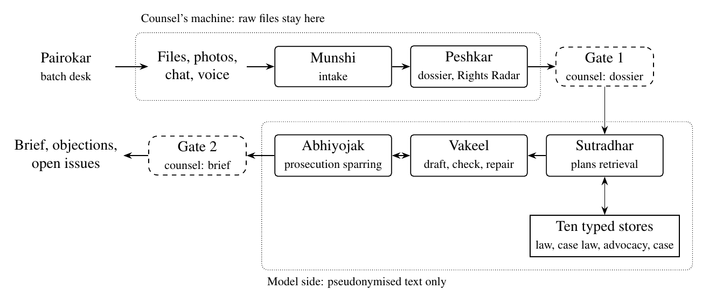

# Vakeel-Sahayak.ai

**A Multi-Agent Harness for Evidence-Grounded Bail Drafting**

Vakeel-Sahayak.ai helps a legal-aid lawyer in India prepare a regular bail application from the case file: it reads the papers, builds a source-checked dossier, drafts grounds that cite only the record and real judgments, and rehearses the prosecution's objections. It is a research prototype (course project, IIIT Hyderabad) built to answer one question: **does a structured multi-agent harness ground bail drafting better than simpler systems on the same model?**

Reports: [8-page technical report](docs/technical-report/technical_report.pdf) and [full report](docs/report/main.pdf).

## Contents

- [Results in brief](#results-in-brief)
- [Architecture](#architecture)
- [Quick start](#quick-start)
- [Step-by-step setup](#step-by-step-setup)
- [Run the full stack](#run-the-full-stack)
- [Evaluator demo](#evaluator-demo)
- [Hosted models](#hosted-models)
- [Reproducing the results](#reproducing-the-results)
- [Tests](#tests)
- [Repository layout](#repository-layout)
- [Privacy and safety rules](#privacy-and-safety-rules)
- [Team](#team) and [Licences](#licences)

## Results in brief

Tested once on 80 sealed public High Court orders, with one model (Sarvam-105B). The input is the facts part of each order, and the reference labels are derived automatically from the rest of the order. VS-Final is the selected system; Full is the first full system; B4 and B5 are the two baselines that retrieve comparably.

| Metric (sealed slice) | VS-Final | Full | B4 | B5 |
|---|---|---|---|---|
| Objection recall (higher is better) | 0.73 | 0.52 | 0.36 | 0.35 |
| Answerable coverage (higher is better) | 0.61 | 0.36 | 0.20 | 0.23 |
| Fabricated-citation rate (lower is better) | 0.00 | 0.00 | 0.95 | 0.64 |
| Citation precision (higher is better) | 0.71 | 0.85 | 0.02 | 0.10 |
| Time per order, seconds | 719 | 398 | 269 | 160 |

The trade-off: against Full, VS-Final gives up citation precision (0.85 to 0.71) and takes longer per order (398 to 719 s). Four of the five registered hypotheses hold. These are automated metrics on public orders; use in a legal-aid office has not been studied. Definitions, intervals and all seven baselines are in the technical report.

## Architecture



*Figure 1 of the technical report. Dashed boxes are the two gates enforced in code; dotted frames show where each part runs; double-headed arrows are request and reply.*

Six agents, each named after a role in an Indian court office and each making one narrow decision:

| Agent | Role |
|---|---|
| **Munshi** (intake) | Reads any PDF (digital, scanned, photographed, Hindi, several documents in one file), files it into typed stores, asks counsel only for what is missing |
| **Peshkar** (dossier) | Builds the dossier with a source quote for every field, the List of Dates, and the rules-based Rights Radar (custody periods, statutory rights) |
| **Sutradhar** (orchestrator) | Plans retrieval for each bail factor: which store to query, with what, and when the evidence is sufficient |
| **Vakeel** (drafter) | Writes the grounds, then checks and repairs every sentence |
| **Abhiyojak** (prosecution sparring) | Attacks the draft as the prosecution would, with its own prompt and its own stores |
| **Pairokar** (batch desk) | Orders a legal-aid office's files by urgency |

- **Ten typed stores on four shelves.** Law (statutes, old-to-new section concordance), case law (reasoning paragraphs, citation graph, whole-order fact vectors), advocacy (defence arguments, prosecution objections; used for coverage, never cited as authority) and the private case shelf (client documents, dated timeline, dossier).
- **Evidence contracts.** For each of twelve bail factors, a contract states what a ground needs (slots, which are required, which stores may hold them, a budget). A required slot that stays empty becomes an open issue for counsel.
- **Per-sentence checks.** Vakeel checks every sentence with a natural-language-inference model and with rules (statute lookup, section mapping, a good-law check), and repairs or flags what fails.
- **Two counsel gates, enforced in code.** Gate 1 approves the dossier, Gate 2 the brief. Only counsel can open a gate; Gate 2 is bound to a hash of the brief, so a later change closes it again, and no export is possible before it.
- **Privacy boundary.** Raw client files stay on counsel's machine. Text reaches a hosted model only after pseudonymisation (names and identifiers become aliases, dates shift by a per-case offset). External services are off by default.
- **Event log.** Every action is appended to a log; the dossier, the brief and the sparring record are views of it.

More: the Methodology section of the technical report, `docs/architecture/skeleton.md` (module map), `docs/plan.md` (design).

## Quick start

```bash
git clone https://github.com/vishakkashyapk30/lma-group-project && cd lma-group-project
make setup    # Python 3.11+: creates .venv, installs the package, copies .env.example to .env, installs git hooks
make smoke    # runs the case-0007 fixture end to end offline: no data, no GPU, no key
```

To see the product in a browser on Linux with Docker: `./install.sh`, then open http://localhost:3000.

## Step-by-step setup

**Prerequisites:** Python 3.11 or newer, git, bash, perl (for the commit hook). Node 20 only for the frontend. Docker only for the one-command stack. About 10 GB of free disk for data and stores, more for model weights. Offline stand-in models are the default, so nothing below needs a GPU or an API key.

```bash
# 1. Environment
make setup            # safe to re-run; `make setup-full` adds the heavy extras (torch, docling; several GB)
make test-collect     # optional: test collection must be clean
make help             # lists every target

# 2. Data: the team bundle (private Hugging Face dataset)
#    needs HF_TOKEN in the untracked .env (or `hf auth login`) and membership of the Hugging Face organisation Vakeel-Sahayak
make data             # skips if data/ is in place; RAW=0 make data skips the raw sources (about 1.8 GB)
make data-check       # table of what is present or missing

# 3. Helper models (BGE-M3, DeBERTa NLI, MiniCheck, Whisper small; about 5.5 GB)
make models-dry-run   # lists sizes and free disk, downloads nothing
make models

# 4. Offline end-to-end checks
make smoke            # case-0007 through the agents: Gate 1 approved, Gate 2 left closed, export blocked
make eval-smoke       # 3 development cases through the Full system (needs the data from step 2)
```

<details>
<summary>No access to the team bundle? Rebuild the data from public sources</summary>

```bash
make datasets   # public datasets into data/raw (resumable): Open India Law bail shards, IPC2BNS-Verify, Kathbath
make interim    # data/raw to data/interim (orders, statutes, concordance edges, splits)
SAMPLE=2000 EMBEDDER=hashed-ngram make stores   # quick sample build first
make stores     # full build of the shared stores (took about 35 minutes)
```

Some items need a person (HLDC on Hugging Face, the CrPC and NDPS statutes from India Code). See `data/README.md`.
</details>

## Run the full stack

**With Docker (Linux).** The installer checks Docker, disk and ports, installs the data bundle if it is absent, seeds the data volume and starts the offline stack.

```bash
./install.sh               # then open the printed URL
./install.sh --skip-data   # empty stack without stores (API and UI diagnostics only)
./install.sh --help        # other options

docker compose up          # the lower-level command, when data is already seeded (or: make docker-up)
docker compose down        # stop; named volumes are kept
```

| Service | URL | Change the port with |
|---|---|---|
| UI (Next.js) | http://localhost:3000 | `FRONTEND_PORT` |
| API (FastAPI) | http://localhost:8000 (`GET /healthz`) | `BACKEND_PORT` |

Ports bind to 127.0.0.1 and nothing external is called by default. Profiles, variables and image notes: [`DOCKER.md`](DOCKER.md).

**Without Docker (Node 20 for the UI).** Two terminals:

```bash
# terminal 1: API on :8000 (same as `make api`)
.venv/bin/python -m uvicorn vakeel_sahayak.api.asgi:app --port 8000

# terminal 2: UI on :3000, production build
cd frontend && npm ci && npm run build && NEXT_PUBLIC_API_BASE=http://localhost:8000 npx next start -p 3000
# or the dev server: make frontend
```

The UI is in live mode: an unreachable API shows an error, never sample data. The interface also runs in Hindi.

## Evaluator demo

Six recorded synthetic cases (no real record) load when the API starts, so the system can be walked through without a key or a model call. Start the stack, open http://localhost:3000, go to the Cases page and pick a case under **Guided demos**. Each tour has nine steps from the papers to the exported application. The Gate 2 step runs the real gate: export stays closed until you approve. The cases demonstrate the interface and workflow; they are not an evaluation.

## Hosted models

Everything above runs on offline stand-ins. Real or hosted models need an explicit `VS_MODELS=auto` (or `real`).

| Provider | Default | To use it |
|---|---|---|
| Sarvam, OpenAI (paid) | Locked: every call is refused in code | Name the provider in `VS_ALLOW_PAID` (for example `VS_ALLOW_PAID=sarvam`), set `VS_EXTERNAL=pseudonymised` and choose it with `VS_LLM_BACKEND`. Team members: do not unlock without the owner. Spend is capped in code (`make openai-spend`, `make sarvam-spend`) |
| Gemini free tier | Off | Public data only (the provider may use free-tier prompts), so client text is refused in every mode. `GEMINI_API_KEY` in `.env`, then `make gemini-models MODEL=<id>` and `make gemini-usage` |

Keys (`SARVAM_API_KEY`, `OPENAI_API_KEY`, `GEMINI_API_KEY`) live only in an untracked `.env` or the shell; never commit, print or log one. Every external payload must pass the pseudonymisation boundary. See `.env.example` for every variable.

## Reproducing the results

The sealed runs were made from the git tag `eval-freeze-v1`. Data, model weights and keys are not in the repository (`make data`, `make models`; keys only in an untracked `.env`).

```bash
make setup && make data && make models   # environment, team data bundle, helper models (NLI, MiniCheck, BGE-M3, Whisper small)
make smoke && make eval-smoke            # offline end-to-end checks (no key, no GPU)

# run one system on the development cases (VS-Final = the c1457 switch string); hosted runs need VS_ALLOW_PAID=sarvam and a key
VS_MODELS=auto VS_LLM_BACKEND=sarvam VS_EXTERNAL=pseudonymised \
  .venv/bin/python -m vakeel_sahayak.eval.runners.driver run --system \
  "S13:signal_source=merge,abstention=strict,draft_source=facts_text,objection_grounding=by_id" --cases <cases.jsonl> --out <dir>

# score an arm against the agreed reference labels, then build the final tables
VS_M6_CHECKER=minicheck .venv/bin/python -m vakeel_sahayak.eval.scoring score --runs <arm outputs> --slice dev --gold-source agreed --out <scores>
VS_RUNS=<runs root> .venv/bin/python scripts/midsub/final_tables.py     # writes docs/results/search/final_report/

```

The tables in both reports are copied from `docs/results/search/final_report/` (`summary.md`, `hypotheses_blind.json`, `means_blind.csv`, `variance_d12.csv`, `reserve_dev.md`). Claims, baselines and metrics: `docs/evaluation-plan.md` and `docs/preregistration.md`.

## Tests

The full suite is slow (about 4,950 tests), so run it by area. Per-area commands are in `progress.md` section 5; see also `tests/README.md`.

```bash
make test-collect                              # collection must be clean
make test-unit                                 # or one area: .venv/bin/pytest tests/unit/privacy -q
make test-integration && make test-system      # modules wired together, user flows and the safety suite (no GPU)
make test-frontend                             # Vitest; needs `cd frontend && npm ci`
```

Each test gets its own data directory, so no test depends on `data/`.

## Repository layout

| Path | What it holds |
|---|---|
| `src/vakeel_sahayak/agents/` | The six agents (`munshi`, `peshkar`, `sutradhar`, `vakeel`, `abhiyojak`, `pairokar`) |
| `src/vakeel_sahayak/stores/`, `contracts/`, `rights/` | Ten stores on four shelves; evidence contracts (12 factors); Rights Radar rules |
| `src/vakeel_sahayak/orchestration/`, `record/` | LangGraph wiring, approval gates, budgets, opt-in switches; event log and case state |
| `src/vakeel_sahayak/privacy/`, `models/` | Pseudonymisation boundary, leak check, injection guard; model clients and the paid-provider lock |
| `src/vakeel_sahayak/ingestion/`, `tools/`, `export/` | PDF routing ladder, Hindi and voice intake; agent tools; DOCX and PDF export |
| `src/vakeel_sahayak/eval/`, `pipelines/`, `testsets/` | Baselines, ablations, metrics, statistics, runners; data pipelines; test-set construction |
| `src/vakeel_sahayak/api/`, `frontend/` | FastAPI app and routers; Next.js UI (design rules in `frontend/DESIGN.md`) |
| `configs/`, `scripts/`, `tests/` | YAML configuration; data, model, sweep and report helpers; unit, integration and system tests |
| `demo/`, `data/`, `models/` | Recorded evaluator demo cases; data and weights (contents gitignored, see `data/README.md`) |
| `docs/` | Reports (`technical-report/`, `report/`), design (`plan.md`, `architecture/`) and results (`results/`) |

## Privacy and safety rules

- Raw client files stay on the user's machine. External model services are off by default and gated by `VS_EXTERNAL=off|public|pseudonymised|consented` plus per-case consent.
- Approvals come only from counsel, and the code enforces it: export is impossible before Gate 2.
- No outcome predictions, no grant rates, no advice to the public. The system is a drafting aid for a lawyer, who remains responsible for the application.
- Ground truth for evaluation comes from court text, official tables, existing datasets, construction and agreement between automatic labelers, never from hand-made labels.

## Team

Vishak Kashyap K, Shravani K, Satvik Rao, Harshita Kumari. IIIT Hyderabad, CL3.410 Language Models and Agents (group project, 2026).

## Licences

The repository has no `LICENSE` file. [`NOTICE`](NOTICE) lists the third-party datasets, models, fonts and libraries the project uses, with each licence and the required attribution (for example Open India Law by Vaquill AI under CC BY 4.0), and marks which entries are verified. Some sources are for non-commercial research use only; read `NOTICE` before any reuse.
