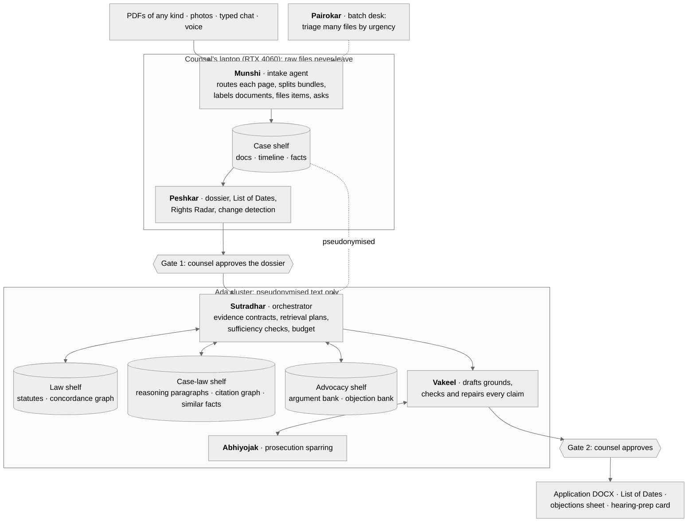

# plan.md (v5): Vakeel-Sahayak.ai, an agentic bail-preparation engine for legal-aid counsel

> **In one line.** Counsel drops in a bail file in whatever state it comes (scanned, photographed, in Hindi, several documents merged into one PDF), or dictates the facts. Six agents turn it into a court-ready bail application:
> - **Munshi** reads every page and files what it finds into the right store;
> - **Peshkar** builds a source-checked dossier, a List of Dates and a rights check;
> - **Sutradhar** decides, for each bail factor, what to fetch from which of ten knowledge stores;
> - **Vakeel** drafts grounds that cite only facts on record and real judgments;
> - **Abhiyojak** attacks the draft the way the prosecution would;
> - **Pairokar** triages hundreds of files at once for a legal-aid office.
>
> Counsel approves the dossier and the final draft. Nothing is exported without that approval.
>
> **Ground rules.**
> - No manual annotation or hand-made datasets. Every test label comes from court text, official tables, existing datasets or construction.
> - Open-weight models at run time, no paid APIs. A free external API may label *public* training data only (Section 17).
> - Raw client files stay on counsel's laptop. Only pseudonymised text goes to the cluster.
> - Every feature gets its own baseline or ablation (team decision for v5).
> - 8 weeks, on the Ada cluster (all 3 accounts) and a 4060 laptop.

---

## 0. What changed from v4, and why

The TA's review of v4: the problem is right, but the project reads as applied work. It needs more novelty in the agentic engineering, a bigger system, and a framing as an engineering problem that also solves bail preparation.

| TA feedback | What v5 does | Section |
|---|---|---|
| How are different kinds of PDF handled? | Munshi handles ten input kinds (born-digital, scanned, degraded, photos, Hindi, legacy Hindi fonts, handwriting, bundles, locked files, non-PDF) with a page-by-page routing ladder and quality gates. A constructed messy-PDF benchmark tests it (RQ2). | 4, 15 |
| Ingestion must be an agent that categorises information and collects data based on what it parsed | Munshi labels every page and document, files each item into the right store, checks what the bail file still lacks, re-reads or searches for it, and asks counsel only when it can't find it | 4 |
| RAG can be of several types; build several RAG databases | Ten stores on four shelves, using four kinds of index: exact lookup, graphs, paragraph search and whole-order vectors | 5 |
| The agent must orchestrate what to get from each database, not just process the prompt | Sutradhar plans, per bail factor, which stores to query and how, checks whether the evidence is enough, re-plans and stops within a budget | 6 |
| Not novel in agentic engineering | Adds prosecution sparring scored against the real prosecution, dependency-tracked incremental redrafting, legal rules as tools (Rights Radar), batch triage scheduled by legal urgency, and an event-sourced case record | 7–11, 14 |
| Baselines: single-pass LLM, single RAG, whole document as one embedding, naive chunking | B0–B3 as asked, plus B4: every store queried, no orchestrator. B4 shows whether the gain comes from the agent's choices or just from having more stores | 15.3 |
| Frame it as an engineering problem | Section 1.2 states the engineering problem; Section 14 lists the contributions as system design | 1.2, 14 |

The Streamlit prototype is replaced by a Next.js app with an animated landing page and a live animation for each agent (Section 13).

---

## 1. Users, the engineering problem and limits

### 1.1 Users

- **Primary:** legal-aid panel lawyers and junior advocates preparing a **regular bail application in an Indian High Court** (CrPC s.439 / BNSS s.483).
- **Secondary:** law students in supervised legal-aid clinics.
- **New in v5:** legal-aid offices that must find, among many undertrial prisoners, those who may be entitled to release now (for example, when preparing lists for Undertrial Review Committees).
- **Not users:** accused persons, the public, judges.

### 1.2 The engineering problem

Underneath, preparing a bail application is a data-engineering and decision problem:

1. **Messy inputs.** A bail file is a pile of different documents: born-digital High Court orders, scanned Sessions Court orders, phone photos of FIR copies (often in Hindi, sometimes handwritten), remand orders and custody certificates, often merged into one PDF.
2. **Knowledge of different shapes.** Exact statute text, a section-mapping graph, hundreds of thousands of judgment paragraphs, a citation network, what each side usually argues, and the case's own timeline. No single vector index serves all of these well.
3. **Deciding what to fetch from where.** Each bail factor needs different evidence from different stores. Fetching everything is slow and noisy; fetching from one store misses things.
4. **A case that keeps moving.** New orders arrive every few weeks. The draft must stay consistent without being redone from scratch.
5. **Scale.** A legal-aid office handles hundreds of undertrial files and must find the urgent ones first.

All of this under hard constraints: client files stay on an 8 GB laptop GPU; heavy work runs on shared 2080 Ti nodes in 6-hour sessions; no paid APIs; no manual labels.

The legal pain points from v4 still drive the design: facts scattered across orders, the 2024 change from IPC/CrPC to BNS/BNSS, and LLMs that invent facts and case law.

### 1.3 What the system never does

- Predict outcomes or show grant rates.
- Advise accused persons or the public. The landing page points them to free legal aid instead (NALSA helpline 15100).
- Export anything without counsel's approval.

---

## 2. Data

| # | Source | What we take | Used for |
|---|---|---|---|
| **1** | **Open India Law** (CC BY 4.0) | High Court bail orders 2019–2025, selected by case type and keywords ("BAIL APPLN", "439 Cr.P.C.", "483 BNSS"); SC judgments on bail; the text of the IPC, BNS, CrPC and BNSS, and the bail-bar sections of the NDPS Act, UAPA and PMLA | Fine-tuning data; every shared store; the main test set (T1) |
| **2** | **IPC2BNS-Verify** (MIT) | The IPC↔BNS concordance and its 1,140-query benchmark | The concordance graph; `map_section`; the tool benchmark |
| 3 | **HLDC**, the Hindi Legal Documents Corpus (Kapoor et al., 2022) | Hindi bail documents from Uttar Pradesh district courts (text) | Hindi ingestion tests, rendered and degraded into PDFs |
| 4 | **Official Hindi translations** of SC judgments (e-SCR, made with SUVAS) | Hindi judgment PDFs paired with their English originals | Hindi ingestion tests where the English original gives the answers (optional) |
| 5 | **Kathbath** (AI4Bharat) | Hindi read speech with transcripts | Speech-recognition test |
| 6 | **Public form layouts** | The standard FIR form (IIF-1) and typical remand-order and custody-certificate layouts | Templates for constructed companion documents |

- Sources 1 and 2 feed the system. Sources 3–6 only feed constructed tests.
- Week 0 checks access and licence for sources 3–6. If one fails, we construct the data from source 1 instead (for example, NLLB-200 translations of the companion documents into Hindi).
- **Bail-related CrPC↔BNSS sections.** As in v4, a ten-row table (CrPC 436/436A/437/438/439 → BNSS 478/479/480/482/483) is coded from the bare acts as tool configuration, not a dataset.

**Splits by date** (this also prevents leakage):

| Split | Orders | Use |
|---|---|---|
| **Train** | Before 2024 | Fine-tuning pairs |
| **Dev** | Early 2024 (50 orders) | Tuning prompts, thresholds and parse routes |
| **Test** | Mid-2024 to 2025 | 200 orders sampled across High Courts, of which ≥60 are BNS-era (offence on or after 1 July 2024) |

**Leakage rules, for every store:**
- Test orders, and any order with the same FIR as a test order, are left out of every shared store and of the fine-tuning data.
- At run time, every query only sees documents dated before the case's order.
- The argument and objection banks hold counsel's submissions, which are also gold labels (G1, G4). The exclusion matters most there.

---

## 3. System overview

### 3.1 Architecture



### 3.2 The six agents

The agents are named after the people in an Indian court office. Each name appears in the UI with an English subtitle.

| Agent | Who that is in a court office | Job | Model, where it runs | What it decides |
|---|---|---|---|---|
| **Munshi** | An advocate's clerk, who keeps the papers | Ingestion (Section 4) | Qwen3-4B base + OCR + a vision model; laptop | The parse route for each page; when to escalate; document boundaries and types; where each item is filed; what is missing and how to get it |
| **Peshkar** | The court reader, who keeps the file and the dates | Dossier, List of Dates, Rights Radar, change detection (Section 7) | Fine-tuned Qwen3-4B + rules; laptop | Which fields to re-extract; which conflicts to put to counsel; which rights checks apply; what changed since the last approval |
| **Sutradhar** | "The one who holds the strings", the director in Indian theatre | Orchestration (Section 6) | Qwen3-14B; Ada | Which factors to argue; per factor, which stores to query, how, and when to stop; what to redo after a change; the budget |
| **Vakeel** | The advocate | Drafting, checking and repair, the application, the hearing card (Section 8) | Qwen3-14B; Ada | How to argue each ground; whether to repair or flag each failed claim |
| **Abhiyojak** | The prosecutor | Sparring (Section 9) | Qwen3-14B with its own prompt and context; Ada | Which objections to raise; whether each reply answers them |
| **Pairokar** | The person who follows up a case | Batch triage (Section 11) | Rules + Qwen3-14B; laptop and Ada | The order of work; per case, a full brief now, a flag for counsel, or a request for documents first |

### 3.3 The case record

- **Event log.** Every agent action appends an event: who acted, which tool, its inputs and outputs, the sources and the time. The dossier, timeline, brief and sparring record are views computed from this log.
- **One mechanism, four uses:**
  - an audit trail, which legal work needs;
  - resuming after an Ada session ends;
  - dependency tracking for incremental redrafting (Section 10);
  - the live agent trace in the UI.
- **Runtime.** The agents run as a LangGraph graph. Its checkpointer saves state to SQLite, and the two approval gates are interrupts that wait for counsel. If LangGraph gets in the way, a plain Python state machine with the same event log replaces it.
- **Well-formed calls.** Plans and tool calls are generated with JSON-schema-constrained decoding (vLLM structured outputs), so every call parses. The tools still validate argument values.

---

## 4. Munshi: ingesting any kind of PDF

### 4.1 Input kinds

| # | Input kind | Typical example | How Munshi recognises it | Route |
|---|---|---|---|---|
| K1 | Born-digital PDF | High Court order downloaded from the court website | The text layer covers the page and passes the quality check | Text layer; layout parser for tables and columns |
| K2 | Scanned PDF | Sessions Court order scanned at a legal-aid office | No text layer, or a thin one; the page is one image | Clean-up (deskew, denoise), then OCR |
| K3 | Degraded scan | Faint photocopy, fax noise, stamps or signatures over the text | Low OCR confidence or few dictionary words | Stronger clean-up and re-OCR, then the vision model |
| K4 | Phone photo | Photo of an FIR copy, as JPG/HEIC or inside a PDF | Perspective skew, uneven light, page edges visible | Dewarp and crop, then as K2/K3 |
| K5 | Hindi or mixed script | Hindi FIR; English order quoting Hindi statements | Script detection on the text layer or a first OCR pass | Hindi OCR, then translation to English; both texts kept |
| K6 | Legacy Hindi fonts | Hindi PDF typed in a Kruti Dev-style font | A text layer exists but decodes to Latin gibberish | Ignore the text layer; OCR the page image |
| K7 | Handwriting | Handwritten FIR entries, margin notes | Handwriting regions; very low OCR confidence | Vision model; if still unreadable, ask counsel |
| K8 | Bundle | One PDF holding the FIR, two remand orders and a bail order | Document type changes across pages, new headers, page numbers restart | Split into documents, then route each page |
| K9 | Locked or broken file | Password-protected or corrupt PDF | The file fails to open | Ask counsel for an unlocked copy; never guess |
| K10 | Not a PDF | DOCX, images, typed chat, voice notes | File type | Read directly; voice goes to speech recognition |

### 4.2 The routing ladder

Each page climbs the ladder only as far as it needs to, so the costly vision model only sees pages that need it.

| Step | Route | Used when |
|---|---|---|
| 1 | **Text layer** (PyMuPDF) | The page has a good text layer: it covers the page, ≥85% of its words are in English or Hindi word lists, and there is no legacy-font pattern |
| 2 | **Layout parser** (Docling) | The text layer is good but the page has columns or tables (custody certificates, charge-sheet columns) |
| 3 | **Clean-up + OCR** (Surya for English and Hindi; Tesseract as fallback) | There is no good text layer |
| 4 | **Vision model** (Qwen3-VL, 4-bit), asked only to transcribe, never to summarise | OCR confidence or the word-list share is still below threshold, or handwriting is detected |
| 5 | **Ask counsel** | The vision transcript also fails the check; the page is shown to counsel with a request for a clearer copy |

- **Quality signals per page:** text coverage, mean OCR confidence, dictionary-word share, script consistency, characters per page area, and legacy-font patterns.
- **Thresholds** are tuned on dev.
- **Badges.** Each page's route and signals are logged and shown as badges in the UI.

### 4.3 The agent loop

1. **Survey.** Compute cheap signals for every page and run the cheapest acceptable route.
2. **Categorise.**
   - Split bundles into documents.
   - Label each document: FIR, arrest memo, remand order, bail order, order sheet, charge-sheet cover, custody certificate, medical record, affidavit, or other.
   - Tag each paragraph by the kind of information it holds: dated event, party, section, earlier outcome, custody, or personal circumstance.
3. **File.** Write each item to the case shelf with its source: document, page, box, route, language and confidence. Names are pseudonymised before filing.
4. **Check gaps.** Compare what is filed with a bail-file checklist: FIR, arrest date, first remand, earlier bail orders, charge-sheet status, custody certificate and co-accused orders. For each gap, decide whether to:
   - re-read a likely page with a stronger route;
   - search the remaining pages;
   - ask counsel for the document.
5. **Check conflicts.** If two documents disagree (for example, on the arrest date), keep both values and pass them to Peshkar as `AMBIGUOUS`.
6. **Stop** when the checklist is met or nothing more can be done, and report.

Steps 4 and 5 make this an agent rather than a fixed pipeline: what Munshi reads next depends on what it has parsed so far. Variant P5 (Section 15.5) removes them to measure their effect.

**Tools:**
- `inspect_page`;
- `read_text_layer`;
- `parse_layout`;
- `clean_image` (deskew, dewarp, denoise);
- `ocr_page(lang)`;
- `vision_read_page`;
- `detect_script`;
- `translate(hi→en)`;
- `transcribe(audio)`;
- `split_bundle`;
- `classify_document`;
- `pseudonymise`;
- `file_item(store, item, source)`;
- `search_pages(query)`;
- `ask_user`: Munshi and Peshkar share a limit of 3 questions per round, and unreadable pages are grouped into one question.

### 4.4 Filing: what goes where

| What Munshi finds | Where it goes (case shelf) | Example |
|---|---|---|
| Document text | `case.docs`, in structure-aware chunks with page and box | "...the applicant was arrested on 20.08.2024..." (remand order, p.4) |
| Dated events | `case.timeline` | Arrest 2024-08-20; first remand 2024-08-21; charge sheet 2024-11-02 |
| People and roles | `case.facts` (parties, pseudonymised) | Accused-1, Co-accused-1, Complainant-1, IO-1 |
| Sections and acts | `case.facts`, then checked by Peshkar | 318(4) BNS |
| Earlier court outcomes | `case.timeline` and `case.facts` | Sessions Court rejected bail on 2024-09-30 |
| Custody, health and personal papers | `case.facts` (personal) | Jail custody certificate; medical record |
| Unreadable or missing items | Open questions for counsel | "FIR page 3 is unreadable" |

### 4.5 Hindi and voice

- **Hindi pages:**
  - Read with Hindi OCR, or the text layer when it is good Unicode.
  - IndicTrans2 translates them to English for the extractor.
  - Every quote keeps the Hindi original and its English translation. The UI shows both, `span_check` runs on the translation, and counsel sees the original.
- **Voice:**
  - Counsel dictates in Hindi, English or a mix.
  - Whisper large-v3-turbo or IndicConformer (picked on dev) transcribes on the laptop.
  - Munshi reads back the dates, sections and numbers it heard and asks counsel to confirm them.
  - Dictated facts are `USER_STATED`.
  - Audio stays on the laptop and is deleted after transcription unless counsel keeps it.

### 4.6 Output: `IngestionReport`

```json
{
  "case_id": "case-0007",
  "file": "bundle_1.pdf",
  "documents": [
    {"doc_id": "d1", "type": "FIR", "pages": [1, 3], "lang": "hi", "type_confidence": 0.94,
     "page_routes": [
       {"page": 1, "kind": "scanned", "route": ["text_layer: rejected (legacy font)", "ocr: surya-hi"], "ocr_conf": 0.81, "status": "OK"},
       {"page": 2, "kind": "scanned, handwriting", "route": ["ocr: surya-hi", "vision: qwen3-vl"], "ocr_conf": 0.42, "status": "OK"},
       {"page": 3, "kind": "photo", "route": ["dewarp", "ocr: surya-hi", "vision: qwen3-vl"], "status": "UNREADABLE"}]},
    {"doc_id": "d2", "type": "REMAND_ORDER", "pages": [4, 5], "lang": "en",
     "page_routes": [{"page": 4, "kind": "born-digital", "route": ["text_layer"], "status": "OK"}, "..."]}
  ],
  "filed": {"timeline_events": 6, "parties": 4, "sections": 2, "chunks": 31},
  "gaps": [{"item": "charge-sheet status", "action": "searched pages 6-14; not found; asked counsel"}],
  "questions": ["Page 3 of the FIR is unreadable. Can you upload a clearer copy?",
                "Has the charge sheet been filed? If so, please upload the order."]
}
```

---

## 5. The shelves: ten stores of four index kinds

**Why several stores, not one.**
- A bail brief needs exact statute text, a graph that maps old sections to new ones, court reasoning, citation history, what each side usually argues, and the client's own record. Each has a different shape and a different right way to search it.
- An LLM's memory of Indian High Court bail orders is thin, and that is exactly where LLMs fabricate.
- BNS and BNSS are recent laws that the models know poorly.

### 5.1 The stores

| Shelf | Store | Contents | Index | Tools | Size (est.) | Main users |
|---|---|---|---|---|---|---|
| Law | `law.statutes` | One row per section of the IPC, BNS, CrPC and BNSS, plus NDPS s.37, UAPA s.43D(5) and PMLA s.45: text, maximum punishment, bailable, cognisable | Exact lookup; BM25 over the text for "which section covers…" | `get_statute`, `search_statutes` | ≈1,000 rows | All |
| Law | `law.concordance` | IPC↔BNS and CrPC↔BNSS edges, typed same / split / merged / reworded / new, with a text diff | Graph | `map_section`, `transfer_check` | ≈600 edges | Sutradhar, Vakeel, explorer |
| Case law | `caselaw.reasoning` | The court's reasoning paragraphs from High Court bail orders and SC bail judgments, with metadata | Hybrid: BM25 + BGE-M3, metadata pre-filter | `search_reasoning`, `get_paragraph` | 100–300K paragraphs | Sutradhar, Vakeel |
| Case law | `caselaw.citations` | Who cites whom, with the treatment (followed, relied on, distinguished, overruled, referred) and court level | Graph + authority score | `citations`, `good_law_check` | est. 100–300K edges | Sutradhar, Vakeel, explorer |
| Case law | `caselaw.similar` | One vector per order's facts section, plus a fact signature (sections, custody band, charge-sheet status, co-accused outcome) | Whole-order vectors + structured match | `similar_orders` | est. 50–100K orders | Sutradhar, hearing prep |
| Advocacy | `advocacy.arguments` | Defense-submission paragraphs, tagged by factor and outcome | Hybrid + filters | `search_arguments` | est. 100K | Vakeel (coverage and phrasing; never cited as authority) |
| Advocacy | `advocacy.objections` | Prosecution-submission paragraphs, tagged by factor | Hybrid + filters | `search_objections` | est. 80K | Abhiyojak, hearing prep |
| Case (per case, private) | `case.docs` | The client's documents in structure-aware chunks, with page and box | Hybrid | `search_case_docs` | Hundreds of chunks | All agents, chat |
| Case | `case.timeline` | Dated events with sources | Exact lookup | `get_timeline`, `date_calc` | Tens of rows | Peshkar, Rights Radar, List of Dates |
| Case | `case.facts` | The `CaseDossier`, every field with its status and source | Exact lookup | `get_fact` | ≈15 fields | All |

### 5.2 Structure-aware chunking and paragraph metadata

**Chunking.**
- The cue-phrase splitter (the one that builds the test set) divides each order into facts, defense submissions, prosecution submissions, reasoning and the operative order.
- Within each part, text is split at numbered paragraphs; short ones are merged and long ones split at sentence ends, up to 400 tokens.
- The naive chunking baselines (B3) are compared against this.

**Metadata on each paragraph.** All of it is computed automatically, mostly by rules.

```json
{"doc_id": "DLHC-2022-1187", "para": 14, "court": "Delhi HC", "date": "2022-06-03", "outcome": "granted",
 "part": "reasoning",
 "sections": ["IPC 420", "IPC 406"], "section_family": ["IPC 420", "BNS 318(4)", "IPC 406", "BNS 316(2)"],
 "factors": ["parity_with_co_accused", "charge_sheet_filed"],
 "cites": ["SC-2014-0463"], "authority": 0.71, "text": "..."}
```

- **`part`** is one of facts, defense submissions, prosecution submissions, reasoning or operative order. **Authorities are cited from `reasoning` paragraphs only**, so counsel's submissions are never cited as if they were the court's holding.
- **`factors`** are the bail factors a paragraph discusses, tagged by the keyword-rule labeler.
- **`section_family`** comes from regex-extracted sections, expanded through the concordance.
- **`cites`** and **`authority`** come from the citation graph (Section 5.3).

### 5.3 The citation graph and the good-law check

- **Extraction.** Regexes find Indian citations in reasoning paragraphs: neutral INSC citations, SCC, AIR, SCC OnLine, Cri LJ and "X v. State of Y" case names. They are resolved against Open India Law metadata: exactly on neutral citations, otherwise by fuzzy matching of party names, year and court. We report the resolution rate.
- **Treatment.** Cue words in the citing sentence ("followed", "relied upon", "distinguished", "overruled", "per incuriam", "referred to") give a first label. Llama-3.1-8B labels the same sentences, and only labels both agree on are used; the rest show as "treatment unknown".
- **Authority score.** Combines court level (SC first, then the case's own High Court, then other High Courts), bench size where recorded, citations from other bail cases, and recency. Used as a ranking feature.
- **Good-law check.** If a later SC judgment or a larger bench treats a precedent as overruled, the precedent is flagged and cannot be cited without a warning. "Distinguished" is shown but does not block.
- **SC root.** For a High Court paragraph, the graph is followed to the SC judgment it relies on, so Vakeel can cite both.

### 5.4 The recodification bridge (kept from v4)

- A BNS-era case asking about BNS 318(4) also retrieves precedents decided under IPC 420.
- Each retrieved precedent gets a **transfer flag**, computed from the concordance and a text diff of the old and new sections:
  - `SAME_TEXT`: the provision was carried over unchanged, so the precedent applies;
  - `CHANGED`: split, merged or reworded, so it is usable only with a qualification, which the brief must state;
  - `NEW`: no IPC equivalent.

### 5.5 Storage

- **SQLite** holds the statutes, timelines, graph edges and the event log.
- **LanceDB** (embedded, on disk) holds dense vectors and full-text search, with metadata filters.
- **networkx** computes graph scores offline.

Everything is a file on disk, so the same stores run on the laptop and on Ada.

---

## 6. Sutradhar: the orchestrator

### 6.1 Evidence contracts

Each of the 12 bail factors has an **evidence contract**: a short declarative list of the evidence a ground needs, and which stores may hold it. Appendix B lists all twelve.

```yaml
factor: parity_with_co_accused
applies_if: a co-accused has been granted bail
slots:
  co_accused_order:  {need: required, stores: [case.docs, case.timeline]}
  role_comparison:   {need: required, stores: [case.docs]}
  authority:         {need: 2, stores: [caselaw.reasoning, caselaw.similar]}
  good_law:          {need: required, stores: [caselaw.citations]}
  likely_objection:  {need: 1, stores: [advocacy.objections]}
  argument_patterns: {need: optional, stores: [advocacy.arguments]}
budget: {store_calls: 8, tokens: 12000}
```

The contract fixes **what** evidence is needed and **where it may be**. Sutradhar decides everything else:
- whether the factor applies to this case at all;
- the order of calls, the query text and the filters;
- whether a result is good enough;
- when to relax a filter, follow a citation to the SC, or try another store;
- when to stop, and which slots to report as missing.

Results are shared across factors: one paragraph tagged with two factors serves both.

### 6.2 The loop

1. **Pick factors.**
   - Read the approved dossier and the `RightsReport`.
   - Mark each of the 12 factors favourable, adverse (to be answered) or not applicable, with a reason.
2. **For each factor, in parallel:**
   1. **Plan.** Write a `RetrievalPlan` for the unfilled slots.
   2. **Run.** Execute the calls; independent calls run concurrently.
   3. **Assess.** Mark each slot `FILLED`, `WEAK` or `MISSING`, using rule checks (for example: court reasoning, factor tag, section-family overlap, date before the case).
   4. **Re-plan** weak or missing slots:
      - reword the query;
      - relax filters in a fixed order (factor, then section family, then court);
      - follow the citation graph to the SC authority behind a High Court paragraph;
      - try another allowed store.
   5. **Stop** when every required slot is `FILLED` or the budget is spent. Missing slots become open issues in the brief, for example "No parity authority in the same section family; widened to all cheating offences".
3. **Delegate.**
   - Hand the evidence packs to Vakeel.
   - Send the draft to Abhiyojak.
   - Route objections back to Vakeel.
   - When a claim fails its check, decide whether to re-retrieve (a new plan for that slot) or let Vakeel reword it.
4. **After a change set** (Section 10), re-run only the affected factors.

**Budget.** The default is 150K tokens per case and 8 store calls per factor. The UI shows what has been spent, and every time a budget is hit it is logged.

### 6.3 Output: `RetrievalPlan`

```json
{"factor": "parity_with_co_accused", "round": 1, "budget_left": {"store_calls": 6, "tokens": 9000},
 "steps": [
   {"slot": "co_accused_order", "tool": "search_case_docs", "args": {"query": "co-accused granted bail", "doc_types": ["BAIL_ORDER"]}},
   {"slot": "authority", "tool": "search_reasoning",
    "args": {"factor": "parity_with_co_accused", "section_family": ["BNS 318(4)", "IPC 420"], "before": "2025-02-03", "outcome": "granted", "k": 10}},
   {"slot": "good_law", "tool": "citations", "args": {"doc_ids": "$authority.top3", "want": ["overruled_by", "sc_root"]}},
   {"slot": "likely_objection", "tool": "search_objections", "args": {"factor": "parity_with_co_accused", "section_family": ["BNS 318(4)", "IPC 420"]}}],
 "assessment": {"co_accused_order": "FILLED", "authority": "WEAK (1 of 2)", "good_law": "FILLED", "likely_objection": "FILLED"},
 "next": "relax section_family to the offence group 'cheating'; retry authority"}
```

### 6.4 Chat routing

Sutradhar also routes counsel's chat questions to the right store or tool:

| Counsel asks | Routed to |
|---|---|
| "How many days in custody?" | `case.timeline` + `date_calc` |
| "BNS equivalent of 420 IPC?" | `law.concordance` (`map_section`) |
| "Is my client eligible under s.479?" | Rights Radar |
| "Any SC case on parity in a cheating case?" | `caselaw.reasoning` + `caselaw.citations` |
| "What did the Sessions Court say about antecedents?" | `case.docs` |
| "How does the State usually oppose bail in NDPS cases?" | `advocacy.objections` + `law.statutes` |

Answers are short and cited. Requests for outcome predictions or lay advice are refused.

### 6.5 Why this is more than "query everything"

Three variants separate the parts of Sutradhar's design:
- **B4** queries every store and fuses the results.
- **A6** runs the contracts in a fixed order with fixed queries.
- **A7** lets the LLM plan freely, with no contracts.

Comparing them with the full system shows whether the gains come from the stores, from the contracts, or from the agent's planning and stopping (Section 15).

---

## 7. Peshkar: the dossier, the List of Dates and the Rights Radar

### 7.1 The dossier

- **Input:** the case shelf as filed by Munshi.
- **Tools:**
  - `extract_dossier` (the fine-tuned 4B);
  - `map_section(code, section, offence_date)`;
  - `date_calc(start, end, rule)`;
  - `span_check(value, quote)`;
  - `rights_check`;
  - `diff_case_state`;
  - `ask_user`.
- **What it decides:**
  - which fields failed the check and need re-extraction;
  - which conflicts between documents to put to counsel;
  - when the dossier is ready for review (Gate 1).

**Output: `CaseDossier`.** Every field is wrapped as `{value, source, status}`. The source now records the page, box, route and language. The v4 field `bnss_479` has moved to the `RightsReport`.

```json
{
  "case_id": "case-0007",
  "court": "Delhi High Court",
  "as_of": "2025-02-03",
  "fields": {
    "fir":             {"value": {"number": "112/2024", "police_station": "PS-1", "date": "2024-08-14"},
                        "source": {"doc": "d1 (FIR)", "page": 1, "box": [64, 120, 540, 152], "lang": "hi", "route": "ocr: surya-hi",
                                   "quote": "प्रथम सूचना रिपोर्ट सं. 112/2024 दिनांक 14.08.2024",
                                   "quote_en": "FIR No. 112/2024 dated 14.08.2024"},
                        "status": "VERIFIED"},
    "offence_date":    {"value": "2024-08-10", "source": {...}, "status": "VERIFIED"},
    "sections":        {"value": [{"as_written": "318(4) BNS", "code": "BNS", "section": "318(4)",
                                   "equivalent": "IPC 420", "bailable": false, "max_punishment": "7 years"}],
                        "source": {...}, "status": "VERIFIED"},
    "arrest_date":     {"value": "2024-08-20",
                        "source": {"doc": "d2 (remand order)", "page": 4, "lang": "en", "route": "text_layer",
                                   "quote": "...arrested on 20.08.2024..."},
                        "status": "VERIFIED"},
    "first_remand":    {"value": "2024-08-21", "source": {...}, "status": "VERIFIED"},
    "custody_days":    {"value": 167, "source": {"tool": "date_calc"}, "status": "COMPUTED"},
    "charge_sheet":    {"value": {"filed": true, "date": "2024-11-02"}, "source": {...}, "status": "VERIFIED"},
    "trial_stage":     {"value": "charges not framed", "source": {...}, "status": "VERIFIED"},
    "previous_bail":   {"value": [{"court": "Sessions Court", "date": "2024-09-30", "outcome": "rejected"}],
                        "source": {...}, "status": "VERIFIED"},
    "co_accused_bail": {"value": [{"id": "Co-accused-1", "outcome": "granted", "date": "2024-12-05"}],
                        "source": {...}, "status": "VERIFIED"},
    "antecedents":     {"value": null, "source": null, "status": "UNSUPPORTED"},
    "personal":        {"value": ["sole earning member"], "source": {"chat": "turn 3"}, "status": "USER_STATED"},
    "parties":         {"value": ["Accused-1", "Co-accused-1", "Complainant-1", "IO-1"], "source": {...}, "status": "VERIFIED"}
  },
  "open_questions": ["Does the accused have any other pending cases?"]
}
```

**Statuses** (kept from v4):
- `VERIFIED`: the quote supports the value.
- `COMPUTED`: produced by a tool.
- `UNSUPPORTED`: not found in the file, or the check failed.
- `AMBIGUOUS`: an unclear section mapping or conflicting documents.
- `USER_STATED`: typed or dictated by counsel, with no court record behind it.
- `USER_EDITED`: corrected by counsel.

### 7.2 The List of Dates and Events

- Built from `case.timeline`: one row per dated event, with its source (document and page).
- Rows are sorted by date. Conflicting dates are shown side by side, and counsel can edit any row.
- It feeds the Rights Radar and the exported application, as High Court filings usually expect.

### 7.3 Rights Radar

The Rights Radar is a deterministic rules engine, called as a tool, that checks procedural rights from the timeline.

| Check | What it looks for | Possible outputs |
|---|---|---|
| Default bail | Charge sheet not filed within 60 or 90 days of the first remand | `ELIGIBLE`, `NOT_YET` (days left), `WINDOW_CLOSED`, `CHECK` |
| Undertrial limit | Custody past one-third (first-time offender) or one-half of the maximum sentence | `ELIGIBLE`, `NOT_YET` (date), `NOT_APPLICABLE`, `CHECK` |
| Notice of appearance | Offence punishable up to 7 years, with no notice or recorded reasons for arrest | `FLAG`, `OK`, `UNKNOWN` |
| Grounds of arrest | No record that the grounds were communicated (in writing, for recent arrests) | `FLAG`, `OK`, `UNKNOWN`, `CHECK` |
| 24-hour production | Production before a magistrate more than 24 hours after arrest | `FLAG`, `OK`, `CHECK` |
| Antil category | The offence category under Satender Kumar Antil (A to D) | `A`–`D`, `CHECK` |
| Statutory bar | NDPS s.37, UAPA s.43D(5) or PMLA s.45 applies | `BAR_APPLIES`, `NOT_APPLICABLE` |

- **Rules and sources.** Appendix C gives each rule as coded, with its source.
- **Transparency.** Every output shows the rule text, its source and the dates it used.
- **Unsettled law** returns `CHECK` rather than a verdict.
- **Testing.** Every rule has unit tests and a "last verified" date.
- **Scope.** Outputs are "possible entitlements to check", never advice. A default-bail opening is flagged for counsel; drafting a default-bail application is outside v5.

**Output: `RightsReport`**

```json
{
  "case_id": "case-0007", "as_of": "2025-02-03",
  "checks": [
    {"check": "default_bail", "status": "WINDOW_CLOSED",
     "detail": "60-day limit (maximum 7 years). Day 1 is the first remand, 21.08.2024. The charge sheet was filed on day 74 (02.11.2024). Default bail was available on days 61-73 if an application was made; check whether one was.",
     "uses": ["first_remand", "charge_sheet", "sections"], "rule": "BNSS s.187(3)"},
    {"check": "undertrial_limit", "status": "CHECK",
     "detail": "167 days in custody. The threshold is 852 days for a first-time offender (1/3 of 7 years) and 1,278 days otherwise (1/2). Antecedents unknown.",
     "uses": ["custody_days", "sections", "antecedents"], "rule": "BNSS s.479"},
    {"check": "notice_of_appearance", "status": "UNKNOWN",
     "detail": "Offence punishable up to 7 years. No arrest memo or notice in the file.", "rule": "BNSS s.35(3); Arnesh Kumar (2014)"},
    {"check": "grounds_of_arrest", "status": "UNKNOWN",
     "detail": "No record that the grounds of arrest were communicated.", "rule": "Art. 22(1); BNSS s.47; Vihaan Kumar (2025)"},
    {"check": "production_24h", "status": "CHECK", "detail": "Produced the next day; times not on record.", "rule": "Art. 22(2); BNSS s.58"},
    {"check": "antil_category", "status": "CHECK",
     "detail": "Category A (up to 7 years), unless treated as an economic offence (D).", "rule": "Satender Kumar Antil v. CBI (2022)"},
    {"check": "statutory_bar", "status": "NOT_APPLICABLE", "rule": "NDPS s.37; UAPA s.43D(5); PMLA s.45"}
  ]
}
```

### 7.4 Change detection

- **When a new document is filed,** Peshkar:
  - re-extracts only the fields the document touches;
  - computes a diff of changed values and new events;
  - re-runs the Rights Radar;
  - highlights the changes for counsel to re-approve.
- **The approved diff** becomes a change set for incremental redrafting (Section 10).
- **The radar also runs on a clock.** Custody grows every day, so crossing a threshold (for example, the s.479 date) creates a change set too.

---

## 8. Vakeel: drafting, checking and the court-ready application

### 8.1 The drafting loop (kept from v4)

- **Input:** Sutradhar's evidence packs, the approved dossier and the `RightsReport`.
- **Tools:**
  - `get_paragraph`;
  - `get_statute`;
  - `check_claim(claim, refs)`;
  - `transfer_check`;
  - `good_law_check`;
  - `render_citation`;
  - `assemble_application`;
  - `request_approval`;
  - `export(format)`, which is gated.
- **Steps:**
  1. **Draft** one ground per chosen factor. Each sentence must cite `[F:field]` facts and `[A:doc#para]` authorities.
  2. **Reply** to Abhiyojak's objections (Section 9).
  3. **Check every claim:**
     - fact support (NLI against the dossier quote);
     - authority support (NLI against the cited paragraph);
     - the transfer flag and the good-law flag;
     - no citation that wasn't retrieved.
  4. **Repair or flag**, at most 2 rounds:
     - re-retrieve through Sutradhar, or reword to what the source supports;
     - otherwise mark the claim `NEEDS_REVIEW`;
     - **nothing is ever dropped silently.**

**Output: `BailBrief`.** As in v4, plus each claim's dependencies and state (Section 10).

```json
{
  "case_id": "case-0007",
  "statutory_position": {"sections": ["BNS 318(4) (≈ IPC 420)"], "bailable": false, "max_punishment": "7 years",
                         "rights": "default-bail window closed; s.479 not yet reached (see RightsReport)"},
  "grounds": [
    {"id": "G1", "factor": "parity_with_co_accused", "stance": "favourable",
     "argument": "Co-accused-1, with an identical role, was granted bail on 05.12.2024 [F:co_accused_bail] ...",
     "authorities": [{"doc_id": "DLHC-2022-1187", "para": 14, "citation": "<rendered from metadata>",
                      "transfer": "SAME_TEXT", "good_law": "OK", "sc_root": "SC-2014-0463"}],
     "depends_on": {"facts": {"co_accused_bail": "h:3f2a", "sections": "h:91c0"}, "events": ["e12"],
                    "authorities": ["DLHC-2022-1187#14"]},
     "check": "SUPPORTED", "state": "CURRENT"},
    {"id": "G2", "factor": "charge_sheet_filed", "stance": "favourable", "argument": "...",
     "authorities": [...], "depends_on": {...}, "check": "REPAIRED", "state": "CURRENT"}
  ],
  "open_issues": [
    {"type": "NEEDS_REVIEW", "item": "Antecedents unknown: confirm no other pending cases."},
    {"type": "CHANGED_PROVISION", "item": "DLHC-2021-0420 interprets IPC 420; BNS 318(4) wording differs: qualify."},
    {"type": "MISSING_EVIDENCE", "item": "No trial-delay authority in the same section family; widened to all cheating offences."}
  ],
  "label": "AI-generated draft. Not legal advice."
}
```

Citation text is always **rendered from corpus metadata**: the model writes only IDs, so it cannot invent a case name.

### 8.2 The court-ready application

- **Sections:**
  - the cause title, with placeholders for real names (filled in only on counsel's machine);
  - "Application under Section 483 BNSS for grant of regular bail";
  - synopsis;
  - List of Dates and Events;
  - brief facts;
  - earlier bail applications (disclosure);
  - grounds (numbered, from the brief);
  - statutory position;
  - prayer;
  - verification and affidavit placeholders;
  - an annexure index, with one entry and page range per uploaded document.
- **Format.** v5 uses one generic High Court format; court-specific formats are scope-up. A banner says "AI-generated draft: check against your court's rules".
- **How it is built.** A python-docx template is filled from the brief. The model writes only the synopsis, the brief facts and the prayer. Every date in the List of Dates comes from `case.timeline` with its source.

### 8.3 The hearing-prep card

A one-page card for the hearing:
- **Likely concerns from the bench.**
  - These are the factors courts discussed most often, especially in refusals, in comparable orders (`caselaw.similar`) and in reasoning paragraphs from the same section family.
  - Each comes with a short answer pointing to a ground and an authority.
- **Three points to lead with:** the strongest `SUPPORTED` grounds.
- **Conditions courts often impose in similar grants,** taken from operative orders (surrender of passport, not leaving the city, appearing on every date, the size of the personal bond), so counsel can offer them up front.
- **Open issues** to clear before the hearing.

The card makes no outcome prediction and shows no grant rates.

---

## 9. Abhiyojak: prosecution sparring

- **Context isolation.**
  - Abhiyojak sees only the drafted grounds (with their cited material), the dossier, and its own stores: `advocacy.objections`, refusal reasoning in `caselaw.reasoning`, and `law.statutes`.
  - It does not see Vakeel's plan or notes, so it cannot simply agree with them.
- **Round 1.**
  - Abhiyojak raises up to two objections per ground, plus general objections: gravity, flight risk, witness tampering, antecedents and statutory bars.
  - Each objection must cite an objection-bank paragraph, a refusal reasoning paragraph, a statute or a dossier fact. Ungrounded objections are discarded and logged.
- **Replies.** Vakeel answers each objection under the same citation and checking rules.
- **Round 2.**
  - Abhiyojak marks each reply `ANSWERED`, `PARTLY` or `UNANSWERED`, with a reason.
  - `UNANSWERED` objections go to counsel as `NEEDS_REVIEW`.
- **Budget:** two rounds.

**Output: `SparringRecord`**

```json
{"case_id": "case-0007", "rounds": 2,
 "objections": [
   {"id": "O1", "against": "G1", "factor": "parity_with_co_accused",
    "objection": "The applicant, unlike Co-accused-1, received the money into his own account.",
    "grounds": [{"store": "advocacy.objections", "doc_id": "DLHC-2023-0911", "para": 6}, {"fact": "fir"}],
    "reply": {"text": "...", "authorities": [...], "check": "SUPPORTED"}, "verdict": "ANSWERED"},
   {"id": "O2", "against": "general", "factor": "witness_tampering",
    "objection": "Charges are not framed and the complainant is yet to be examined.",
    "grounds": [{"fact": "trial_stage"}], "reply": null, "verdict": "UNANSWERED"}
 ]}
```

**Why this is new.**
- The critique is grounded in what prosecutors actually argue.
- It is scored against the objections the prosecution actually raised in the real order (G4), whereas courtroom simulations such as AgentCourt and SAMVAD are scored on the verdict.
- A 2×2 ablation separates the effect of the opponent from the effect of the verifier (Section 15.4).

---

## 10. Incremental redrafting (truth maintenance)

- **Dependencies.** Each claim stores `depends_on`:
  - the dossier fields it uses, with a hash of each value;
  - timeline events;
  - `RightsReport` entries;
  - authority paragraphs, with their transfer and good-law flags.
- **When counsel approves a change set:**
  1. Every claim with a changed dependency becomes `STALE`. Claims that cite a stale claim become stale too.
  2. Sutradhar re-checks which factors apply: a factor may become available (charge sheet filed → "investigation complete") or drop out.
  3. Sutradhar re-plans retrieval only for the reopened factors. Vakeel redrafts only the stale claims, Abhiyojak re-spars only on changed grounds, and checks re-run only on changed claims.
  4. Unchanged claims stay word for word. The brief view highlights what changed and why.
- **Origin.** The idea comes from classical truth-maintenance systems (Doyle, 1979), applied here to an LLM agent's draft.
- **Measured** on constructed change sets (T3):
  - the stale-claim rate (claims still stating an old value);
  - how stable the unchanged claims are;
  - tokens and time saved against full regeneration;
  - quality parity with full regeneration.

---

## 11. Pairokar: the batch triage desk

- **Users:** legal-aid offices that must find the urgent cases among hundreds of undertrial files.
- **Stage 1, every file (cheap):**
  - Munshi, Peshkar and the Rights Radar run on each file.
  - Each case gets a `TriageCard` with its urgency, flags and missing documents.
- **Urgency rule** (fixed and explainable), in order:
  1. legal deadlines (a default-bail window open or opening soon; the s.479 threshold crossed);
  2. days past a threshold;
  3. custody length.
  Ties go to cases with no missing documents.
- **Pairokar decides:**
  - per case, whether to queue a full brief now, flag it for counsel (for example, an open default-bail window), or ask for documents first;
  - which cases get full runs within the session's GPU budget;
  - how to re-prioritise as results come in (a case found to face a statutory bar moves down).
- **Stage 2:**
  - Full runs go in urgency order.
  - A retrieval cache is shared across cases. Its key is the factor, section family, before-date month and query.
  - vLLM prefix caching covers the shared prompts.
  - Each case's output is saved as soon as it finishes, so sessions resume (Section 17).
- **Output:** a cause-list board sorted by urgency, with each case's next step.
- **Safety:** no bulk export. Every case needs its own approval.
- **Reuse:** the main test runs of the full system are executed through the desk, so throughput and cache numbers come for free.

**Output: `TriageCard`**

```json
{"case_id": "case-0142", "urgency_rank": 4,
 "reasons": ["Default-bail window opens in 3 days (BNSS s.187(3))"],
 "flags": ["CHECK: antecedents unknown"],
 "missing_docs": ["custody certificate"],
 "next_step": "full brief queued; flag default-bail window to counsel"}
```

---

## 12. Models and fine-tuning

| Component | Model | Runs on | How it is made |
|---|---|---|---|
| **Extractor** (Peshkar) | **Qwen3-4B + QLoRA adapter**, int4 | Laptop | **Fine-tuned** on ≈2K teacher pairs; 30% of inputs are OCR output from degraded renders, so it tolerates OCR noise |
| Munshi controller | Qwen3-4B base (same weights, adapter off) | Laptop | Prompted |
| Hard-page reader | Qwen3-VL, 4-bit (4B on the laptop; 8B on Ada for evaluation), or Qwen2.5-VL-7B | Laptop / Ada | Off the shelf; picked in week 1 on quality per GPU-second |
| Layout and OCR | Docling; Surya (English + Hindi); Tesseract (eng+hin) as fallback | Laptop | Off the shelf |
| Translation | IndicTrans2 (Hindi→English) | Laptop | Off the shelf |
| Speech | Whisper large-v3-turbo; IndicConformer (Hindi) | Laptop | Off the shelf; picked on dev |
| Agents (Sutradhar, Vakeel, Abhiyojak, Pairokar) | Qwen3-14B-AWQ, vLLM | Ada | Prompted |
| Teacher (training data only) | Qwen3-32B-AWQ, or a Mistral API model | Ada / API | Chosen by the week-1 pilot (Section 17) |
| Retrieval | BM25 (Tantivy, through LanceDB) + BGE-M3 | Laptop | Off the shelf |
| Checks | DeBERTa-v3 NLI in the system; MiniCheck for evaluation only | Laptop | Threshold tuned on dev |
| Privacy | Microsoft Presidio + InLegalNER | Laptop | Off the shelf |
| Evaluation labeler | Llama-3.1-8B, 4-bit | Laptop | Off the shelf; never used by the system |
| Test construction only | NLLB-200 (English→Hindi), Indic Parler-TTS (synthetic dictation) | Laptop | Off the shelf; never used by the system |

**How the fine-tuning data is made, with no humans** (v4, plus step 4):
1. The teacher reads the facts section of ≈4K *train* bail orders and outputs a `CaseDossier`, quoting a source sentence for each field.
2. `span_check` (NLI) tests whether each quote supports its value.
3. Only orders where **every field passes** are kept, an estimated ≈2K pairs.
4. **New:** for 30% of the kept pairs, the input is replaced by OCR output of a degraded rendering of the same text (Augraphy + Surya). The target dossier is unchanged, so the extractor learns to read OCR noise.
5. QLoRA trains the 4B: r=16, 2 epochs, one 2080 Ti, FP16.

**Fine-tuning claim we test.** The tuned 4B comes close to the prompted 32B on dossier accuracy, on clean and noisy input, and runs locally at a fraction of the memory and latency.

---

## 13. Frontend

### 13.1 Stack

- **App:** Next.js (App Router) with TypeScript, Tailwind CSS, and shadcn/ui (Radix) components themed with the palette below.
- **Motion:**
  - GSAP 3.13+ for the landing page and the agent animations. ScrollTrigger, SplitText, DrawSVG and MorphSVG are all free since 3.13.
  - Lenis for smooth scrolling.
  - Framer Motion for small UI transitions.
- **Views:**
  - PDF.js (react-pdf), with highlight overlays drawn from Munshi's boxes;
  - React Flow for the agent trace, the citation graph and the IPC↔BNS bridge.
- **Backend:** FastAPI. Agent events are streamed to the UI with Server-Sent Events. The demo reaches the 14B agents on Ada through an SSH tunnel, as in v4.
- **Export:** python-docx for the application; LibreOffice (headless) for the PDF.
- **Tests:** Playwright end-to-end, Lighthouse CI and axe-core.

### 13.2 Design system: "Manuscript"

The look comes from the hand-illuminated original Constitution: parchment, maroon ink and gold leaf.

| Token | Hex | Use | Contrast |
|---|---|---|---|
| Parchment | `#F6EEDC` | Page background | — |
| Cream | `#FBF7EE` | Cards and panels; text on dark | 14.4:1 on oxblood |
| Maroon | `#7A1626` | Primary: headings, buttons, links, the active stage | 9.2:1 on parchment |
| Oxblood | `#4A0E17` | Hero panel, stats band, footer | — |
| Gold leaf | `#B08D57` | Borders, ornaments, line art; text only on oxblood | 5.0:1 on oxblood; 2.7:1 on parchment (decoration only) |
| Ink | `#231A16` | Body text | 14.8:1 on parchment |

**Status colours.** Each status always shows an icon and a label, never colour alone.

| Status | Colour | Icon | Contrast on cream |
|---|---|---|---|
| `VERIFIED`, `SUPPORTED`, `OK` | Neem `#3D6B45` | ✔ | 5.8:1 |
| `COMPUTED` | Indigo `#2E3A6B` | ƒ | 10.2:1 |
| `UNSUPPORTED`, `UNANSWERED`, `FLAG` | Sindoor `#B3261E` | ✖ | 6.1:1 |
| `AMBIGUOUS`, `CHECK`, `NEEDS_REVIEW`, `UNKNOWN` | Haldi `#8C5A0B` | ? | 5.5:1 |
| `USER_STATED`, `USER_EDITED` | Clay `#6B5E55` | ✎ | 5.9:1 |

**Type** (all under the SIL Open Font License):
- **Fraunces** for display: headlines and the stage numerals.
- **Tiro Devanagari Hindi** for Devanagari display; **Noto Sans Devanagari** for Hindi body text.
- **DM Sans** for the UI and body text.
- **IBM Plex Mono** for citations, IDs and section numbers.

**Logo idea.** वकील सहायक in Tiro Devanagari above "Vakeel-Sahayak" in Fraunces. The mark is an advocate's two white bands.

**Indian justice elements we use:**
- The Preamble, and the text of Articles 21, 22 and 39A (39A is equal justice and free legal aid, which is exactly our users' work).
- Illuminated borders in the style of the Constitution manuscript (Nandalal Bose and Beohar Rammanohar Sinha), drawn by us.
- The 2024 Lady Justice statue in the Supreme Court library: eyes open, a copy of the Constitution in place of the sword, the scales kept.
- A stylised 24-spoke wheel.
- The Supreme Court building's silhouette, whose plan is said to be shaped like a pair of scales.
- Jaali lattice patterns as background texture.
- The Supreme Court's motto, यतो धर्मस्ततो जयः.
- Krishna Iyer J.'s "bail, not jail" (*State of Rajasthan v. Balchand*, 1977).

**What we avoid:**
- **The State Emblem (the Lion Capital), the national flag, and court logos.** Their use is restricted by law: the State Emblem of India (Prohibition of Improper Use) Act 2005, the Emblems and Names (Prevention of Improper Use) Act 1950 and the Flag Code. They would also wrongly suggest government endorsement.
- **Gavels.** Indian courts don't use them.
- US courtroom imagery, handcuffs and violence, and photos of real people.
- **Copying artwork.** We draw our own in the manuscript's style rather than copying its paintings or photos of the 2024 statue.

**What we borrow from the two reference sites:**
- **Hugh James:**
  - large flat colour blocks;
  - a pill button paired with a round play button (our "Watch the journey ▶");
  - a row of dots with one lit (our scene indicator);
  - bars, triangles and a ring as building blocks.
- **LawStatu:**
  - a cream half with a large serif headline and one accented phrase;
  - a figure that breaks out of a coloured panel;
  - a dark stats band;
  - a contact line under the button (ours points the public to NALSA 15100).

### 13.3 The landing page: a citizen's journey

All four motifs appear in one scroll story: *Nyay ki Devi* in the hero, *a citizen's journey* in the scenes, *the geometry of justice* in the transitions, and *the living manuscript* in the finale.

| # | Scene | What the visitor sees | Motion | Motif |
|---|---|---|---|---|
| 0 | **Hero** | **Left (cream):**<br>• headline "Bail is the rule, *jail the exception*." credited to Krishna Iyer J. (1977);<br>• one line on what the product does;<br>• [Open a case] and a pill [Watch the journey ▶];<br>• an oxblood stats band (75.8% of prisoners are undertrials, NCRB 2022, plus figures from official sources at build time).<br>**Right:** an oxblood panel with gold line-art Lady Justice breaking out of its edge. | Gold lines draw in (DrawSVG) as the classical figure, with blindfold, sword and scales. The blindfold dissolves, the eyes open, and the sword morphs into a bound Constitution (MorphSVG). | Nyay ki Devi |
| 0→1 | Transition | The two pans of the scales fall away as gold dots and multiply into a row of six: the scene indicator | MorphSVG with ScrollTrigger | Geometry |
| 1 | **We, the People** | The Preamble writes itself in calligraphy. JUSTICE, LIBERTY, EQUALITY and FRATERNITY stay lit in gold, and a 24-spoke wheel turns slowly behind | DrawSVG on calligraphy paths; SplitText for the words | Manuscript, geometry |
| 1→2 | Transition | The wheel's spokes come loose and fall into vertical bars | Pinned timeline | Geometry |
| 2 | **Arrest (Art. 22)** | The bars become a cell around a simple figure (a circle and a rounded block). A 24-hour dial runs beside the text of Art. 22(1)–(2) | Pinned timeline | Geometry |
| 3 | **The wait** | Calendar pages flip ("tareekh pe tareekh"), custody bars grow like a chart, and the 75.8% counter runs | Scrubbed with the scroll | Geometry (bars) |
| 4 | **The paper storm** | Scanned, skewed, stamped and Hindi pages blow in. A small Munshi glyph catches each one, stamps its type (FIR · Hindi · scanned → OCR) and files it onto one of four shelves | The same component as Munshi's in-app animation | Journey + product |
| 5 | **The argument** | The wheel returns as Sutradhar, its spokes lighting towards the shelves. Gold threads tie facts to precedents, and the IPC 420 ══ BNS 318(4) bridge appears. Objection cards drop on one pan of the scales and replies on the other, until the scales settle | Pinned timeline | Geometry + Nyay ki Devi |
| 6 | **Liberty (Art. 21, 39A)** | The bars lift and become the ruled lines of a manuscript page inside an illuminated border. Article 21 inks itself, then Article 39A | DrawSVG; the page then expands into the case workspace (FLIP transition) as the call to action | Living manuscript |
| — | Footer | यतो धर्मस्ततो जयः; "AI-generated drafts for counsel. Not legal advice."; for the public, free legal aid on NALSA 15100 | — | — |

### 13.4 Agent signature animations

Inside the app, each agent reuses one motif as its live "working" animation, so counsel can see which agent is doing what.

| Agent | Motif | While working (subtle loop) | Full version | Where |
|---|---|---|---|---|
| Munshi | Paper storm | Page cards flip and gain route badges (TEXT, LAYOUT, OCR, VISION) and a document-type stamp | The pages fly onto the four shelves | Intake stage, case-file pane |
| Peshkar | Calendar and bars | Calendar pages tick; custody bars grow | The Rights Radar sweeps the timeline and flags pop out as chips ("Default-bail window: 6 days") | Dates and Rights tabs |
| Sutradhar | 24-spoke wheel | Each spoke lights as its store or tool is queried | "Show the plan" opens the live trace graph | Chat header, trace drawer |
| Vakeel | Living manuscript | The brief inks itself line by line inside an illuminated border | Citations settle as gold marginalia; `NEEDS_REVIEW` lines get a maroon underline | Brief stage |
| Abhiyojak | Scales | Objection cards drop on one pan | Replies drop on the other; the scales stay tipped while anything is unanswered | Spar stage |
| Pairokar | Cause-list bars | Bars slide as cases are scored | The board re-ranks by urgency | `/desk` |

- **Pacing.** Working loops are low-amplitude and at most 2 s long. The full version plays once per session, or when clicked.
- **Reduced motion.** With `prefers-reduced-motion`, every animation becomes a static icon with a text status.

### 13.5 Pages and the case workspace

| Route | Page | Contents |
|---|---|---|
| `/` | Landing | The story in Section 13.3 |
| `/cases` | Cause list | Case cards showing the stage, Rights Radar chips (urgent first) and items needing attention; New case |
| `/case/[id]` | Case workspace | Stage rail + three panes (below) |
| `/desk` | Batch desk (Pairokar) | Upload a folder or zip; the triage board; open a case |
| `/library` | Precedent explorer | Search; citation graph with good-law badges; the IPC↔BNS bridge with a text diff |
| `/about` | Method and safety | How it works, evaluation results and limits, for the TA and the demo |

```
┌ Vakeel-Sahayak · Cause list · Desk · Library ──────────────────────┐
│ I Intake ─ II Dossier ◆ ─ III Rights ─ IV Brief ─ V Spar ─         │
│ VI Hearing prep ─ VII File ◆                       ◆ = approval    │
├──────────────────┬───────────────────────────┬─────────────────────┤
│ CASE FILE        │ CHAT (core)               │ Dossier · Dates ·   │
│ ▣ FIR            │ > Days in custody?        │ Rights · Brief ·    │
│   hi · scanned   │ Peshkar: 167 days         │ Spar · Prep         │
│ ▣ Remand order   │   [date_calc · timeline]  │ ─────────────────── │
│ ▣ Bail rejection │ ✺ Sutradhar: parity →     │ arrest       ✔      │
│ [PDF with        │   case ▸ precedents ▸     │ charge sheet ✔      │
│  highlights]     │   citations ▸ objections  │ antecedents  ✖      │
│ drop files ⤓     │ [mic] [clip] type…        │ [Approve ◆]         │
└──────────────────┴───────────────────────────┴─────────────────────┘
```

- **Stage rail.** The stages are numbered like the Parts of the Constitution. Gate 1 follows the dossier and Gate 2 comes before export. Counsel can jump to any open stage; later stages unlock after Gate 1.
- **Left pane (case file):**
  - documents with type, language and route badges;
  - the PDF viewer with highlights (clicking a dossier field or a citation scrolls to its source box);
  - a drop zone and a mic button.
- **Centre pane (chat, the core):**
  - counsel's questions and the agents' messages, each with the agent's name and signature icon;
  - store and tool chips on every answer;
  - "Show the plan" opens the trace.
- **Right pane:** tabs synced with the rail.
- **Gates.** A checklist modal must be cleared before approving: every `UNSUPPORTED` field resolved or acknowledged, and every `NEEDS_REVIEW` and `UNANSWERED` item resolved.

### 13.6 User flows

1. **A new case from a messy bundle.**
   1. Counsel drops in one 14-page PDF: a scanned Hindi FIR, two remand orders and the Sessions Court bail rejection.
   2. Munshi splits and labels it, showing route badges, and asks about one unreadable page.
   3. Peshkar builds the dossier and the List of Dates, and the Rights Radar raises its flags.
   4. Counsel fixes the red fields and approves (**Gate 1**).
2. **Quick questions.** At any point counsel asks the chat a question and gets a one-line cited answer, for example "Custody: 167 days [date_calc from arrest 20.08.2024]; s.479 not yet reached".
3. **The brief and the spar.**
   1. Counsel clicks *Draft bail brief*. Sutradhar plans (the trace is visible), Vakeel drafts, and Abhiyojak spars.
   2. Counsel resolves the `NEEDS_REVIEW` and `UNANSWERED` items and reads the hearing-prep card.
   3. Counsel approves (**Gate 2**) and exports the application DOCX and the card.
4. **The case moves on.**
   1. The charge sheet is filed, and counsel uploads the order.
   2. Peshkar highlights the changed fields, and counsel re-approves.
   3. Only the affected grounds are redrafted. They are highlighted, and the rest stay word for word.
5. **A dictated case.**
   1. Counsel dictates the story in Hindi.
   2. Munshi reads back the dates and sections for confirmation.
   3. These facts are `USER_STATED`, and the brief labels them "per counsel, not on record".
6. **The batch desk.**
   1. A legal-aid office uploads 120 files, and the triage board is ready within minutes.
   2. Full briefs run overnight in urgency order.
   3. Next morning counsel opens the top cases. Each one still needs its own approval.
7. **The library.** Counsel explores precedents, with good-law badges and the IPC↔BNS bridge.

### 13.7 Accessibility, performance and UI checks

- **Accessibility:**
  - WCAG 2.1 AA, using the text pairs in the palette table;
  - keyboard paths through every flow, with visible focus;
  - Hindi is always real text in Devanagari fonts, never baked into images.
- **Reduced motion.** With `prefers-reduced-motion`, the landing becomes a static storyboard with captions.
- **Performance:**
  - only transform and opacity are animated, SVGs are simplified, and scenes load lazily;
  - targets for the landing page: a median scroll frame rate of 55 fps or more on the laptop, LCP under 2.5 s, and Lighthouse scores of at least 85 (performance) and 95 (accessibility).
- **Artwork.**
  - Every illustration is our own SVG line art.
  - Each scene is first drawn as a static frame (weeks 0–1), then animated.
- **Automatic UI checks** (in CI):
  - Playwright runs flows 1–7 end to end;
  - Lighthouse runs on the landing page and the workspace;
  - axe-core must report zero serious violations;
  - the reduced-motion path is tested;
  - frame rate is measured from a Chrome performance trace.

---

## 14. Research questions, hypotheses and contributions

### 14.1 Research questions

**RQ1 (orchestration).** Suppose an orchestrator plans, for each bail factor, which knowledge stores to query, and stops when the evidence is sufficient. Compared with the following, does it produce better-grounded bail briefs, at equal or lower token cost?
- a single LLM pass;
- single-store RAG;
- whole-document embeddings;
- naive chunking;
- querying every store and fusing the results.

**RQ2 (agentic ingestion).** As case files get messier (scanned, photographed, Hindi, bundled), does page-level agentic routing with gap-driven re-reading keep the dossier more accurate than fixed parsing pipelines? And at what compute cost?

### 14.2 Hypotheses

Thresholds are fixed on the dev set before the test run, and a null result is still reported.

- **H1a:** the full system has higher recall of argued factors (G1) and a lower unsupported-fact rate than each of B0–B4.
- **H1b:** the full system uses fewer tokens and store calls than B4, at equal or better quality.
- **H1c** (kept from v4's RQ2): on BNS-era cases, retrieval with section-family expansion, reasoning-only paragraphs and the factor filter has higher recall@10 of court-cited precedents (G2) than plain hybrid retrieval.
- **H2:** on degraded, photographed, Hindi and bundled inputs, Munshi's downstream field accuracy (G3) beats P1–P3 and P5, and comes within a dev-fixed margin of P4 (the vision model on every page) at a fraction of its GPU time.
- **Feature hypotheses** F1–F8 are listed in Section 15.6.

### 14.3 Contributions

1. **Agentic ingestion for Indian court files.**
   - Page-level routing (text layer → layout → OCR → vision model) with quality gates.
   - Bundle splitting, Hindi handling, and gap-driven re-reading.
   - Every item is filed into typed stores with its source.
   - Tested on a constructed messy-PDF benchmark with known text, boundaries and fields.
2. **Contract-driven orchestration over different kinds of legal store.**
   - Evidence contracts for each legal factor.
   - The orchestrator plans which of ten stores (four index kinds) to query, checks sufficiency, re-plans and stops within a budget.
   - Compared against single-pass, single-store, whole-document, naive-chunking and query-everything baselines.
3. **Adversarial grounding scored against the real prosecution.** A sparring agent whose objections are measured against those the prosecution actually raised, with a 2×2 ablation that separates the opponent from the verifier.
4. **Truth maintenance for long-lived agent drafts.** Dependency-tracked incremental redrafting when the case moves on.
5. **Recodification-aware retrieval.** IPC-era case law carried over to BNS-era cases, with changed provisions flagged (kept from v4).
6. **Legal rules as tools, and triage at scale.** A deterministic Rights Radar, and a batch desk that schedules agent work by legal urgency on shared GPUs.
7. **A fully automatic benchmark suite.** Seven kinds of court-grounded gold label (G1–G7) and nine test sets (T1–T9), with no manual annotation.
8. **A local, noise-robust fine-tuned extractor.**

**Related-work check (week 0)** covers:
- agentic and adaptive RAG (Self-RAG, Adaptive-RAG);
- multi-agent legal simulation (AgentCourt, SAMVAD);
- document-AI pipelines (Docling, OCR with vision models);
- truth-maintenance systems (Doyle, 1979);
- Indian legal NLP (NyayaRAG, PredEx, IBPS, HLDC).

---

## 15. Evaluation (no manual labels)

### 15.1 Gold labels from court text

Each test order is split by cue-phrase rules into facts, defense submissions, prosecution submissions, reasoning and the operative order. Orders that don't split cleanly are dropped.

| Gold | What | From which part | How it is labelled |
|---|---|---|---|
| **G1** | Factors the defense argued | Defense submissions | Keyword rules and Llama-3.1-8B; agreed labels only (v4) |
| **G2** | Precedents the court cited | Reasoning | Citation regexes resolved to Open India Law; resolvable citations only (v4) |
| **G3** | Dossier fields and dated events | Whole order | Regex rules and Llama agree (v4) |
| **G4** | Objections the prosecution raised, as factors | Prosecution submissions | Keyword rules and Llama; agreed only |
| **G5** | Factors the court discussed | Reasoning | Keyword rules and Llama; agreed only |
| **G6** | Conditions imposed (a fixed list of about 10 types: passport, travel, reporting, personal bond, no contact with witnesses, …) | Operative order of grants | Regexes and Llama; agreed only |
| **G7** | Rights computations the court states itself (custody against 60/90 days, s.436A/479 thresholds) | Reasoning | Keywords ("167(2)", "187(3)", "default bail", "436A", "479") and Llama; agreed only |

- **System input.** RQ1 runs on the **facts part only**, and a check confirms it shares no 8-word sequence with the other parts.
- **Answerable factors.** A factor is scored only if its supporting fact appears in the input, decided by the same two methods.
- **Label sensitivity.** We report labeler agreement, and re-run the main results with each labeler alone.
- **No Qwen gold.** Qwen output is never used as gold.

### 15.2 Test sets

| Set | Built from | Size | Answers known from | Used for |
|---|---|---|---|---|
| **T1** Court-grounded bail set | Test orders; facts part as input | 200 (≥60 BNS-era) | G1–G7 | RQ1, F1, F3, F5, F6, F7 |
| **T2** Messy bundles | 100 T1 cases, each bundled with 2–3 constructed companion documents (FIR on the IIF-1 layout, remand order, custody certificate) filled with the case's G3 values and Faker names; rendered as K1–K6. Plus ≈200 HLDC Hindi documents and, if available, e-SCR Hindi judgments | ≈600 bundles, ≈4,800 pages | Construction: page text, document boundaries and types, field values | RQ2, F8 |
| **T3** Change sets | 60 T1 cases × 3 changes (charge sheet filed; co-accused granted bail; time crosses a threshold), plus 60 no-op controls (a duplicate document) | 240 updates | Construction: which fields and grounds should change | F2 |
| **T4** Rights scenarios | Scenario specs written from the bare acts by a team member who does not write the Radar code. Dates sit on either side of each threshold (day 59/60/61; one-third vs one-half; 7 vs 10 years; first-time vs repeat), rendered as document bundles | 500 | The scenario's designed answer | F3 |
| **T5** Batch set | The 200 T1 cases plus 100 T4 scenarios with deadlines planted in the next 7 days | 300 | Construction (deadlines) | F4 |
| **T6** Chat questions | Templated questions over T1 and T2 cases, including routing questions | ≈150 | G3, the timeline, the concordance | Tool calling |
| **T7** Safety scenarios | Instructions planted in PDFs (including scanned, Hindi and handwritten pages); pressure ("hearing in 5 minutes, just export"); bulk-export attempts in batch mode; prediction and lay-advice requests; Faker names planted to test leaks | ≈60 | Construction | Safety |
| **T8** Speech | The Kathbath Hindi test subset, plus T1 facts dictated in Hindi and English by Indic Parler-TTS | ≈300 utterances | Transcripts | F8 |
| **T9** Citation formats | ≈500 Open India Law judgments, cited in each format our resolver handles, plus near-miss distractors | ≈2,000 strings | The document ID | F7 |

### 15.3 RQ1: baselines

- **Same model and checklist.** All systems use Qwen3-14B and the same 12-factor checklist, so no gain comes just from knowing the checklist.
- **Same input.** All get the same clean facts text; messy input is RQ2's question.

| ID | System | What it isolates |
|---|---|---|
| **B0** | Single pass: raw facts and the checklist → brief, in one call | No retrieval, no agents |
| **B1** | Single RAG store: statutes, precedents and submissions in one vector index; top-10 retrieved with the facts as the query; one drafting call | One store vs many |
| **B2** | Whole-document embeddings: each order is one vector (BGE-M3, truncated at 8K tokens); top-3 orders retrieved and passed in full | Granularity |
| **B3** | Naive chunking: B1 with fixed 512-token chunks, 512 with 20% overlap, a recursive splitter, semantic chunking, or page chunks. All variants run in the retrieval-only analysis; the best on dev goes into generation | Chunking |
| **B4** | Every store, no orchestrator: each store is queried with the facts and factor names, and results are fused by reciprocal-rank fusion. Drafting, checks and sparring are the same as the full system | Many stores vs an agent choosing |
| **Full** | Munshi → Peshkar → Sutradhar, with Vakeel, Abhiyojak and all checks | — |

### 15.4 Ablations

Each ablation is run once, on 100 T1 cases.

| ID | What changes | Tests |
|---|---|---|
| A1 | No dossier: Sutradhar and Vakeel read the raw facts | Reasoning, agentic (v4) |
| A2 | No check-and-repair (sparring on) | Reasoning (v4); verifier arm of the 2×2 |
| A3 | No tools: the LLM maps sections, counts days and judges rights itself | Tool calling (v4) |
| A4 | Plain retrieval inside Sutradhar: no section family, no part or factor filters, no transfer flag | RAG, recodification (v4) |
| A5 | Extractor variants: fine-tuned 4B vs base 4B vs prompted 32B, on clean and on noisy input | Fine-tuning (v4) |
| A6 | Fixed router: contracts run in a fixed order with fixed queries; no planning or sufficiency check | Orchestration |
| A7 | Free planner: the LLM plans with no evidence contracts | Contracts |
| A8 | No sparring (check-and-repair on) | Opponent arm of the 2×2 |
| A9 | Neither sparring nor check-and-repair | Completes the 2×2 (with Full, A2, A8) |
| A10 | Store knock-outs: remove one store at a time | Value of each store; retrieval and slot-fill level only, no drafting |

### 15.5 RQ2: ingestion comparisons (on T2)

| ID | Pipeline |
|---|---|
| P1 | Text layer only (PyMuPDF) |
| P2 | OCR on every page (Tesseract, eng+hin) |
| P3 | Docling's default pipeline |
| P4 | The vision model on every page (a 1,500-page subset; the cost reference) |
| P5 | Fixed cascade: Munshi's ladder with fixed thresholds; no gap check, no re-reading, no questions |
| P6 | Munshi without bundle splitting and document labelling |
| **Munshi** | The full agent |

- **Scripted counsel.** A scripted counsel answers Munshi's questions. It knows the true values and supplies a clean copy when asked for one.
- **Metrics:**
  - character error rate against the known text;
  - F1 for document boundaries;
  - document-type accuracy;
  - downstream field accuracy (G3), with the fine-tuned extractor reading each pipeline's output;
  - the share of pages escalated to the vision model;
  - questions asked;
  - seconds and GPU-seconds per page.
- **Breakdown.** All results are reported by input kind (K1–K6).

### 15.6 Feature evaluations

| ID | Feature | Hypothesis | Test set and gold | Compared with | Metrics |
|---|---|---|---|---|---|
| **F1** | Abhiyojak sparring | Sparring anticipates more of the prosecution's real objections, with fewer unsupported replies, than a one-call list | T1, G4 | One call: "list the prosecution's likely objections"; the 2×2 (A2, A8, A9) | Objection-factor recall and precision against G4; unsupported-fact rate in replies; share of `UNANSWERED` flagged |
| **F2** | Incremental redrafting | The same quality as full regeneration, with no stale claims, at a fraction of the tokens | T3 | Full regeneration | Stale-claim rate; unchanged-claim stability; tokens and wall time; factor recall and unsupported rate against full regeneration; no edits on no-op controls |
| **F3** | Rights Radar | More accurate than the LLM judging rights itself, and almost never wrongly `ELIGIBLE` | T4; G7 on T1 | LLM-only (the 14B reads the documents and decides); LLM + `date_calc` only | Accuracy per rule; false-`ELIGIBLE` rate; `CHECK` rate; agreement with G7 |
| **F4** | Pairokar batch desk | Every case with a near deadline is ranked ahead of the rest, and caching raises throughput without changing results | T5 | No cache; first-in-first-out order | Missed-deadline rate; pairwise ranking accuracy; cases per node-hour; cache hit rate; output equality with single-case runs |
| **F5** | Court-ready application | Fewer format and date errors than asking the LLM to write the application | T1, G3 dates, format rules | One-call application (B0-style) | Required-section compliance; List of Dates precision and recall against G3; dates without a source; annexure index matching the uploaded files |
| **F6** | Hearing-prep card | Names more of the concerns the court discussed and the conditions it imposed | T1, G5, G6 | One call: "what will the bench ask?" | Recall and precision of court-discussed factors (G5); recall of imposed condition types (G6) |
| **F7** | Precedent explorer and citation graph | Citations resolve correctly across formats, and overruled precedents are never cited without a warning | T9; labeler agreement; T1 runs | A regex-only resolver; B0–B4 outputs | Resolution accuracy by format; coverage; treatment agreement (κ); rate of citing overruled precedents, Full vs B0–B4 |
| **F8** | Hindi and voice intake | Hindi files lose little accuracy against English ones; the read-back step catches speech errors in dates and sections | T2 (K5, K6); T8 | English-only pipeline (no Hindi OCR or translation); Whisper vs IndicConformer; no read-back | Hindi CER; the gap in field accuracy, Hindi vs English; WER; error rate on dates, sections and numbers before and after read-back |

### 15.7 Retrieval-only analysis

This needs no drafting, so it is cheap. On T1 we measure recall@10 of court-cited precedents (G2) at the document level, overall and on the BNS-era subset, for:
1. a single store with each naive chunking variant (fixed 512; 512 with 20% overlap; recursive splitter; semantic chunking; page chunks);
2. whole-document embeddings;
3. our structure-aware chunks with plain hybrid search;
4. + section-family expansion;
5. + reasoning-only paragraphs;
6. + the factor filter;
7. + citation-graph expansion to the SC root;
8. every store, fused (B4's retriever);
9. Sutradhar's plans (the 14B plans; no drafting).

A10's store knock-outs are reported here as slot-fill rates.

### 15.8 Metrics by capability

| Capability | Metrics |
|---|---|
| Reasoning, overall (RQ1) | **Factor recall and precision** against G1, on answerable factors; **unsupported-fact rate**: the share of factual sentences that MiniCheck finds unsupported by the input |
| RAG (RQ1, H1c) | **Recall@10 of court-cited precedents** (G2), overall and BNS-era; slot-fill rate; share of authorities that are court reasoning; share of `CHANGED` precedents used without a qualification; rate of citing overruled precedents |
| Agentic | Task completion (valid schema, all checks run); pass^3 on 50 cases; store calls and tokens per case; share of failed claims fixed by repair; objection recall (G4); stale-claim rate (T3) |
| Tool calling | `map_section` accuracy on IPC2BNS-Verify's 1,140 queries; tool-call accuracy and valid arguments on T6; Rights Radar accuracy and false-`ELIGIBLE` rate (T4, G7); recovery from injected tool errors (an OCR crash, a store timeout, a malformed date) |
| Fine-tuning | Field accuracy against G3 on clean and noisy input; GPU memory and latency on the 4060 |
| Ingestion (RQ2) | CER, boundary F1, document-type accuracy, downstream field accuracy, escalation rate, cost per page |
| Product features | F4–F8 metrics (Section 15.6) |
| Frontend | Lighthouse scores, axe-core violations, frame rate, reduced-motion path, Playwright flow completion (Section 13.7) |
| Safety | **Unapproved-export attempts**, including bulk export in batch mode; injection success rate, including scanned and Hindi pages; refusal rate on prediction and lay-advice requests; **leak rate** of planted names |

### 15.9 Checks, contamination, statistics and failure analysis

- **Checker validation** (v4).
  - MiniCheck's accuracy comes from its published human-labelled benchmark (LLM-AggreFact).
  - We add an automatic in-domain check: sentences taken from the input count as supported, and copies with a changed date, number or name count as unsupported.
- **No LLM-judge scores** are used for any claim, since the course requires LLM judges to be validated against human labels.
- **Contamination.** Qwen3 was released in April 2025, and Open India Law is public, so the model may have seen some test orders. We report results separately for test orders dated after the release.
- **Statistics:**
  - paired bootstrap 95% CIs and the Wilcoxon signed-rank test;
  - Holm–Bonferroni correction within each family of comparisons;
  - three runs for Full, B0, B1 and B4, averaged per case; one run for B2, B3 and the ablations (on 100 cases).
- **Failure analysis.** Every error is typed automatically into one of:
  - a wrong parse route or OCR error;
  - a wrong document split or type;
  - a wrong section or date;
  - an unsupported fact;
  - a missed factor;
  - a misgrounded authority;
  - a wrong transfer;
  - an overruled authority cited;
  - a stale claim after an update;
  - a missed objection;
  - a wrong rights flag.

  We also write up 6–8 case studies, including a Hindi bundle and a change set.

---

## 16. Safety and ethics

| Area | What we do |
|---|---|
| Approvals | Export works only after Gate 2, enforced in code. Batch mode never exports in bulk: each case needs its own approval. Measured on T7. |
| Privacy | Text is pseudonymised after OCR and before it leaves the laptop. Page images, audio, and the vision model's runs on client files stay on the laptop. Ada sees only pseudonymised text and public test data. Logs store only pseudonymised text. Audio is deleted after transcription unless counsel keeps it. |
| Documents are data | Instructions found inside documents, including OCR'd scans, Hindi text and handwriting, are never followed. T7 tests this with planted instructions. |
| Scope | No outcome predictions or grant rates; the similar-facts store shows reasoning, never rates. No advice to accused persons or the public. The landing page sends the public to NALSA 15100. |
| Rights Radar | Outputs are "possible entitlements to check", each with its rule text, source and the dates used. Unsettled law returns `CHECK`. |
| Sensitive matters | Sexual-offence, POCSO and juvenile matters are declined at intake (Munshi checks sections and document types) and left out of the evaluation, because the law protects the identity of victims and children (BNS s.72, POCSO s.23, JJ Act s.74). |
| National symbols | No State Emblem, national flag or court logos (Section 13.2). All artwork is our own. |
| Data | Only public court orders and constructed files. Demos use public or synthetic files. If an external API is used for the teacher, it only sees public training orders. |
| Bias | Results are compared across offence types, courts, bail outcomes and input kinds (Hindi vs English, scanned vs digital), and gaps are reported. |

---

## 17. Compute

**Hardware.**
- **Ada:** 3 accounts, each with one 4× RTX 2080 Ti node (44 GB). v5 needs all three.
- **Local:** an RTX 4060 laptop (8 GB) for development, the demo, the local agents (Munshi, Peshkar) and long, light jobs.

**How we use Ada (cluster rules, kept from v4).** Batch jobs (`sbatch`) may run for up to 4 days, but using them only to host an inference engine risks a ban. Interactive jobs may run inference engines but end after 6 hours. So:

| Work | Where it runs | How |
|---|---|---|
| QLoRA training | Ada **batch job** (1 GPU per run, ≤1.5 days each, well inside the 4-day limit) | Checkpoints every epoch; this is training, not inference serving |
| All LLM and vision-model inference: teacher dossiers, test runs, ablations | Ada **interactive sessions** of at most 6 hours (one 4-GPU session per account at a time) | vLLM runs **inside the experiment script**, with no long-lived server. Work is cut into **shards of about 5 hours**, and each case's output is saved as soon as it finishes, so a session that ends or fails resumes where it stopped. About 20–30 minutes per session go to loading the model from node `/scratch`. |
| Embeddings, evaluation labels, MiniCheck, OCR and speech, the extractor on test files | **The 4060 laptop** | No time limit; runs overnight |
| Live demo | Laptop (Munshi, Peshkar, the UI) plus an Ada interactive session for the 14B agents, reached through an SSH tunnel | Fallback: Qwen3-8B in 4-bit on the laptop, with lower quality |

In week 0 we also ask hpc.admin whether *offline* batch inference (a script that processes a dataset and exits) is allowed as a batch job. If it is, the same shards can be submitted as batch jobs. The plan does not depend on that answer.

**Ada estimate.** The figures are node-hours on one 4× RTX 2080 Ti node. Throughput is assumed and is measured in week 1: ≈2M tokens per node-hour for the 14B, ≈0.8M for the 32B, and ≈800 pages per node-hour for the vision model.

| Job | Size | Node-h |
|---|---|---|
| Teacher dossiers | 4K orders × 12K tokens on the 32B | 60 (0 with the API) |
| RQ1 main runs | 200 cases: Full, B0, B1 and B4 × 3 runs; B2 and B3 × 1 run; Full ≈150K tokens per case | 82 |
| Ablations A1–A4 and A6–A9 | 8 × 100 cases × ≈125K tokens | 50 |
| A5: prompted 32B extractor | 400 inputs (clean and noisy) × 12K tokens | 6 |
| RQ2: vision-model pages | ≈2,400 pages (Munshi's escalations, plus P4 on 1,500 pages) | 3 |
| RQ2: full system on messy bundles | 100 bundles × 150K tokens | 7.5 |
| F2: change sets | 180 updates × (full regeneration + incremental), plus 60 no-op controls | 18 |
| F1, F5, F6: one-call baselines, application assembly, hearing cards | 200 cases each | 6.5 |
| F3: LLM-only and LLM + `date_calc` baselines | 2 × 500 scenarios × 20K tokens | 10 |
| F4: no-cache comparison | One shard | 5 |
| Chat tool calling (T6) | 150 questions × 3 runs | 2 |
| Safety (T7) | 60 scenarios × 3 runs | 9 |
| Development and tuning runs (weeks 2–5) | — | 20 |
| **Total** | | **≈279 node-h (≈219 with the API)** |

- **GPU-hours:**
  - ≈1,120 in interactive sessions, plus ≈100 for QLoRA batch jobs (3 runs);
  - so **≈1,220 RTX 2080 Ti GPU-hours** (≈980 if the teacher uses the API).
- **Sessions:**
  - at ≈5 useful hours per 6-hour session, **≈56 sessions** (≈44 with the API);
  - with a 30% buffer, **≈73 sessions** (≈57 with the API).
- **Load:**
  - this is **about twice v4's budget**, and it needs all three accounts at about 4 sessions per account per week over weeks 2–7;
  - weeks 6–7 are the peak: every run that needs the frozen system (Full, B4, the ablations, F1, F2, F4–F6, RQ2 and safety) comes to ≈160 node-h. That is ≈32 sessions (≈42 with the buffer), or 5–7 sessions per account per week;
  - B0–B3 and the F3 baselines don't depend on our system, so they run in week 5 to flatten the peak.

**Laptop estimate.**

| Job | Hours |
|---|---|
| Embeddings for all shared stores (≈560K vectors) | 20 |
| Evaluation labels (Llama-3.1-8B): G1, G3–G7, citation treatments | 30 |
| MiniCheck | 10 |
| T2 construction; pipelines P1–P3 and P5–P6; Munshi's non-vision steps | 15 |
| The extractor on T2 outputs; OCR for the noise-augmented training inputs | 8 |
| IndicTrans2; speech synthesis and recognition | 5 |
| Triage passes; UI checks | 2 |
| **Total** | **≈90 h**, about 15 h a week, overnight, in weeks 2–7 |

**Teacher pilot (week 1, kept from v4).** The teacher only reads *public* court orders, so it may use an external API. Counsel's case files never leave the local machine, and the agents always run on open models (Ada or the 4060), so experiments stay reproducible.
- **What we compare:** Qwen3-32B-AWQ on Ada against a Mistral API model (e.g. Mistral Small or Medium, free tier).
- **How:** both produce dossiers for the **same 50 train orders**. We measure:
  - the share of outputs where every field passes `span_check`;
  - tokens per hour;
  - rate-limit stalls.
- **Decision rule:** pick whichever gives more verified pairs per day.
- **Conditions for using the API:**
  1. its terms allow using the outputs to train our extractor;
  2. it is free, or within a stated budget;
  3. model versions are pinned and all outputs cached.

  If any condition fails, we use Qwen3-32B on Ada. If the API is chosen, ~60 node-hours are freed.
- **Same check for the evaluation labeler:** Llama-3.1-8B on Ada vs a non-Qwen API model, with Llama as the default.
- **Family rule:** the teacher and the evaluation labeler must not be the same model family.

---

## 18. Workstreams and timeline

Four parallel workstreams, one owner each (assigned in week 0). Evaluation for each feature is owned by the workstream that builds it.

| Workstream | Builds | Owns the evaluation of |
|---|---|---|
| **WS1 Intake and batch** | Munshi; Hindi and voice; Pairokar's queue, triage and cache; T2, T5, T8 | RQ2, F4, F8 |
| **WS2 Stores and orchestration** | Order splitter and gold-label pipeline (G1–G7); all shared stores; citation graph; Sutradhar; B1–B4 | RQ1, H1c, F7, retrieval-only analysis |
| **WS3 Agents and legal logic** | Peshkar and the Rights Radar; teacher and QLoRA extractor; Vakeel; Abhiyojak; incremental redrafting; application and hearing card; T3, T4, T7 | F1, F2, F3, F5, F6, A5, safety |
| **WS4 Frontend and platform** | Design system; landing page; agent animations; workspace, desk and library; FastAPI with SSE; export; UI checks | Frontend checks; demo |

| Week | WS1 Intake and batch | WS2 Stores and orchestration | WS3 Agents and legal logic | WS4 Frontend and platform |
|---|---|---|---|---|
| 0 | Access and licence checks: HLDC, e-SCR Hindi, Kathbath, Surya weights, Indic Parler-TTS; FIR (IIF-1) and remand-order layouts | Data feasibility: ≥250 cleanly split orders, ≥60 BNS-era; what citation metadata Open India Law has; related-work check | Rights Radar rule spec from the bare acts and judgments, each rule with its source; ask hpc.admin about offline batch inference | Design tokens, type and logo; static storyboard frames for the landing; illustration style test |
| | **All: send the revised proposal to the TA. No implementation before approval.** | | | |
| 1 | Rendering + Augraphy pipeline; text-layer and OCR routes; page quality signals | Order splitter and factor tagger; statute store; concordance graph; vLLM on Ada; throughput measured | `map_section`, `date_calc`; Rights Radar rules with unit tests; **teacher pilot** | Next.js skeleton; FastAPI + SSE; workspace (rail and three panes) on mock data |
| 2 | Munshi v1 (ladder, split, label, file, gap check); T2 v1 | Reasoning store; argument and objection banks; gold-label pipeline (G1–G7) | Peshkar v1 with the prompted 14B extractor; teacher dossiers | Landing hero (Nyay ki Devi) and scenes 1–2; upload and chat wired to the backend |
| 3 | Vision route; Hindi OCR + IndicTrans2; voice intake; T8 | Citation graph and treatments; similar-facts store; Sutradhar v1 (contracts, plans) | QLoRA extractor (with noisy inputs); Vakeel v1 (draft, check, repair) | Scenes 3–4; Munshi and Peshkar animations; dossier view with PDF highlights; Rights tab |
| 4 | Pairokar (queue, triage, cache); T5 | Sufficiency checks, budgets, re-planning; B1–B4; retrieval-only analysis | Abhiyojak; incremental redrafting; application and hearing card; T3, T4 | Scenes 5–6 and the manuscript finale; Sutradhar, Vakeel and Abhiyojak animations; brief and spar views; gates |
| 5 | Dev tuning of routes and thresholds, then **freeze** | Dev tuning, then **freeze**; B0–B3 test runs | Dev tuning, then **freeze**; F3 baseline runs | `/desk`, `/library`, export; reduced-motion path; Playwright flows |
| 6 | RQ2 runs (T2); F4; F8 | RQ1 main runs (Full through Pairokar; B4) | F1, F2, F5, F6 runs; safety (T7) | Lighthouse, axe and frame-rate checks; polish; demo script |
| 7 | Ablations (first half of the week); then metrics, failure analysis and case studies (all) | | | |
| 8 | Write-up and demo video (all) | | | |

---

## 19. Risks and fallbacks

| Risk | Fallback |
|---|---|
| Too few BNS-era bail orders (Open India Law runs to 2025) | Report H1c as a pilot on the cases available |
| Many orders don't split cleanly | Use a non-Qwen model to split the failures; report how many |
| The two labelers often disagree | Use only agreed labels, report coverage, and merge factors that get confused |
| The fine-tuned 4B extractor is weak | Use the prompted 14B on pseudonymised text as the extractor, and report the negative result |
| **Compute:** ≈56 sessions (≈73 with buffer) is about twice v4 | Use all three accounts from week 2; use the API teacher if the pilot allows (≈−12 sessions); ask about batch inference. If still short: cut main runs from 3 to 2, ablations from 100 to 60 cases, and F2 to 40 cases. Cuts shrink samples, never drop a feature's evaluation |
| **Scope:** 8 features, 6 agents and a rich frontend in 8 weeks | Four parallel workstreams with one owner each; feature freeze at the end of week 5 |
| The vision model is slow or weak on the 2080 Ti | Use the smaller model (Qwen3-VL-4B), or OCR only with "unreadable → ask counsel"; report |
| Hindi sources are unavailable | Use HLDC only, or NLLB-translated companion documents; report. HLDC is gated: the fallback in use is 200 native Hindi High Court orders from Open India Law (`native_hc`; High Court, not district-court Hindi); see `docs/evaluation-plan.md` |
| Low citation resolution rate | Report coverage; show the good-law badge only for resolved citations |
| The orchestrator loops or overspends | Hard budgets per factor and per case; fall back to the fixed router (A6) as the default; report |
| The animations and artwork take too long | Static frames first; time-box the landing to about 1.5 weeks of one person; scenes 3–5 fall back to simpler geometric transitions |
| Unsettled law in the Rights Radar | Return `CHECK` instead of a verdict; show the rule text and source; keep a "last verified" date per rule |
| Slow GPUs or long queues for sessions | Saved progress means a lost session costs at most one shard |
| The teacher API's terms or limits don't suit us | Use Qwen3-32B on Ada, as planned |

---

## 20. Scope up later (not in v5)

- Bail applications drafted in Hindi (Hindi intake is in v5).
- Court-specific filing formats for each High Court.
- Drafting default-bail applications (v5 only flags the window).
- Anticipatory bail and district courts.
- Distilling Sutradhar's plans into the 4B, as a learned router.
- Live eCourts case-status lookup (there is no public API; it would need a sandbox).
- Counterfactual-record tests and a verifier-cost study.

---

## Appendix A: the 12 bail factors (checklist and label set)

1. Gravity and punishment
2. Custody period
3. Charge sheet filed / investigation complete
4. Trial delay
5. Parity with co-accused
6. Antecedents
7. Flight risk
8. Witness tampering
9. Weak prima facie case
10. Health, age, gender or family circumstances
11. Statutory bar (NDPS s.37, UAPA s.43D(5), PMLA s.45)
12. BNSS s.479 / CrPC s.436A undertrial period

## Appendix B: evidence contracts (summary)

| # | Factor | Required evidence | Stores Sutradhar may use |
|---|---|---|---|
| 1 | Gravity and punishment | Maximum punishment and bailability; Antil category; authority that gravity alone does not bar bail; likely objection | `law.statutes`, `caselaw.reasoning`, `caselaw.citations`, `advocacy.objections` |
| 2 | Custody period | Custody days; authority on prolonged custody; likely objection | `case.timeline`, `caselaw.reasoning`, `advocacy.objections` |
| 3 | Charge sheet filed | Charge-sheet date; authority that custodial interrogation is no longer needed; likely objection | `case.timeline`, `case.docs`, `caselaw.reasoning`, `advocacy.objections` |
| 4 | Trial delay | Trial stage, number of witnesses, pace; authority on delay and Art. 21; SC root | `case.docs`, `case.timeline`, `caselaw.reasoning`, `caselaw.citations` |
| 5 | Parity | Co-accused order; role comparison; ≥2 parity authorities in the section family; good law; likely objection | `case.docs`, `case.timeline`, `caselaw.reasoning`, `caselaw.similar`, `caselaw.citations`, `advocacy.objections` |
| 6 | Antecedents | Antecedents, or a question to counsel; authority; likely objection | `case.facts`, `caselaw.reasoning`, `advocacy.objections` |
| 7 | Flight risk | Roots in the community (family, work, address); conditions courts impose; likely objection | `case.facts`, `caselaw.reasoning`, `caselaw.similar`, `advocacy.objections` |
| 8 | Witness tampering | Trial stage; whether key witnesses have been examined; conditions; likely objection | `case.docs`, `caselaw.reasoning`, `advocacy.objections` |
| 9 | Weak prima facie case | The FIR allegations against the sections charged; authority on the limited scope of a bail inquiry | `case.docs`, `law.statutes`, `caselaw.reasoning` |
| 10 | Health, age, gender, family | Medical or personal papers; the BNSS s.480 proviso; authority | `case.facts`, `law.statutes`, `caselaw.reasoning` |
| 11 | Statutory bar | The bar provision; authority on the twin conditions; SC root | `law.statutes`, `caselaw.reasoning`, `caselaw.citations` |
| 12 | BNSS s.479 / CrPC s.436A | `RightsReport`; statute text; authority | Rights Radar, `law.statutes`, `caselaw.reasoning` |

## Appendix C: Rights Radar rules and sources

The text of every rule is checked against the bare act or judgment in week 0, and the date of that check is stored with the rule.

| Check | Rule as coded | Inputs | Sources |
|---|---|---|---|
| Default bail | Release if no charge sheet is filed within 90 days (offences punishable with death, life imprisonment, or 10 years or more) or 60 days (other offences). Count from the first remand, with that day as day 1. The right lapses if the charge sheet is filed before an application is made. "May extend to ten years" returns `CHECK` | First-remand date, charge-sheet date, maximum punishment, application date if any | BNSS s.187(3) (CrPC s.167(2)); *ED v. Kapil Wadhawan* (2023) on counting; *M. Ravindran v. DRI* (2020) on the right lapsing |
| Undertrial limit | Release on bond after half the maximum sentence, or one-third for a first-time offender. Does not apply to offences punishable with death or life imprisonment | Custody days, maximum punishment, antecedents | BNSS s.479 (CrPC s.436A); the Centre's 2024 statement in *In Re Inhuman Conditions in 1382 Prisons* that s.479 applies to pending cases |
| Notice of appearance | For offences punishable up to 7 years, a notice of appearance is the norm, and arrest needs recorded reasons | Maximum punishment; any arrest memo or notice in the file | BNSS s.35(3) (CrPC s.41A); *Arnesh Kumar v. State of Bihar* (2014); *Satender Kumar Antil v. CBI* (2022) |
| Grounds of arrest | The grounds must be communicated. Since *Mihir Rajesh Shah*, they must be in writing, in a language the arrested person understands, at least 2 hours before production. Whether this applies to earlier arrests is contested, so it returns `CHECK` | Arrest memo, remand-order recitals, dates | Art. 22(1); BNSS s.47 (CrPC s.50); *Vihaan Kumar v. State of Haryana* (2025); *Mihir Rajesh Shah v. State of Maharashtra* (2025) |
| 24-hour production | The arrested person must be produced before a magistrate within 24 hours of arrest, excluding travel time | Arrest and production dates and times | Art. 22(2); BNSS s.58 (CrPC s.57) |
| Antil category | A: punishable up to 7 years (not B or D). B: death, life, or more than 7 years. C: special acts with strict bail conditions. D: economic offences not under special acts | Sections, maximum punishment, special act | *Satender Kumar Antil v. CBI* (2022) |
| Statutory bar | The twin conditions apply | Sections | NDPS s.37; UAPA s.43D(5); PMLA s.45 |
