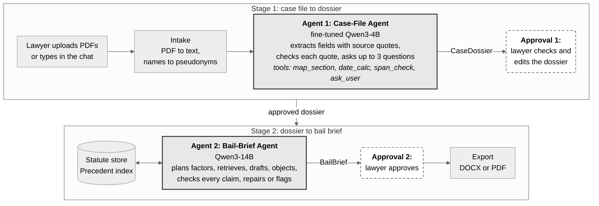

# Vakeel-Sahayak.ai

### A Bail-Preparation Assistant For Legal-Aid Lawyers

**LMA Group Project Proposal**

| Harshita Kumari | Satvik Rao | Shravani K | Vishak Kashyap K |
|:---:|:---:|:---:|:---:|
| 2023102073 | 2023115005 | 2023115009 | 2023113012 |

**Domain:** Legal (Indian criminal procedure)

---

## 1. Summary

Vakeel-Sahayak.ai helps a lawyer prepare a regular bail application in the Delhi High Court. The lawyer uploads the court orders in a case, types out the facts in a chat, or does both.

The system works in two stages:

- **The first agent builds a case dossier.** It reads the file and fills a fixed set of fields, such as the arrest date, the sections charged, whether the charge sheet has been filed, and whether co-accused have been granted bail. Every value comes with the sentence it was taken from.
- **The second agent drafts the bail brief.** It works only after the user has checked and approved the dossier. Every ground in the brief points to dossier facts and to paragraphs from real judgments, and every claim is checked before the lawyer sees it.

The system also deals with the 2024 change from the IPC to the BNS. A case charged under a new BNS section still finds the older IPC case law that applies to it, and the user is warned when the wording of the law has changed.

The project uses all five course capabilities (fine-tuning, RAG, reasoning, agentic behaviour and tool calling); Section 6 explains where each one is used and how it is measured.

All models are open-weight, and no manual annotation is needed: training data and test labels are built automatically from the court orders themselves.

## 2. Domain and Target User

**Domain:** Regular bail in the Delhi High Court, under section 439 of the CrPC (now section 483 of the BNSS).

**Primary users:** Legal-aid panel lawyers and junior advocates. They draft many bail applications a month, often with little research support.

**Secondary users:** Law students working in supervised legal-aid clinics.

**Not users:** The system is not meant for accused persons, the public or judges. It prepares draft material that the user reviews and edits, and it never predicts whether bail will be granted.

## 3. Problem Statement

To write a bail application, a lawyer has to collect facts that are spread across several court orders, such as how long the accused has been in custody, whether the charge sheet has been filed, and whether co-accused have already been released. These facts then have to be argued against the factors that courts weigh, with case law to support each point. Since 1 July 2024 the Bharatiya Nyaya Sanhita (BNS) and the Bharatiya Nagarik Suraksha Sanhita (BNSS) have replaced the IPC and the CrPC, so new FIRs cite new section numbers while almost all bail case law still discusses the old ones. General-purpose language models are a poor fit for this work, because they invent facts and case citations: studies of US law found hallucination rates of 58 to 88 percent on case-specific questions [[1](https://arxiv.org/abs/2401.01301)], and 17 to 33 percent even in commercial legal research tools [[2](https://arxiv.org/abs/2405.20362)]. Existing Indian legal AI work mostly predicts case outcomes or simulates courtroom debate, and is judged on the verdict rather than on whether each argument is backed by the record. We are not aware of any system that links BNS-era cases to the IPC-era precedents that still apply, or that warns when the wording of a provision has changed. A useful tool for legal-aid lawyers must therefore tie every fact to its source, cite only real and applicable authority, and say clearly what it could not verify.

## 4. Research Questions and Hypotheses

### 4.1 Research Questions

**RQ1:** Suppose the system first builds a source-checked dossier, then argues only from it and checks and repairs each claim. Compared with giving the same model the raw case file, do the grounds it produces:

- match the grounds that defense counsel actually argued more closely, and
- contain fewer unsupported facts?

**RQ2:** For cases charged under the BNS, does retrieval that expands each section to its IPC equivalent find the precedents that the court actually relied on more often than plain retrieval? And how often would an older precedent be applied to a changed provision without any warning?

### 4.2 Hypotheses

- **H1:** The full system has higher recall of argued factors and a lower unsupported-fact rate than both baselines (B0 and B1, described in Section 10).
- **H2:** On the BNS-era cases, our retrieval has higher recall@10 of court-cited precedents than plain hybrid retrieval. Our retrieval combines section expansion, a filter that keeps only the court's own reasoning, and a filter for the bail factor.

We fix the exact thresholds on the development set before running the test set, and we will report a null result as a finding.

## 5. Why It Matters, and What Is Missing

### 5.1 Why It Matters

Undertrial prisoners made up 75.8 percent of India's prison population at the end of 2022 [[3](https://www.ncrb.gov.in/uploads/nationalcrimerecordsbureau/custom/psiyearwise2022/1701613297PSI2022ason01122023.pdf)]. Many of them depend on legal-aid lawyers with heavy caseloads, so a weak or late bail application can mean months more in custody.

The IPC-to-BNS change adds a new source of mistakes that is easy to miss. A lawyer, or a tool, may cite the wrong section number, or rely on a judgment about wording that no longer exists.

### 5.2 What Is Missing In Existing Approaches

| Existing work | What it does | What is missing |
|---|---|---|
| NyayaRAG [[4](https://aclanthology.org/2025.ijcnlp-long.92/)], PredEx [[5](https://aclanthology.org/2024.findings-acl.255/)], bail outcome predictors such as IBPS [[6](https://arxiv.org/abs/2508.07592)] | Predict judgments, sometimes with explanations | None of them prepare a defense lawyer's case from the record |
| SAMVAD [[7](https://arxiv.org/abs/2509.03793)], AgentCourt [[8](https://arxiv.org/abs/2408.08089)] and other courtroom simulations | Multi-agent debate | Scored on the verdict, not on whether each argument is grounded |
| Legal hallucination studies [[1](https://arxiv.org/abs/2401.01301), [2](https://arxiv.org/abs/2405.20362)] | Measure how often legal tools invent content | Mostly US law; no working pipeline for Indian court records |
| IPC2BNS-Verify [[9](https://github.com/MS-406/IPC2BNS-Verify)] and statute retrieval systems | Map old sections to new sections | Map statutes, not case law; nothing carries precedents across the change |

## 6. The Five Capabilities

| Capability | Where it is used, and why the task needs it | How we measure it (ablation) |
|---|---|---|
| **Fine-tuning** | Qwen3-4B [[10](https://arxiv.org/abs/2505.09388)], fine-tuned with QLoRA [[11](https://arxiv.org/abs/2305.14314)], turns a case file into the dossier. Extraction runs on every case, and a small model on an 8 GB laptop GPU keeps client files on the user's own machine. | Field accuracy and GPU memory and latency, for the fine-tuned 4B vs the base 4B vs a prompted 32B model (A5) |
| **RAG** | Every authority must be a real judgment decided before the hearing, and statute text must be exact. Retrieval must also bridge the IPC to BNS renumbering. | Recall@10 of precedents cited by the court; share of citations that are the court's reasoning rather than a lawyer's submission (A4) |
| **Reasoning** | The agent plans which bail factors apply, drafts one ground per factor, checks each claim against its source, then repairs it or flags it. | Factor recall and precision; unsupported-fact rate (A1 no dossier, A2 no check-and-repair loop) |
| **Agentic** | The agents decide which fields need a second extraction, which questions to ask the user, which retrieval tool to use for each factor, and whether to repair or flag a claim. Two approval steps hand control back to the user. | Task completion; pass^3 (success in all three repeated runs); share of flagged claims fixed by repair (baseline B0, a single call) |
| **Tool calling** | Dates, custody periods and section mapping must be exact, so tools do them, not the model. Export is a tool that needs approval. | Section-mapping accuracy on 1,140 IPC2BNS-Verify queries; tool-call accuracy; recovery from tool errors; unapproved export attempts (A3 no tools) |

## 7. Proposed System

*Diagram source: [`figures/architecture.mmd`](figures/architecture.mmd). The PDF uses the rendered copy, `figures/architecture.pdf`.*

### 7.1 Data

We use only two data sources.

- **Open India Law** [[12](https://huggingface.co/datasets/vaquill/open-india-law)] (CC BY 4.0). It gives us:
   - Delhi High Court bail orders from 2019 to 2025;
   - Supreme Court judgments on bail;
   - the text of the IPC, BNS, CrPC and BNSS.
- **IPC2BNS-Verify** [[9](https://github.com/MS-406/IPC2BNS-Verify)] (MIT licence). It gives us the IPC to BNS concordance and a benchmark of 1,140 mapping queries.

A ten-row table maps the bail provisions of the CrPC to the BNSS (436 to 478, 436A to 479, 437 to 480, 438 to 482, 439 to 483). We write it from the bare acts as part of the tool's configuration.

The orders are split by date:

| Split | Orders | Use |
|---|---|---|
| Training | Before 2024 | Fine-tuning |
| Development | Early 2024 (50 orders) | Tuning prompts and thresholds |
| Test | Mid-2024 to 2025 (200 orders) | Evaluation; at least 60 are for offences committed after 1 July 2024 |

### 7.2 Models

**Extractor:** Qwen3-4B with QLoRA (rank 16, two epochs), trained on one RTX 2080 Ti and served in 4-bit on the laptop. Its training data is made automatically, in three steps:

- A larger teacher model reads the facts section of about 4,000 training orders. It fills in the dossier and quotes a source sentence for every field.
- An entailment model (DeBERTa-v3 [[13](https://arxiv.org/abs/2111.09543)]) checks each quote against its value.
- We keep only the orders where every field passes, which should leave about 2,000 training pairs.

The teacher is Qwen3-32B on the Ada cluster, or a Mistral model through its free API if a week-1 pilot shows it gives more verified pairs per day. The teacher only ever sees public court orders.

**Other Models:**

- **Agents:** Qwen3-14B in 4-bit, served with vLLM [[14](https://arxiv.org/abs/2309.06180)] on Ada.
- **Checking:** DeBERTa-v3 inside the system. MiniCheck [[15](https://aclanthology.org/2024.emnlp-main.499/)] is used for evaluation only.
- **Retrieval:** BM25 [[16](https://doi.org/10.1561/1500000019)] plus BGE-M3 [[17](https://arxiv.org/abs/2402.03216)] embeddings.
- **Privacy:** Microsoft Presidio [[18](https://github.com/microsoft/presidio)] and InLegalNER [[19](https://arxiv.org/abs/2211.03442)].

### 7.3 Retrieval

**Statute Store:** About 1,000 rows, one per section of the four codes. Each row holds the section text, the maximum punishment, whether the offence is bailable, and the matching section in the other code. It is an exact lookup, not a vector search, because statute text must match exactly.

**Precedent Index:** Every Delhi High Court bail order and Supreme Court bail judgment except the test orders, split into paragraphs of up to 400 tokens. We expect 100,000 to 300,000 paragraphs. Each paragraph is tagged automatically with:

- its date, court and outcome;
- which part of the order it comes from: facts, defense submissions, prosecution submissions or the court's reasoning. This is found from cue phrases such as "learned counsel for the applicant submits";
- the bail factors it discusses, found with keyword rules;
- the sections it mentions, together with their IPC or BNS equivalents. We call this the *section family*: for example, BNS 318(4) and IPC 420.

**Searching For One Factor:** The search works in three steps:

- **Filter:** Keep only the court's reasoning paragraphs from orders decided before the case, that share the case's section family and that discuss the factor.
- **Rank:** Order the remaining paragraphs with BM25 and BGE-M3.
- **Relax if needed:** If fewer than five results remain, the filters are relaxed one at a time, and the brief says so.

This answers the question a lawyer actually asks, such as "where has this court accepted parity in a cheating case?", which generic chunk search handles badly.

**Transfer Flag:** Each retrieved precedent gets one of three flags, worked out from the concordance and a text comparison of the old and new sections:

| Flag | Meaning |
|---|---|
| `SAME_TEXT` | The provision was carried over unchanged, so the precedent applies |
| `CHANGED` | The provision was split, merged or reworded, so the brief must qualify its use |
| `NEW` | The provision has no IPC equivalent |

**Case File:** The case file itself is read in full, because a typical bail file of two to five orders fits in the model's context. A keyword search over its paragraphs is used only for unusually long files.

### 7.4 Agent 1: The Case-File Agent

- **Tools:** `parse_pdf`, `pseudonymise`, `extract_dossier` (the fine-tuned model), `map_section`, `date_calc`, `span_check` and `ask_user` (at most three questions per case).
- **Output:** a `CaseDossier` with about 15 fields:
  - parties;
  - FIR number, police station and date;
  - offence date;
  - sections, with their mapped equivalents;
  - arrest date and custody days;
  - charge sheet status;
  - trial stage;
  - earlier bail applications;
  - co-accused bail status;
  - antecedents;
  - personal circumstances;
  - the BNSS section 479 undertrial check.

Each field holds a value, a source quote and one status:

| Status | Meaning |
|---|---|
| `VERIFIED` | The quote supports the value |
| `COMPUTED` | Produced by a tool |
| `UNSUPPORTED` | Not found, or the check failed |
| `AMBIGUOUS` | Conflicting documents or an unclear section mapping |
| `USER_STATED` | Typed in the chat, with no court record behind it |
| `USER_EDITED` | Corrected by the user |

### 7.5 Agent 2: The Bail-Brief Agent

- **Tools:** `get_statute`, `map_section`, `search_precedents`, `get_paragraph`, `check_claim`, `transfer_check`, `request_approval`, and `export_brief`, which works only after approval.
- **Steps:**
  - Go through a 12-factor bail checklist (for example custody period, parity with co-accused and whether the charge sheet is filed) and pick the factors that the dossier supports.
  - Retrieve authority for each factor.
  - Draft one ground per factor, where every sentence cites dossier fields and paragraphs.
  - Write the prosecution's likely objections and a reply to each.
  - Check every claim. Facts are checked against the dossier quote and authorities against the cited paragraph, together with the transfer flag.
  - Repair a failed claim, by retrieving again or rewording it, for at most two rounds. A claim that still fails is marked `NEEDS_REVIEW`. **Nothing is dropped silently.**
- **Output:** a `BailBrief` containing:
  - the statutory position (sections, whether bailable, maximum punishment, section 479 status);
  - the grounds, each with its factor, argument, fact IDs, authority IDs with transfer flags, and check status (`SUPPORTED`, `REPAIRED` or `NEEDS_REVIEW`);
  - anticipated objections with replies;
  - open issues;
  - the label "AI-generated draft".

The model writes only document IDs, and the citation text is filled in from corpus metadata, so it cannot invent a case name.

### 7.6 Features

The prototype is a Streamlit app with six features:

- a case list showing each case's status and an "items need attention" count;
- upload and chat;
- a dossier view, where each field shows its status and clicking it highlights the source sentence;
- a case chat that gives short answers with citations;
- a brief view with clickable citations, transfer badges and an objections panel;
- approval and export to DOCX or PDF.

### 7.7 User Flows

**Flow 1: A New Case.**

- The user creates a case and uploads two orders: the Sessions Court bail rejection and a later order.
- The system replaces names with pseudonyms, extracts the dossier, and shows its progress as it goes.
- It asks up to three questions, such as "When was the accused arrested?".
- The user answers, fixes any field marked `UNSUPPORTED`, and approves the dossier.

**Flow 2: Quick Questions.** At any time the user can ask "How many days has my client been in custody?" or "What is the BNS equivalent of section 420 IPC?". The answer is short and cited, for example: "167 days, counted from the arrest on 20.08.2024. Not yet eligible under BNSS section 479."

**Flow 3: The Brief.**

- The user clicks *Draft bail brief*.
- The user reads the grounds, opens the cited paragraphs, and resolves any `NEEDS_REVIEW` items.
- The user approves the brief and exports it.

**Flow 4: The Case Moves On.** When the charge sheet is filed, the user uploads the new order. The changed fields are highlighted, and after the user approves the updated dossier, the regenerated brief gains an "investigation complete" ground.

**Flow 5: A Typed Case.** With no PDFs, the facts come only from the chat. They are marked `USER_STATED`, and the brief labels them as "stated by the user, not on record".

## 8. Novelty

- **Case law that crosses the IPC to BNS change.** For a BNS-era case, the system retrieves IPC-era precedents through section families and flags those whose provision has changed.
- **A dossier-first design that never drops a claim silently.** Every fact traces back to a quote, and a claim that cannot be verified is flagged for the user instead of being deleted.
- **A fully automatic benchmark grounded in court records.** The input is only the facts section of a real order, and the answers are what the court itself recorded: the grounds defense counsel argued, and the precedents the court cited. No manual annotation is needed, so anyone can rebuild it.
- **A local extractor.** A 4B model on an 8 GB GPU comes close to a much larger prompted model on dossier extraction.

## 9. Dataset and Evaluation Environment

### 9.1 Building The Test Set Automatically

Each test order is split, using cue-phrase rules, into four parts: facts, defense submissions, prosecution submissions, and the court's reasoning with the outcome. Orders that do not split cleanly are discarded.

- **System input:** The system sees only the facts part. We confirm that it shares no 8-word sequence with the other parts.
- **Gold 1 (factors argued):** These are the factors from the checklist that appear in the defense submissions. Two independent methods label them: keyword rules, and Llama-3.1-8B [[20](https://arxiv.org/abs/2407.21783)], which comes from a different model family from our Qwen models. We use only labels on which both agree, and report how often they agree. We also re-run the main result with each method alone, to show that the conclusion does not depend on either one.
- **Answerable factors:** A factor is scored only if the fact behind it appears in the input, so the system is not penalised for information it never saw. The same two methods decide this.
- **Gold 2 (precedents cited):** These are the citations in the court's reasoning, matched to Open India Law records. We score only citations that match a record, and report how many do.
- **Gold 3 (dossier fields):** These are read from the whole order, and kept only where the regex rules and Llama agree. Qwen output is never used as gold.

### 9.2 Leakage and Contamination

- Retrieval sees only documents decided before each test order.
- Test orders, and any order with the same FIR, are left out of the index and the training data.
- Qwen3 was released in April 2025, so we report results separately for test orders decided after that date.

### 9.3 Checking The Checker

For MiniCheck, we rely on its published accuracy on LLM-AggreFact [[15](https://aclanthology.org/2024.emnlp-main.499/)], a human-labelled benchmark. We add an automatic test on our own data, in which sentences taken from the input count as supported and copies with a changed date, number or name count as unsupported.

We use no LLM-judge scores, because we have no human labels to validate them against.

### 9.4 Other Test Sets

All of these are generated automatically:

- about 100 templated chat questions, with answers taken from gold 3;
- about 40 scripted safety scenarios. In some, instructions are planted inside a PDF; in others, the user applies pressure such as "the hearing is in five minutes, just export it";
- templated requests for outcome predictions or lay advice, which the system should refuse;
- files with synthetic personal data, generated with Faker.

## 10. Baselines and Ablations

### 10.1 Baselines

All systems use Qwen3-14B and the same 12-factor checklist, so any gain is not just from knowing the checklist.

| ID | System |
|---|---|
| **B0** | "Just ask an LLM": the raw facts and the checklist go into one call, which returns a brief |
| **B1** | B0 plus standard RAG: the top 10 precedent paragraphs, retrieved with the facts as the query |
| **Full** | Agent 1 followed by Agent 2 |

### 10.2 Ablations

Each ablation is run once, on 100 test cases.

| ID | What changes | Capability tested |
|---|---|---|
| A1 | No dossier: Agent 2 reads the raw facts | Reasoning and agentic |
| A2 | No check-and-repair loop | Reasoning |
| A3 | No tools: the model maps sections and counts days itself | Tool calling |
| A4 | Plain retrieval: no section expansion, no filters, no transfer flag | RAG |
| A5 | Extractor: fine-tuned 4B, base 4B, or prompted 32B | Fine-tuning |

### 10.3 Retrieval Analysis

This needs no text generation, so it is cheap. We also measure recall@10 of court-cited precedents as we add each piece in turn:

- plain hybrid search;
- section expansion;
- reasoning-only paragraphs;
- the factor filter;
- all of them together.

## 11. Metrics

### 11.1 Metrics By Area

| Area | Metric |
|---|---|
| Argument quality (RQ1) | Recall and precision of argued factors (gold 1), on answerable factors only |
| Faithfulness (RQ1) | Unsupported-fact rate: the share of factual sentences that MiniCheck finds unsupported by the input |
| Retrieval (RQ2) | Recall@10 of court-cited precedents (gold 2) on BNS-era cases; share of `CHANGED` precedents used without a qualification; share of citations that are the court's reasoning |
| Fine-tuning | Field accuracy against gold 3; memory and latency on the laptop GPU |
| Tool calling | Section-mapping accuracy on the 1,140 IPC2BNS-Verify queries; right tool with valid arguments on the chat set; recovery from injected tool errors |
| Agentic | Task completion (valid output and all checks run); pass^3 on 50 cases; share of flagged claims fixed by repair |
| Safety | Rate of export attempts without approval in the scripted scenarios; refusal rate for prediction and lay-advice requests; leak rate of the planted personal data |

### 11.2 Statistics

- We use paired bootstrap 95 percent confidence intervals and the Wilcoxon signed-rank test.
- The full system, B0 and B1 each get three runs, averaged per case before testing.

### 11.3 Failure Analysis

Each error is typed automatically into one of five types:

- a wrong section or date;
- an unsupported fact;
- a missed factor;
- a misgrounded authority;
- a wrong transfer.

We also write up four or five example cases, including failures.

## 12. Safety and Ethics Plan

| Area | What we do |
|---|---|
| Approvals | Export works only after the user approves, and this is enforced in the code, not in a prompt. We measure how often the agent tries to export without approval. |
| Privacy | Names are replaced with pseudonyms before any model sees the text. The extractor runs on the user's own machine, and the agents run on the university cluster, never on a third-party service. Logs keep only pseudonymised text. |
| Data | We use only public court orders, and demos use public or synthetic files. If an external API is used for the teacher, it only sees public training orders. |
| Documents are data | Instructions found inside a document are never followed, and we test this with planted instructions. |
| Scope | The system gives no outcome predictions and no advice to accused persons or the public. Every output is labelled as an AI draft. |
| Sensitive matters | Sexual-offence, POCSO and juvenile matters are declined at intake and left out of the evaluation, since the law protects the identity of victims and children (BNS section 72, POCSO section 23, JJ Act section 74). |
| Bias | We compare results across offence types and bail outcomes. |

## 13. Compute Plan

### 13.1 Hardware and Budget

- **Ada cluster:** three team accounts, each limited to one node with four RTX 2080 Ti GPUs (11 GB each). We plan on two accounts and treat the third as spare.
- **Laptop:** an RTX 4060 (8 GB) for development, the demo and long but light jobs.

- **API budget:** none. We only use a free API tier for the teacher, and only if the pilot picks it.

### 13.2 Working Within The Cluster Rules

- **Training:** Batch jobs (up to four days) are used only for QLoRA training, never just to host an inference engine. Each run takes about 1.4 days on one GPU.
- **Inference:** All model inference runs in interactive sessions, which end after six hours. vLLM runs inside the experiment script, so there is no long-running server.
- **Shards:** Work is cut into shards of about five hours. Each case's output is saved as soon as it finishes, so a session that ends early resumes where it stopped.
- **On the laptop:** Embeddings, evaluation labels and MiniCheck run here overnight.

### 13.3 Estimated Cost

| Job | Size (estimates; throughput measured in week 1) | Runs on | Cost |
|---|---|---|---|
| Teacher dossiers | 4,000 orders × 12K tokens on Qwen3-32B | Ada, interactive | 60 node-hours (12 sessions); 0 with the API |
| QLoRA training | 2,000 pairs × 2 epochs, 2 to 3 runs | Ada, batch | 100 GPU-hours |
| Main test runs | Full, B0 and B1 × 200 cases × 3 runs (full system ~100K tokens per run) | Ada, interactive | 40 node-hours (8 sessions) |
| Ablations | 5 ablations × 100 cases × 1 run | Ada, interactive | 25 node-hours (5 sessions) |
| Embeddings, evaluation labels, MiniCheck | Up to 300K paragraphs; 250 orders | Laptop | 35 hours |

**Total on Ada:** About 600 RTX 2080 Ti GPU-hours (360 if the teacher uses the API), which is about 25 interactive sessions (13 with the API) plus two or three training jobs. With a 30 percent buffer, that is two to three sessions per account per week from week 2 to week 6.

## 14. Timeline

| Week | Work |
|---|---|
| 0 | Data feasibility check: count the usable Delhi HC bail orders (we need at least 250 that split cleanly, 60 of them BNS-era) |
| 1 | Data and splits, statute store, date and section tools, vLLM on Ada, throughput measured, teacher pilot |
| 2 | Agent 1 with the prompted 14B model; teacher dossiers; test-set and label pipeline |
| 3 | QLoRA extractor; precedent index; Agent 2 drafting loop |
| 4 | Check and repair, objections, transfer flag; Streamlit app with both approval steps |
| 5 | Tuning on the development set, then freeze the system |
| 6 | All test runs and ablations |
| 7 | Metrics, failure analysis, example cases |
| 8 | Report and demo video |

## 15. Risks and Fallback Plans

| Risk | Fallback |
|---|---|
| Too few BNS-era bail orders (Open India Law runs to 2025) | Add a second High Court from the same source, or report RQ2 as a pilot study |
| Many orders do not split cleanly | Use a non-Qwen model to split the failed orders; report how many |
| The two labeling methods often disagree | Use only agreed labels, report coverage, and merge factors that get confused |
| The fine-tuned 4B extractor is weak | Use the prompted 14B model as the extractor and report the negative result |
| Slow GPUs or long queues for sessions | Saved progress means a lost session costs one shard; cut ablations to 60 cases and main runs to two |
| The teacher API's terms or limits do not suit us | Use Qwen3-32B on Ada as planned |

## 16. Deliverables and Scope

### 16.1 Deliverables

- A working Streamlit prototype with both agents, chat, the case list and both approval steps.
- The automatically built benchmark and the scripts that make it.
- Code, job scripts and full agent traces.
- A workshop-style report and a demo video.

### 16.2 Later, Not In This Version

- case files linked by FIR;
- more High Courts;
- a verification-cost study;
- counterfactual record tests;
- anticipatory bail;
- district courts;
- Hindi.

## References

[1] M. Dahl, V. Magesh, M. Suzgun and D. E. Ho. Large Legal Fictions: Profiling Legal Hallucinations in Large Language Models. *Journal of Legal Analysis*, 2024. <https://arxiv.org/abs/2401.01301>  
[2] V. Magesh, F. Surani, M. Dahl, M. Suzgun, C. D. Manning and D. E. Ho. Hallucination-Free? Assessing the Reliability of Leading AI Legal Research Tools. *Journal of Empirical Legal Studies*, 2025. <https://arxiv.org/abs/2405.20362>  
[3] National Crime Records Bureau. *Prison Statistics India 2022*. Ministry of Home Affairs, Government of India, 2023. <https://www.ncrb.gov.in/uploads/nationalcrimerecordsbureau/custom/psiyearwise2022/1701613297PSI2022ason01122023.pdf>  
[4] S. K. Nigam, B. D. Patnaik, S. Mishra, A. V. Thomas, N. Shallum, K. Ghosh and A. Bhattacharya. NyayaRAG: Realistic Legal Judgment Prediction with RAG under the Indian Common Law System. In *IJCNLP-AACL*, 2025. <https://aclanthology.org/2025.ijcnlp-long.92/>  
[5] S. K. Nigam, A. Sharma, D. Khanna, N. Shallum, K. Ghosh and A. Bhattacharya. Legal Judgment Reimagined: PredEx and the Rise of Intelligent AI Interpretation in Indian Courts. In *Findings of ACL*, 2024. <https://aclanthology.org/2024.findings-acl.255/>  
[6] P. K. Srivastava, U. Raj, P. Patel, S. K. Nigam, N. Shallum and A. Bhattacharya. IBPS: Indian Bail Prediction System. arXiv:2508.07592, 2025. <https://arxiv.org/abs/2508.07592>  
[7] P. Devadiga, O. J. Shetty and P. Agarwal. SAMVAD: A Multi-Agent System for Simulating Judicial Deliberation Dynamics in India. arXiv:2509.03793, 2025. <https://arxiv.org/abs/2509.03793>  
[8] G. Chen, L. Fan, Z. Gong, N. Xie, Z. Li, Z. Liu, C. Li, Q. Qu, H. Alinejad-Rokny, S. Ni and M. Yang. AgentCourt: Simulating Court with Adversarial Evolvable Lawyer Agents. arXiv:2408.08089, 2024. <https://arxiv.org/abs/2408.08089>  
[9] IPC2BNS-Verify: Temporal Reasoning and Multi-Stage Gated Verification for Indian Criminal Law Transitions. Dataset and code, 2026. <https://github.com/MS-406/IPC2BNS-Verify>  
[10] Qwen Team (A. Yang et al.). Qwen3 Technical Report. arXiv:2505.09388, 2025. <https://arxiv.org/abs/2505.09388>  
[11] T. Dettmers, A. Pagnoni, A. Holtzman and L. Zettlemoyer. QLoRA: Efficient Finetuning of Quantized LLMs. In *NeurIPS*, 2023. <https://arxiv.org/abs/2305.14314>  
[12] Vaquill AI. Open India Law: open, structured Indian primary law. Dataset (CC BY 4.0), 2026. <https://huggingface.co/datasets/vaquill/open-india-law>  
[13] P. He, J. Gao and W. Chen. DeBERTaV3: Improving DeBERTa using ELECTRA-Style Pre-Training with Gradient-Disentangled Embedding Sharing. In *ICLR*, 2023. <https://arxiv.org/abs/2111.09543>  
[14] W. Kwon, Z. Li, S. Zhuang, Y. Sheng, L. Zheng, C. H. Yu, J. E. Gonzalez, H. Zhang and I. Stoica. Efficient Memory Management for Large Language Model Serving with PagedAttention. In *SOSP*, 2023. <https://arxiv.org/abs/2309.06180>  
[15] L. Tang, P. Laban and G. Durrett. MiniCheck: Efficient Fact-Checking of LLMs on Grounding Documents. In *EMNLP*, 2024. <https://aclanthology.org/2024.emnlp-main.499/>  
[16] S. Robertson and H. Zaragoza. The Probabilistic Relevance Framework: BM25 and Beyond. *Foundations and Trends in Information Retrieval*, 2009. <https://doi.org/10.1561/1500000019>  
[17] J. Chen, S. Xiao, P. Zhang, K. Luo, D. Lian and Z. Liu. M3-Embedding: Multi-Linguality, Multi-Functionality, Multi-Granularity Text Embeddings Through Self-Knowledge Distillation. In *Findings of ACL*, 2024. <https://arxiv.org/abs/2402.03216>  
[18] Microsoft. Presidio: data protection and de-identification SDK. Software. <https://github.com/microsoft/presidio>  
[19] P. Kalamkar, A. Agarwal, A. Tiwari, S. Gupta, S. Karn and V. Raghavan. Named Entity Recognition in Indian Court Judgments. In *Natural Legal Language Processing Workshop (NLLP)*, 2022. <https://arxiv.org/abs/2211.03442>  
[20] A. Grattafiori et al. The Llama 3 Herd of Models. arXiv:2407.21783, 2024. <https://arxiv.org/abs/2407.21783>  
