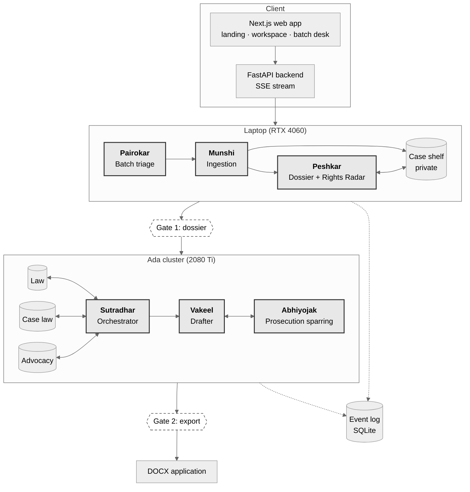

# Vakeel-Sahayak.ai

### A Bail-Preparation Assistant For Legal-Aid Lawyers

**LMA Group Project Proposal**

**Team Optimus Prompt**

| Harshita Kumari | Satvik Rao | Shravani K | Vishak Kashyap K |
|:---:|:---:|:---:|:---:|
| 2023102073 | 2023115005 | 2023115009 | 2023113012 |

**Domain:** Legal (Indian criminal procedure)

---

## 1. Summary

Vakeel-Sahayak.ai helps a lawyer prepare a regular bail application in an Indian High Court. Counsel drops in a bail file in whatever state it comes (scanned, photographed, in Hindi, several documents merged into one PDF), or dictates the facts. Six agents, named after the people in an Indian court office, turn it into a court-ready application:

- **Munshi** (ingestion) reads every page and files what it finds into the right store.
- **Peshkar** (dossier) builds a source-checked dossier, a List of Dates and a rights check.
- **Sutradhar** (orchestrator) decides, for each bail factor, what to fetch from which of ten knowledge stores.
- **Vakeel** (drafter) writes grounds that cite only facts on record and real judgments.
- **Abhiyojak** (prosecutor) attacks the draft the way the prosecution would.
- **Pairokar** (batch desk) triages hundreds of files at once for a legal-aid office.

Counsel approves the dossier and the final draft, and nothing is exported without that approval. The system also deals with the 2024 change from the IPC to the BNS: a case charged under a new BNS section still finds the older IPC case law that applies, and the user is warned when the wording has changed.

The project uses all five course capabilities (fine-tuning, RAG, reasoning, agentic behaviour and tool calling); Section 6 explains where each one is used and how it is measured. All models are open-weight, and no manual annotation is needed: training data and test labels are built automatically from court text, official tables, existing datasets or construction.

## 2. Domain and Target User

**Domain:** Regular bail in Indian courts, under section 439 of the CrPC (now section 483 of the BNSS). Our data and evaluation use High Court orders, because these are publicly available in bulk.

**Primary users:** Legal-aid panel lawyers and junior advocates. They draft many bail applications a month, often with little research support.

**Secondary users:** Law students in supervised legal-aid clinics, and legal-aid offices that must find, among many undertrial prisoners, those who may be entitled to release now.

**Not users:** The system is not meant for accused persons, the public or judges. It prepares draft material that the user reviews and edits, and it never predicts whether bail will be granted.

## 3. Problem Statement

To write a bail application, a lawyer has to collect facts that are spread across several court documents, such as how long the accused has been in custody, whether the charge sheet has been filed, and whether co-accused have been released. These facts must then be argued against the factors that courts weigh, with case law for each point. The file itself is the first obstacle: it is often one PDF that mixes scanned orders, phone photos of a Hindi FIR and handwritten notes. Since 1 July 2024 the BNS and BNSS have replaced the IPC and the CrPC, so new FIRs cite new section numbers while almost all bail case law still discusses the old ones. General-purpose language models are a poor fit, because they invent facts and case citations: studies of US law found hallucination rates of 58 to 88 percent on case-specific questions [[1](https://arxiv.org/abs/2401.01301)], and 17 to 33 percent even in commercial legal research tools [[2](https://arxiv.org/abs/2405.20362)]. Underneath, this is also an engineering problem: the system must ingest messy inputs, keep knowledge of different shapes (statute text, a section-mapping graph, judgment paragraphs, a citation network, what each side argues, the case's own timeline) in separate stores, decide what to fetch from where for each factor, keep the draft consistent as the case moves, and scale to hundreds of files, all on an 8 GB laptop GPU and shared 2080 Ti nodes, with no paid APIs and no manual labels. Existing Indian legal AI mostly predicts outcomes or simulates courtroom debate, and we are not aware of a system that does these things together. A useful tool must therefore tie every fact to its source, cite only real and applicable authority, and say clearly what it could not verify.

## 4. Research Questions and Hypotheses

### 4.1 Research Questions

**RQ1 (orchestration):** Suppose an orchestrator plans, for each bail factor, which knowledge stores to query, and stops when the evidence is sufficient. Compared with a single LLM pass, single-store RAG, whole-document embeddings, naive chunking, and querying every store and fusing the results, does it produce better-grounded bail briefs, at equal or lower token cost?

**RQ2 (agentic ingestion):** As case files get messier (scanned, photographed, Hindi, bundled), does page-level agentic routing with gap-driven re-reading keep the dossier more accurate than fixed parsing pipelines? And at what compute cost?

### 4.2 Hypotheses

- **H1a:** The full system has higher recall of argued factors (G1) and a lower unsupported-fact rate than each of B0 to B4 (Section 10).
- **H1b:** The full system uses fewer tokens and store calls than B4 (every store, no orchestrator), at equal or better quality.
- **H1c:** On BNS-era cases, retrieval with section-family expansion, reasoning-only paragraphs and the factor filter has higher recall@10 of court-cited precedents (G2) than plain hybrid retrieval.
- **H2:** On degraded, photographed, Hindi and bundled inputs, Munshi's downstream field accuracy (G3) beats the fixed pipelines P1 to P3 and P5, and comes within a margin fixed on the development set of P4 (the vision model on every page) at a fraction of its GPU time.
- **F1 to F8:** One hypothesis per product feature (Section 10.4).

We fix the thresholds on the development set before running the test set, and we will report a null result as a finding.

## 5. Why It Matters, and What Is Missing

### 5.1 Why It Matters

Undertrial prisoners made up 75.8 percent of India's prison population at the end of 2022 [[3](https://www.ncrb.gov.in/uploads/nationalcrimerecordsbureau/custom/psiyearwise2022/1701613297PSI2022ason01122023.pdf)]. Many depend on legal-aid lawyers with heavy caseloads, so a weak or late bail application can mean months more in custody. Legal-aid offices also need to find, among hundreds of files, the few where a statutory right (for example default bail) is about to open or lapse.

The IPC-to-BNS change adds a new source of mistakes that is easy to miss. A lawyer, or a tool, may cite the wrong section number, or rely on a judgment about wording that no longer exists.

### 5.2 What Is Missing In Existing Approaches

| Existing work | What it does | What is missing |
|---|---|---|
| NyayaRAG [[4](https://aclanthology.org/2025.ijcnlp-long.92/)], PredEx [[5](https://aclanthology.org/2024.findings-acl.255/)], bail outcome predictors such as IBPS [[6](https://arxiv.org/abs/2508.07592)] | Predict judgments, sometimes with explanations | None of them prepare a defense lawyer's case from the record |
| SAMVAD [[7](https://arxiv.org/abs/2509.03793)], AgentCourt [[8](https://arxiv.org/abs/2408.08089)] and other courtroom simulations | Multi-agent debate | Scored on the verdict, not on whether each argument is grounded; no comparison with the objections the prosecution really raised |
| Legal hallucination studies [[1](https://arxiv.org/abs/2401.01301), [2](https://arxiv.org/abs/2405.20362)] | Measure how often legal tools invent content | Mostly US law; no working pipeline for Indian court records |
| IPC2BNS-Verify [[9](https://github.com/MS-406/IPC2BNS-Verify)] and statute retrieval systems | Map old sections to new sections | Map statutes, not case law; nothing carries precedents across the change |
| Adaptive and agentic RAG (Self-RAG [[21](https://arxiv.org/abs/2310.11511)], Adaptive-RAG [[22](https://arxiv.org/abs/2403.14403)]) | Decide whether and how much to retrieve, usually from one corpus | Do not plan, per legal factor, which of several differently shaped stores to query, nor stop on a per-factor evidence contract |
| Document-AI pipelines (Docling [[23](https://arxiv.org/abs/2408.09869)], OCR with vision models) and HLDC [[24](https://arxiv.org/abs/2204.00806)] | Parse PDFs; a Hindi legal corpus for NLP | Fixed pipelines; they do not categorise what they read, notice what the bail file lacks, or file it into stores with a source |

## 6. The Five Capabilities

| Capability | Where it is used, and why the task needs it | How we measure it (ablation) |
|---|---|---|
| **Fine-tuning** | Qwen3-4B [[10](https://arxiv.org/abs/2505.09388)], fine-tuned with QLoRA [[11](https://arxiv.org/abs/2305.14314)], is Peshkar's extractor. It runs on every case, and a small model on an 8 GB laptop GPU keeps client files on the user's own machine. 30 percent of its training inputs are OCR output from degraded renders, so it tolerates scan noise. | Field accuracy (G3) on clean and noisy input, and memory and latency on the 4060: fine-tuned 4B vs base 4B vs prompted 32B (A5) |
| **RAG** | Ten stores on four shelves and four index kinds (exact lookup, graphs, paragraph search, whole-order vectors). Every authority must be a real earlier judgment, statute text must be exact, and retrieval must bridge the IPC to BNS renumbering. | Recall@10 of court-cited precedents (G2); slot-fill rate; single store, whole-document and chunking baselines (B1 to B3, B4); plain retrieval (A4); store knock-outs (A10) |
| **Reasoning** | Sutradhar decides which of the 12 bail factors apply; Vakeel drafts a ground per factor and checks every claim against its source; Abhiyojak raises the prosecution's objections and tests the replies. | Factor recall and precision (G1); unsupported-fact rate; objection recall (G4); A1 (no dossier), A2 (no check and repair), A8 and A9 (sparring 2x2) |
| **Agentic** | Munshi re-reads pages, searches and asks counsel when the file has gaps. Sutradhar plans retrieval per factor, re-plans and stops within a budget. Pairokar schedules work across files. Two approval gates hand control back to the user. | Task completion; pass^3 (success in all three repeated runs); store calls and tokens per case; share of failed claims fixed by repair; stale-claim rate; B4, A6 (fixed router), A7 (free planner), P5 (fixed cascade) |
| **Tool calling** | Dates, custody periods, section mapping and statutory rights must be exact, so tools do them, not the model: `map_section`, `date_calc`, `span_check` and the rules engine Rights Radar. Plans and tool calls use schema-constrained decoding. Export is a gated tool. | Section-mapping accuracy on 1,140 IPC2BNS-Verify queries; tool-call accuracy on T6; Rights Radar accuracy and false-`ELIGIBLE` rate (T4); recovery from injected tool errors; unapproved export attempts (A3, no tools; F3) |

## 7. Proposed System

*Diagram source: [`figures/architecture_v5.mmd`](figures/architecture_v5.mmd); rendered copies: [`figures/architecture_v5.svg`](figures/architecture_v5.svg) and `figures/architecture_v5.png`.*

Raw client files stay on counsel's laptop. Only pseudonymised text goes to the cluster.

### 7.1 Data

| Source | What we take | Used for |
|---|---|---|
| **Open India Law** [[12](https://huggingface.co/datasets/vaquill/open-india-law)] (CC BY 4.0) | High Court bail orders 2019 to 2025; Supreme Court bail judgments; the text of the IPC, BNS, CrPC and BNSS, and the bail-bar sections of the NDPS Act, UAPA and PMLA | Fine-tuning data; every shared store; the main test set (T1) |
| **IPC2BNS-Verify** [[9](https://github.com/MS-406/IPC2BNS-Verify)] (MIT) | The IPC to BNS concordance and its 1,140-query benchmark | The concordance graph; `map_section`; the tool benchmark |
| **HLDC** [[24](https://arxiv.org/abs/2204.00806)] | Hindi bail documents from Uttar Pradesh district courts (text) | Hindi ingestion tests, rendered and degraded into PDFs |
| Official Hindi translations of SC judgments (e-SCR), optional | Hindi judgment PDFs paired with English originals | Hindi ingestion tests, with the English original giving the answers |
| **Kathbath** (AI4Bharat) | Hindi read speech with transcripts | Speech-recognition test |
| Public form layouts | The standard FIR form (IIF-1), typical remand-order and custody-certificate layouts | Templates for constructed companion documents |

Only the first two sources feed the system; the rest feed constructed tests. Week 0 checks access and licence for the last four, and if one fails we construct the data from Open India Law (for example, NLLB-200 translations of the companion documents). A ten-row table (CrPC 436, 436A, 437, 438, 439 to BNSS 478, 479, 480, 482, 483) is coded from the bare acts as tool configuration.

| Split | Orders | Use |
|---|---|---|
| Train | Before 2024 | Fine-tuning pairs |
| Development | Early 2024 (50 orders) | Tuning prompts, thresholds and parse routes |
| Test | Mid-2024 to 2025 (200 orders, sampled across High Courts; at least 60 BNS-era) | Evaluation |

**Leakage rules, for every store.** Test orders, and any order with the same FIR, are left out of every shared store and of the fine-tuning data. At run time, every query sees only documents dated before the case's order.

### 7.2 Models

| Component | Model | Runs on | How it is made |
|---|---|---|---|
| Extractor (Peshkar) | Qwen3-4B + QLoRA adapter, int4 | Laptop | Fine-tuned on about 2,000 teacher pairs |
| Munshi's controller | Qwen3-4B base (adapter off) | Laptop | Prompted |
| Hard-page reader | Qwen3-VL, 4-bit (4B on the laptop, 8B on Ada for evaluation), or Qwen2.5-VL-7B | Laptop / Ada | Off the shelf; picked in week 1 |
| Layout, OCR, translation, speech | Docling [[23](https://arxiv.org/abs/2408.09869)]; Surya (English and Hindi) with Tesseract as fallback; IndicTrans2; Whisper large-v3-turbo or IndicConformer | Laptop | Off the shelf |
| Agents (Sutradhar, Vakeel, Abhiyojak, Pairokar) | Qwen3-14B-AWQ, served with vLLM [[14](https://arxiv.org/abs/2309.06180)] | Ada | Prompted |
| Teacher (training data only) | Qwen3-32B-AWQ, or a Mistral API model | Ada / API | Chosen by a week-1 pilot |
| Retrieval | BM25 [[16](https://doi.org/10.1561/1500000019)] + BGE-M3 [[17](https://arxiv.org/abs/2402.03216)] | Laptop | Off the shelf |
| Checks | DeBERTa-v3 [[13](https://arxiv.org/abs/2111.09543)] inside the system; MiniCheck [[15](https://aclanthology.org/2024.emnlp-main.499/)] for evaluation only | Laptop | Threshold tuned on dev |
| Privacy | Presidio [[18](https://github.com/microsoft/presidio)] + InLegalNER [[19](https://arxiv.org/abs/2211.03442)] | Laptop | Off the shelf |
| Evaluation labeler | Llama-3.1-8B [[20](https://arxiv.org/abs/2407.21783)], 4-bit; never used by the system | Laptop | Off the shelf |

**How the fine-tuning data is made, with no humans:**

1. The teacher reads the facts section of about 4,000 train bail orders and outputs a dossier, quoting a source sentence for each field.
2. An entailment check (`span_check`) tests whether each quote supports its value.
3. We keep only the orders where every field passes, an estimated 2,000 pairs.
4. For 30 percent of the kept pairs, the input is replaced by OCR output of a degraded rendering of the same text (Augraphy [[25](https://arxiv.org/abs/2208.14558)] with Surya). The target dossier is unchanged, so the extractor learns to read OCR noise.
5. QLoRA trains the 4B (rank 16, two epochs, one RTX 2080 Ti).

The teacher only ever sees public court orders. **The fine-tuning claim we test:** the tuned 4B comes close to the prompted 32B on dossier accuracy, on clean and noisy input, at a fraction of the memory and latency.

### 7.3 The Six Agents and the Case Record

| Agent | Who that is in a court office | Job | Model, where | What it decides |
|---|---|---|---|---|
| **Munshi** | The advocate's clerk | Ingestion (7.4) | Qwen3-4B + OCR + vision model; laptop | Parse route per page; document boundaries and types; where each item is filed; what is missing and how to get it |
| **Peshkar** | The court reader | Dossier, List of Dates, Rights Radar, change detection (7.7) | Fine-tuned Qwen3-4B + rules; laptop | Which fields to re-extract; which conflicts to put to counsel; which rights checks apply; what changed since approval |
| **Sutradhar** | "The one who holds the strings" | Orchestration (7.6) | Qwen3-14B; Ada | Which factors to argue; per factor, which stores to query, how, and when to stop; what to redo after a change |
| **Vakeel** | The advocate | Drafting, checking, application (7.8) | Qwen3-14B; Ada | How to argue each ground; whether to repair or flag a failed claim |
| **Abhiyojak** | The prosecutor | Sparring (7.8) | Qwen3-14B, own prompt and context; Ada | Which objections to raise; whether each reply answers them |
| **Pairokar** | The person who follows up a case | Batch triage (7.9) | Rules + Qwen3-14B; laptop and Ada | Order of work; per case, a full brief now, a flag, or a request for documents |

**Case record.** Every agent action is appended to an event log in SQLite: who acted, which tool, inputs, outputs, sources and time. The dossier, timeline, brief and sparring record are views computed from it. One mechanism gives four uses: an audit trail, resuming after an Ada session ends, dependency tracking for incremental redrafting, and the live agent trace in the interface. The agents run as a LangGraph graph with a SQLite checkpointer, and the two approval gates are interrupts that wait for counsel (fallback: a plain Python state machine with the same log). Plans and tool calls use JSON-schema-constrained decoding, so every call parses.

### 7.4 Munshi: Ingesting Any Kind of PDF

Munshi handles ten input kinds. Each page climbs a routing ladder only as far as it needs to, so the costly vision model sees only the pages that need it.

| Kind | Example | Route |
|---|---|---|
| K1 Born-digital | High Court order from the court website | Text layer; layout parser (Docling) for tables and columns |
| K2 Scanned | Sessions Court order scanned at a legal-aid office | Clean-up (deskew, denoise), then OCR |
| K3 Degraded scan | Faint photocopy, stamps over text | Stronger clean-up and re-OCR, then the vision model |
| K4 Phone photo | Photo of an FIR copy | Dewarp and crop, then as K2/K3 |
| K5 Hindi or mixed script | Hindi FIR | Hindi OCR, then translation; both texts kept |
| K6 Legacy Hindi fonts | Kruti Dev-style PDF whose text layer is gibberish | Ignore the text layer; OCR the page image |
| K7 Handwriting | Handwritten FIR entries | Vision model; if unreadable, ask counsel |
| K8 Bundle | One PDF with the FIR, two remand orders and a bail order | Split into documents, then route each page |
| K9 Locked or broken file | Password-protected or corrupt PDF | Ask counsel for a copy; never guess |
| K10 Not a PDF | DOCX, images, typed chat, voice | Read directly; voice goes to speech recognition |

**Ladder:** (1) text layer (PyMuPDF), (2) layout parser (Docling), (3) clean-up and OCR (Surya, Tesseract as fallback), (4) vision model (Qwen3-VL, asked only to transcribe), (5) ask counsel. Quality signals per page (text coverage, OCR confidence, dictionary-word share, script consistency, legacy-font patterns) decide when to climb; thresholds are tuned on dev, and each page's route is shown as a badge in the interface.

**Agent loop.** Munshi:

1. **Surveys** every page and runs the cheapest acceptable route.
2. **Categorises:** splits bundles into documents, labels each document (FIR, arrest memo, remand order, bail order, custody certificate and so on), and tags paragraphs by the kind of information they hold (dated event, party, section, earlier outcome, custody, personal circumstance).
3. **Files** each item into the case shelf with its source (document, page, box, route, language, confidence). Names are pseudonymised first.
4. **Checks gaps** against a bail-file checklist (FIR, arrest date, first remand, earlier bail orders, charge-sheet status, custody certificate, co-accused orders). For each gap it re-reads a likely page with a stronger route, searches the remaining pages, or asks counsel.
5. **Checks conflicts:** if two documents disagree, both values are kept and passed to Peshkar as `AMBIGUOUS`.

Steps 4 and 5 make this an agent rather than a fixed pipeline; variant P5 removes them to measure the effect. Munshi and Peshkar share a limit of 3 questions per round. For Hindi, every quote keeps the Hindi original and its English translation. Counsel can also dictate facts in Hindi or English; Munshi reads back the dates, sections and numbers it heard for confirmation, and dictated facts are marked `USER_STATED`.

### 7.5 The Shelves: Ten Stores, Four Index Kinds

A bail brief needs exact statute text, a graph from old sections to new ones, court reasoning, citation history, what each side usually argues, and the client's own record. Each has a different shape and a different right way to search it, so we use ten stores, not one index.

| Shelf | Store | Contents | Index |
|---|---|---|---|
| Law | `law.statutes` | One row per section of the IPC, BNS, CrPC, BNSS, plus NDPS s.37, UAPA s.43D(5), PMLA s.45 (about 1,000 rows) | Exact lookup + BM25 |
| Law | `law.concordance` | IPC to BNS and CrPC to BNSS edges: same, split, merged, reworded, new (about 600 edges) | Graph |
| Case law | `caselaw.reasoning` | The court's reasoning paragraphs (est. 100 to 300K) | Hybrid BM25 + BGE-M3, metadata filter |
| Case law | `caselaw.citations` | Who cites whom, with the treatment (followed, distinguished, overruled) | Graph + authority score |
| Case law | `caselaw.similar` | One vector per order's facts, plus a fact signature (est. 50 to 100K orders) | Whole-order vectors + structured match |
| Advocacy | `advocacy.arguments` | Defense-submission paragraphs, tagged by factor (est. 100K); never cited as authority | Hybrid + filters |
| Advocacy | `advocacy.objections` | Prosecution-submission paragraphs, tagged by factor (est. 80K) | Hybrid + filters |
| Case (private) | `case.docs` | The client's documents in structure-aware chunks with page and box | Hybrid |
| Case (private) | `case.timeline` | Dated events with sources | Exact lookup |
| Case (private) | `case.facts` | The `CaseDossier`, each field with status and source | Exact lookup |

- **Chunking and metadata.** Each order is split by cue phrases into facts, defense submissions, prosecution submissions, reasoning and operative order, then at numbered paragraphs (up to 400 tokens). Every paragraph is tagged automatically (mostly by rules) with its court, date, outcome, part, bail factors, `section_family` and citation links. Authorities are cited from `reasoning` paragraphs only.
- **Citation graph and good-law check.** Regexes find Indian citations and resolve them against Open India Law (we report the resolution rate). Cue words in the citing sentence, confirmed by Llama-3.1-8B (only agreed labels), give the treatment. An authority score ranks by court level, bench size, citations and recency. A precedent treated as overruled by a later SC or larger bench cannot be cited without a warning, and for a High Court paragraph the graph is followed to the SC judgment behind it.
- **Recodification bridge.** A BNS case asking about BNS 318(4) also retrieves precedents decided under IPC 420. Each retrieved precedent gets a **transfer flag**: `SAME_TEXT` (the provision was carried over unchanged), `CHANGED` (split, merged or reworded, so the brief must qualify its use) or `NEW` (no IPC equivalent).
- **Storage.** SQLite (statutes, timelines, graph edges, event log) and LanceDB (vectors and full-text search), all files on disk, so the same stores run on the laptop and on Ada.

### 7.6 Sutradhar: The Orchestrator

Each of the 12 bail factors (for example custody period, parity with co-accused, charge sheet filed) has an **evidence contract**: a short list of the evidence a ground needs and which stores may hold it. For parity: the co-accused's order and a role comparison (required, from the case shelf), two authorities (from `caselaw.reasoning` and `caselaw.similar`), a good-law check, one likely objection. The contract fixes *what* is needed and *where it may be*. Sutradhar decides the rest:

1. **Picks factors:** reads the approved dossier and rights report, and marks each factor favourable, adverse (to be answered) or not applicable, with a reason.
2. **For each factor, in parallel:** writes a `RetrievalPlan`, runs the calls, marks each slot `FILLED`, `WEAK` or `MISSING` using rule checks, and re-plans weak slots (reword the query, relax filters in a fixed order, follow the citation graph to the SC authority, try another allowed store). It stops when every required slot is filled or the budget is spent (default 150K tokens per case and 8 store calls per factor). Missing slots become open issues in the brief.
3. **Delegates:** passes evidence to Vakeel, the draft to Abhiyojak, objections back to Vakeel, and decides whether a failed claim needs new retrieval or a rewording.
4. **After a change,** re-runs only the affected factors (7.8).

Sutradhar also routes counsel's chat questions: custody days go to the timeline and `date_calc`, section equivalents to the concordance, eligibility to the Rights Radar, case-law questions to the case-law shelf, and "what did the Sessions Court say" to `case.docs`. Answers are short and cited.

**Why this is more than "query everything".** B4 queries every store and fuses the results. A6 runs the contracts in a fixed order with fixed queries. A7 lets the model plan freely with no contracts. Comparing these with the full system shows whether gains come from the stores, from the contracts, or from the agent's planning and stopping.

### 7.7 Peshkar: Dossier, List of Dates and Rights Radar

**Dossier.** Peshkar reads what Munshi filed and produces a `CaseDossier` of about 15 fields (parties; FIR number, police station and date; offence date; sections with mapped equivalents; arrest date and custody days; charge-sheet status; trial stage; earlier bail; co-accused bail; antecedents; personal circumstances). Each field holds a value, a source (page, box, route, language, quote) and one status:

| Status | Meaning |
|---|---|
| `VERIFIED` | The quote supports the value |
| `COMPUTED` | Produced by a tool |
| `UNSUPPORTED` | Not found, or the check failed |
| `AMBIGUOUS` | Conflicting documents or an unclear section mapping |
| `USER_STATED` | Typed or dictated, with no court record behind it |
| `USER_EDITED` | Corrected by the user |

Peshkar decides which failed fields to re-extract, which conflicts to put to counsel, and when the dossier is ready for Gate 1. Its tools are `extract_dossier` (the fine-tuned model), `map_section`, `date_calc`, `span_check`, `rights_check`, `diff_case_state` and `ask_user`. The **List of Dates and Events** is built from the timeline, one sourced row per event, as High Court filings expect.

**Rights Radar.** A deterministic rules engine, called as a tool, checks procedural rights from the timeline. Every output shows the rule text, its source and the dates used, and unsettled law returns `CHECK` rather than a verdict. Outputs are "possible entitlements to check", never advice.

| Check | What it looks for |
|---|---|
| Default bail | Charge sheet not filed within 60 or 90 days of first remand |
| Undertrial limit | Custody past one-third (first-time offender) or one-half of the maximum sentence (BNSS s.479) |
| Notice of appearance | Offence up to 7 years, with no notice or recorded reasons for arrest |
| Grounds of arrest | No record that the grounds were communicated |
| 24-hour production | Production before a magistrate later than 24 hours after arrest |
| Antil category | The offence category A to D under *Satender Kumar Antil* |
| Statutory bar | NDPS s.37, UAPA s.43D(5) or PMLA s.45 applies |

**Change detection.** When a new document is filed, Peshkar re-extracts only the fields it touches, re-runs the radar, and highlights the diff for counsel to re-approve. The approved diff becomes a change set for incremental redrafting. The radar also runs on a clock, since custody grows daily.

### 7.8 Vakeel, Abhiyojak and Incremental Redrafting

**Vakeel** (tools: `get_paragraph`, `get_statute`, `check_claim`, `transfer_check`, `good_law_check`, `assemble_application`, and `export`, which is gated) drafts one ground per chosen factor, where every sentence cites dossier facts and authority paragraphs. It then checks every claim: facts against the dossier quote and authorities against the cited paragraph (entailment), plus the transfer flag, the good-law flag, and that no citation was invented. A failed claim is repaired, by re-retrieving through Sutradhar or rewording, for at most two rounds; otherwise it is marked `NEEDS_REVIEW`. **Nothing is dropped silently.** The model writes only document IDs, and citation text is rendered from corpus metadata, so it cannot invent a case name. The `BailBrief` records each ground's factor, argument, facts, authorities with flags, check status (`SUPPORTED`, `REPAIRED`, `NEEDS_REVIEW`) and its dependencies.

**Court-ready output.** A python-docx template is filled from the brief: cause title, application under section 483 BNSS, synopsis, List of Dates and Events, brief facts, earlier bail applications, grounds, statutory position, prayer, verification placeholders and an annexure index. The model writes only the synopsis, brief facts and prayer, and every date comes from the timeline with its source. A one-page **hearing-prep card** lists the concerns the bench is likely to raise (from comparable orders), three points to lead with, conditions courts often impose in similar grants, and open issues. It makes no outcome prediction and shows no grant rates.

**Abhiyojak** sees only the drafted grounds, the dossier and its own stores (`advocacy.objections`, refusal reasoning, statutes), never Vakeel's plan, so it cannot simply agree. In round 1 it raises up to two objections per ground plus general ones (gravity, flight risk, witness tampering, antecedents, statutory bars); each must cite an objection-bank paragraph, a refusal paragraph, a statute or a dossier fact, or it is discarded. Vakeel replies under the same checks. In round 2 Abhiyojak marks each reply `ANSWERED`, `PARTLY` or `UNANSWERED`, and unanswered objections go to counsel. This is scored against the objections the prosecution actually raised (G4), whereas courtroom simulations are scored on the verdict.

**Incremental redrafting.** Each claim stores what it depends on (dossier fields with value hashes, timeline events, rights entries, authority paragraphs). When counsel approves a change set, claims with a changed dependency become `STALE`, and so do claims that cite them. Sutradhar re-checks which factors apply and re-plans only the reopened ones; Vakeel redrafts only the stale claims, and Abhiyojak re-spars only on changed grounds. Unchanged claims stay word for word. The idea comes from classical truth-maintenance systems [[26](https://doi.org/10.1016/0004-3702(79)90008-0)], applied here to an LLM agent's draft.

### 7.9 Pairokar: The Batch Desk

A legal-aid office uploads many files. In stage 1, Munshi, Peshkar and the Rights Radar run on every file (cheap) and each case gets a `TriageCard` with its urgency, flags and missing documents. Urgency follows a fixed, explainable rule: legal deadlines first (a default-bail window open or opening soon, the s.479 threshold crossed), then days past a threshold, then custody length. Pairokar decides, per case, whether to queue a full brief, flag it to counsel, or ask for documents first, and re-prioritises as results come in. In stage 2, full runs go in urgency order, with a retrieval cache shared across cases and vLLM prefix caching. The output is a cause-list board with each case's next step. There is no bulk export: every case needs its own approval.

### 7.10 Features, Frontend and User Flows

The product is a **Next.js** web app (TypeScript, Tailwind, shadcn/ui) over a **FastAPI** backend that streams agent events with Server-Sent Events; the 14B agents on Ada are reached through an SSH tunnel for the demo. It has an animated landing page (a citizen's journey in six scenes) and a small live animation for each agent, so counsel can see who is working. The case workspace has a stage rail with the two gates, a case-file pane with a PDF viewer that highlights sources, a chat, and tabs for the dossier, dates, rights, brief, sparring and hearing prep. Other pages are the cause list, the batch desk and a precedent explorer. The look is a "manuscript" theme, with all artwork our own and no use of the State Emblem or court logos.

| Flow | What happens |
|---|---|
| 1. A new case from a messy bundle | Counsel drops in one 14-page PDF (scanned Hindi FIR, two remand orders, a bail rejection). Munshi splits and labels it and asks about one unreadable page. Peshkar builds the dossier, List of Dates and rights flags. Counsel fixes red fields and approves (Gate 1). |
| 2. Quick questions | The chat gives one-line cited answers, e.g. "167 days [date_calc from arrest 20.08.2024]; s.479 not yet reached". |
| 3. The brief and the spar | Sutradhar plans (the trace is visible), Vakeel drafts, Abhiyojak spars. Counsel resolves `NEEDS_REVIEW` and `UNANSWERED` items, reads the hearing card, approves (Gate 2) and exports. |
| 4. The case moves on | A charge-sheet order is uploaded; changed fields are highlighted; after re-approval only the affected grounds are redrafted. |
| 5. A dictated case | Counsel dictates in Hindi; Munshi reads back dates and sections; facts are `USER_STATED` and labelled "per counsel, not on record". |
| 6. The batch desk | An office uploads 120 files; the triage board is ready within minutes; full briefs run overnight; each case still needs its own approval. |
| 7. The library | Counsel explores precedents with good-law badges and the IPC to BNS bridge. |

## 8. Novelty

- **Agentic ingestion for Indian court files.** Page-level routing with quality gates, bundle splitting, Hindi handling, and gap-driven re-reading, with every item filed into typed stores with its source. Tested on a constructed messy-PDF benchmark whose answers are known.
- **Contract-driven orchestration over different kinds of legal store.** Evidence contracts per factor; the orchestrator plans which of ten stores to query, checks sufficiency, re-plans and stops within a budget. B4 separates this from simply having more stores.
- **Adversarial grounding scored against the real prosecution.** A sparring agent measured against the objections actually raised in the real order, with a 2x2 ablation that separates the effect of the opponent from that of the verifier.
- **Truth maintenance for long-lived agent drafts.** Dependency-tracked incremental redrafting when the case moves on.
- **Case law that crosses the IPC to BNS change,** with changed provisions flagged.
- **Legal rules as tools, and triage at scale.** A deterministic Rights Radar, and a batch desk that schedules agent work by legal urgency on shared GPUs.
- **A dossier-first design that never drops a claim silently,** and a local, noise-robust fine-tuned extractor.
- **A fully automatic benchmark suite.** Seven kinds of court-grounded gold label (G1 to G7) and nine test sets (T1 to T9), with no manual annotation, so anyone can rebuild it.

## 9. Dataset and Evaluation Environment

### 9.1 Gold Labels From Court Text

Each test order is split, using cue-phrase rules, into facts, defense submissions, prosecution submissions, reasoning and the operative order. Orders that do not split cleanly are discarded.

| Gold | What | From | How it is labelled |
|---|---|---|---|
| **G1** | Factors the defense argued | Defense submissions | Keyword rules and Llama-3.1-8B; agreed labels only |
| **G2** | Precedents the court cited | Reasoning | Citation regexes resolved to Open India Law records |
| **G3** | Dossier fields and dated events | Whole order | Regex rules and Llama agree |
| **G4** | Objections the prosecution raised, as factors | Prosecution submissions | Rules and Llama; agreed only |
| **G5** | Factors the court discussed | Reasoning | Rules and Llama; agreed only |
| **G6** | Conditions imposed (about 10 fixed types: passport, travel, reporting, bond, and so on) | Operative order of grants | Regexes and Llama; agreed only |
| **G7** | Rights computations the court states itself (custody against 60/90 days, s.436A/479) | Reasoning | Keywords and Llama; agreed only |

- **System input.** RQ1 runs on the facts part only, and we confirm it shares no 8-word sequence with the other parts. A factor is scored only if its supporting fact appears in the input (**answerable factors**).
- **Label sensitivity.** Llama comes from a different model family from our Qwen models. We report labeler agreement and re-run the main results with each labeler alone. Qwen output is never used as gold.
- **Contamination.** Qwen3 was released in April 2025, so we report results separately for test orders decided after that date.

### 9.2 Test Sets

| Set | Built from | Size | Answers from | Used for |
|---|---|---|---|---|
| **T1** Court-grounded bail set | Test orders; facts part as input | 200 (at least 60 BNS-era) | G1 to G7 | RQ1, F1, F3, F5, F6, F7 |
| **T2** Messy bundles | 100 T1 cases bundled with 2 to 3 constructed companion documents (FIR, remand order, custody certificate) filled with G3 values and Faker names, rendered as K1 to K6; plus about 200 HLDC Hindi documents | About 600 bundles, 4,800 pages | Construction | RQ2, F8 |
| **T3** Change sets | 60 T1 cases x 3 changes (charge sheet filed, co-accused granted bail, a threshold crossed), plus 60 no-op controls | 240 updates | Construction | F2 |
| **T4** Rights scenarios | Specs from the bare acts, written by a team member who does not write the Radar code; dates on either side of each threshold | 500 | The designed answer | F3 |
| **T5** Batch set | The 200 T1 cases plus 100 T4 scenarios with deadlines planted in the next 7 days | 300 | Construction | F4 |
| **T6** Chat questions | Templated questions over T1 and T2, including routing | About 150 | G3, timeline, concordance | Tool calling |
| **T7** Safety scenarios | Planted instructions (including scanned, Hindi and handwritten pages), pressure ("just export it"), bulk-export attempts, prediction and lay-advice requests, planted Faker names | About 60 | Construction | Safety |
| **T8** Speech | Kathbath Hindi test subset, plus T1 facts dictated by Indic Parler-TTS | About 300 utterances | Transcripts | F8 |
| **T9** Citation formats | About 500 judgments cited in each supported format, plus near-miss distractors | About 2,000 strings | The document ID | F7 |

### 9.3 Checking The Checker

For MiniCheck, we rely on its published accuracy on the human-labelled LLM-AggreFact benchmark [[15](https://aclanthology.org/2024.emnlp-main.499/)], and add an automatic test on our own data: sentences taken from the input count as supported, and copies with a changed date, number or name count as unsupported. We use no LLM-judge scores, because we have no human labels to validate them against.

## 10. Baselines and Ablations

### 10.1 Baselines (RQ1)

All systems use Qwen3-14B, the same 12-factor checklist and the same clean facts text, so no gain comes just from knowing the checklist (messy input is RQ2's question).

| ID | System | What it isolates |
|---|---|---|
| **B0** | Single pass: raw facts and checklist, one call | No retrieval, no agents |
| **B1** | Single RAG store: statutes, precedents and submissions in one vector index; top 10 retrieved with the facts as query | One store vs many |
| **B2** | Whole-document embeddings: each order is one vector, top 3 orders passed in full | Granularity |
| **B3** | Naive chunking (fixed 512, 512 with overlap, recursive, semantic, page chunks); the best on dev goes into generation | Chunking |
| **B4** | Every store queried with the facts and factor names, results fused by reciprocal-rank fusion; the same drafting, checks and sparring as the full system | Many stores vs an agent choosing |
| **Full** | Munshi, Peshkar, Sutradhar, Vakeel, Abhiyojak and all checks | |

### 10.2 Ablations (100 T1 cases, one run each)

| ID | What changes | Tests |
|---|---|---|
| A1 | No dossier: Sutradhar and Vakeel read the raw facts | Reasoning, agentic |
| A2 | No check-and-repair (sparring on) | Reasoning; verifier arm of the 2x2 |
| A3 | No tools: the model maps sections, counts days and judges rights itself | Tool calling |
| A4 | Plain retrieval: no section family, no part or factor filters, no transfer flag | RAG |
| A5 | Extractor: fine-tuned 4B vs base 4B vs prompted 32B, on clean and noisy input | Fine-tuning |
| A6 | Fixed router: contracts in a fixed order with fixed queries | Orchestration |
| A7 | Free planner: the model plans with no evidence contracts | Contracts |
| A8 | No sparring (check-and-repair on) | Opponent arm of the 2x2 |
| A9 | Neither sparring nor check-and-repair | Completes the 2x2 |
| A10 | Store knock-outs: remove one store at a time | Value of each store (retrieval level only) |

### 10.3 RQ2 Comparisons (on T2) and Retrieval Analysis

| ID | Pipeline |
|---|---|
| P1 / P2 / P3 | Text layer only / OCR on every page / Docling's default pipeline |
| P4 | The vision model on every page (a 1,500-page subset; the cost reference) |
| P5 | Fixed cascade: Munshi's ladder with no gap check, no re-reading, no questions |
| P6 | Munshi without bundle splitting and document labelling |
| **Munshi** | The full agent |

A scripted counsel answers Munshi's questions, and results are reported by input kind (K1 to K6). The **retrieval-only analysis** needs no drafting: on T1 we measure recall@10 of court-cited precedents (G2), overall and BNS-era, for each naive chunking variant, whole-document embeddings, our structure-aware chunks, then adding section-family expansion, reasoning-only paragraphs, the factor filter and citation-graph expansion, then every store fused, and finally Sutradhar's plans.

### 10.4 Feature Evaluations

Every feature has its own baseline or ablation (a team rule).

| ID | Feature | Compared with | Tested on |
|---|---|---|---|
| F1 | Abhiyojak sparring | One call "list the prosecution's likely objections"; the 2x2 (A2, A8, A9) | T1, G4 |
| F2 | Incremental redrafting | Full regeneration | T3 |
| F3 | Rights Radar | The LLM alone; the LLM with `date_calc` only | T4; G7 on T1 |
| F4 | Pairokar batch desk | No cache; first-in-first-out order | T5 |
| F5 | Court-ready application | A one-call application | T1, G3 dates |
| F6 | Hearing-prep card | One call "what will the bench ask?" | T1, G5, G6 |
| F7 | Precedent explorer and citation graph | A regex-only resolver; B0 to B4 outputs | T9; T1 runs |
| F8 | Hindi and voice intake | An English-only pipeline; Whisper vs IndicConformer; no read-back | T2 (K5, K6); T8 |

## 11. Metrics

### 11.1 Metrics By Capability

| Capability | Metric |
|---|---|
| Reasoning (RQ1) | Factor recall and precision against G1, on answerable factors; **unsupported-fact rate**: the share of factual sentences that MiniCheck finds unsupported by the input |
| RAG (RQ1, H1c) | **Recall@10 of court-cited precedents** (G2), overall and BNS-era; slot-fill rate; share of authorities that are court reasoning; share of `CHANGED` precedents used without a qualification; rate of citing overruled precedents |
| Agentic | Task completion (valid schema, all checks run); pass^3 on 50 cases; store calls and tokens per case; share of failed claims fixed by repair; objection recall (G4); stale-claim rate (T3) |
| Tool calling | `map_section` accuracy on 1,140 queries; tool-call accuracy and valid arguments on T6; Rights Radar accuracy and false-`ELIGIBLE` rate (T4, G7); recovery from injected tool errors (an OCR crash, a store timeout, a malformed date) |
| Fine-tuning | Field accuracy against G3 on clean and noisy input; GPU memory and latency on the 4060 |
| Ingestion (RQ2) | Character error rate, boundary F1, document-type accuracy, downstream field accuracy, escalation rate, GPU-seconds per page |
| Product features | The F1 to F8 metrics (Section 10.4), for example missed-deadline rate and cases per node-hour (F4), stale-claim rate and tokens saved (F2) |
| **Safety** | **Unapproved-export attempts**, including bulk export in batch mode; injection success rate, including scanned and Hindi pages; refusal rate on prediction and lay-advice requests; **leak rate** of planted names |

### 11.2 Statistics and Failure Analysis

- Paired bootstrap 95 percent confidence intervals and the Wilcoxon signed-rank test, with Holm-Bonferroni correction within each family of comparisons.
- Three runs for Full, B0, B1 and B4, averaged per case; one run for B2, B3 and the ablations (on 100 cases).
- Every error is typed automatically (wrong parse route or OCR error, wrong document split, wrong section or date, unsupported fact, missed factor, misgrounded authority, wrong transfer, overruled authority cited, stale claim, missed objection, wrong rights flag). We also write up 6 to 8 case studies, including a Hindi bundle and a change set.

## 12. Safety and Ethics Plan

| Area | What we do |
|---|---|
| Approvals | Export works only after Gate 2, enforced in code, not in a prompt. Batch mode never exports in bulk: each case needs its own approval. Measured on T7. |
| Privacy | Text is pseudonymised after OCR and before it leaves the laptop. Page images, audio and the vision model's runs on client files stay on the laptop; Ada sees only pseudonymised text and public test data. Logs keep only pseudonymised text. Audio is deleted after transcription unless counsel keeps it. |
| Documents are data | Instructions found inside documents, including OCR'd scans, Hindi text and handwriting, are never followed. T7 tests this with planted instructions. |
| Scope | No outcome predictions or grant rates, and no advice to accused persons or the public (the landing page points them to free legal aid, NALSA 15100). Every output is labelled an AI draft. |
| Rights Radar | Outputs are "possible entitlements to check", with rule text, source and dates. Unsettled law returns `CHECK`. |
| Sensitive matters | Sexual-offence, POCSO and juvenile matters are declined at intake and left out of the evaluation, since the law protects the identity of victims and children (BNS section 72, POCSO section 23, JJ Act section 74). |
| Data and symbols | Only public court orders and constructed files; an external teacher API, if used, sees only public training orders. No State Emblem, national flag or court logos. |
| Bias | Results are compared across offence types, courts, bail outcomes and input kinds (Hindi vs English, scanned vs digital). |

## 13. Compute Plan

### 13.1 Hardware and Rules

- **Ada cluster:** three team accounts, each with one node of four RTX 2080 Ti GPUs (11 GB each). Version 5 needs **all three**.
- **Laptop:** an RTX 4060 (8 GB) for development, the demo, the local agents (Munshi, Peshkar) and long, light jobs.
- **API budget:** none, apart from a free tier for the teacher, and only if the week-1 pilot picks it.
- **Training:** batch jobs (up to four days) are used only for QLoRA, never to host an inference engine. Each run is at most 1.5 days on one GPU.
- **Inference:** all model inference runs in interactive sessions that end after six hours. vLLM runs inside the experiment script, so there is no long-running server. Work is cut into shards of about five hours, and each case's output is saved as soon as it finishes, so a session that ends early resumes where it stopped.

### 13.2 Ada Estimate

Node-hours on one four-GPU node; throughput is assumed and measured in week 1 (about 2M tokens per node-hour for the 14B, 0.8M for the 32B, 800 vision pages per node-hour).

| Job | Size | Node-h |
|---|---|---|
| Teacher dossiers | 4K orders x 12K tokens on the 32B | 60 (0 with the API) |
| RQ1 main runs | 200 cases: Full, B0, B1, B4 x 3 runs; B2, B3 x 1 run | 82 |
| Ablations A1 to A4, A6 to A9 | 8 x 100 cases x about 125K tokens | 50 |
| A5: prompted 32B extractor | 400 inputs x 12K tokens | 6 |
| RQ2: vision-model pages | About 2,400 pages (escalations, plus P4 on 1,500) | 3 |
| RQ2: full system on bundles | 100 bundles x 150K tokens | 7.5 |
| F2: change sets | 180 updates (full regeneration and incremental), plus 60 controls | 18 |
| F1, F5, F6 baselines and outputs | 200 cases each | 6.5 |
| F3: LLM-only baselines | 2 x 500 scenarios x 20K tokens | 10 |
| F4: no-cache comparison | One shard | 5 |
| Chat tool calling (T6) | 150 questions x 3 runs | 2 |
| Safety (T7) | 60 scenarios x 3 runs | 9 |
| Development and tuning (weeks 2 to 5) | | 20 |
| **Total** | | **about 279 node-h (about 219 with the API)** |

- **GPU-hours:** about 1,120 in interactive sessions plus about 100 for three QLoRA batch runs, so **about 1,220 RTX 2080 Ti GPU-hours** (about 980 with the API).
- **Sessions:** at about 5 useful hours per session, **about 56 sessions** (about 44 with the API); with a 30 percent buffer, **about 73** (about 57 with the API). This needs all three accounts at about 4 sessions per account per week over weeks 2 to 7.
- **Peak:** weeks 6 and 7, when every run that needs the frozen system comes to about 160 node-h. B0 to B3 and the F3 baselines do not depend on our system, so they run in week 5 to flatten the peak.
- **Laptop:** about 90 hours in total (embeddings for about 560K vectors, 20 h; evaluation labels, 30 h; MiniCheck, 10 h; T2 construction and cheap pipelines, 15 h; other, 15 h), overnight in weeks 2 to 7.
- **Teacher pilot (week 1):** Qwen3-32B on Ada against a Mistral API model on the same 50 train orders; we pick whichever gives more verified pairs per day, if the API's terms allow it. The teacher and the evaluation labeler must not be the same model family.

## 14. Timeline

Four workstreams with one owner each (assigned in week 0): intake and batch; stores and orchestration; agents and legal logic; frontend and platform. Each owns the evaluation of what it builds.

| Week | Work |
|---|---|
| 0 | Data feasibility (at least 250 cleanly split orders, 60 BNS-era); licence checks for HLDC, Hindi and speech data; Rights Radar rule spec from the bare acts; related-work check; design tokens. **Send the revised proposal to the TA; no implementation before approval.** |
| 1 | Rendering and Augraphy pipeline; order splitter and factor tagger; statute store and concordance graph; vLLM on Ada; throughput measured; `map_section`, `date_calc`, Rights Radar rules with unit tests; **teacher pilot**; Next.js and FastAPI skeleton |
| 2 | Munshi v1; reasoning store and advocacy banks; gold-label pipeline; Peshkar v1 with the prompted extractor; teacher dossiers; landing hero |
| 3 | Vision route, Hindi OCR, voice intake; citation graph and similar-facts store; Sutradhar v1; QLoRA extractor; Vakeel v1; dossier view |
| 4 | Pairokar; sufficiency checks, budgets and baselines B1 to B4; Abhiyojak; incremental redrafting; application and hearing card; brief and spar views, gates |
| 5 | Tuning on the development set, then **freeze**; B0 to B3 and F3 baseline runs; desk, library, export, Playwright flows |
| 6 | Main runs (Full, B4); RQ2, F1, F2, F4 to F6, F8 and safety runs; UI checks and demo script |
| 7 | Ablations; metrics, failure analysis, case studies |
| 8 | Report and demo video |

## 15. Risks and Fallback Plans

| Risk | Fallback |
|---|---|
| Too few BNS-era bail orders (Open India Law runs to 2025) | Report H1c as a pilot on the cases available |
| Many orders do not split cleanly, or the two labelers often disagree | Use a non-Qwen model to split the failures; use only agreed labels, report coverage, and merge factors that get confused |
| The fine-tuned 4B extractor is weak | Use the prompted 14B on pseudonymised text and report the negative result |
| **Compute:** about 56 sessions (about 73 with buffer) is roughly twice the earlier plan | Use all three accounts from week 2; use the API teacher if the pilot allows (about 12 fewer sessions); ask hpc.admin about offline batch inference. If still short: main runs from 3 to 2, ablations from 100 to 60 cases, F2 to 40 cases. Cuts shrink samples, never drop a feature's evaluation |
| **Scope:** 8 features, 6 agents and a rich frontend in 8 weeks | Four parallel workstreams; feature freeze at the end of week 5; static frames first and a time-boxed landing page |
| The vision model is slow or weak on the 2080 Ti | Use Qwen3-VL-4B, or OCR only with "unreadable, ask counsel"; report |
| Hindi data sources are unavailable | Use HLDC only, or NLLB-translated companion documents |
| Low citation resolution rate | Report coverage; show the good-law badge only for resolved citations |
| The orchestrator loops or overspends | Hard budgets per factor and per case; fall back to the fixed router (A6); report |
| Unsettled law in the Rights Radar | Return `CHECK`; show rule text and source; keep a "last verified" date per rule |
| Slow GPUs or long queues; the teacher API's terms do not suit us | Saved progress means a lost session costs at most one shard; use Qwen3-32B on Ada |

## 16. Deliverables and Scope

### 16.1 Deliverables

- A working Next.js prototype with all six agents, chat, voice, the cause list, the batch desk and both approval gates.
- The automatically built benchmark suite and the scripts that make it.
- Code, job scripts and full agent traces.
- A workshop-style report and a demo video.

### 16.2 Later, Not In This Version

- bail applications drafted in Hindi (Hindi intake is included);
- court-specific filing formats for each High Court;
- drafting default-bail applications (the system only flags the window);
- anticipatory bail and district courts;
- a learned router distilled from Sutradhar's plans;
- live eCourts case-status lookup;
- counterfactual-record tests and a verification-cost study.

## References

[1] M. Dahl, V. Magesh, M. Suzgun and D. E. Ho. Large Legal Fictions: Profiling Legal Hallucinations in Large Language Models. *Journal of Legal Analysis*, 2024. <https://arxiv.org/abs/2401.01301>  
[2] V. Magesh, F. Surani, M. Dahl, M. Suzgun, C. D. Manning and D. E. Ho. Hallucination-Free? Assessing the Reliability of Leading AI Legal Research Tools. *Journal of Empirical Legal Studies*, 2025. <https://arxiv.org/abs/2405.20362>  
[3] National Crime Records Bureau. *Prison Statistics India 2022*. Ministry of Home Affairs, Government of India, 2023. <https://www.ncrb.gov.in/uploads/nationalcrimerecordsbureau/custom/psiyearwise2022/1701613297PSI2022ason01122023.pdf>  
[4] S. K. Nigam, B. D. Patnaik, S. Mishra, A. V. Thomas, N. Shallum, K. Ghosh and A. Bhattacharya. NyayaRAG: Realistic Legal Judgment Prediction with RAG under the Indian Common Law System. In *IJCNLP-AACL*, 2025. <https://aclanthology.org/2025.ijcnlp-long.92/>  
[5] S. K. Nigam, A. Sharma, D. Khanna, N. Shallum, K. Ghosh and A. Bhattacharya. Legal Judgment Reimagined: PredEx and the Rise of Intelligent AI Interpretation in Indian Courts. In *Findings of ACL*, 2024. <https://aclanthology.org/2024.findings-acl.255/>  
[6] P. K. Srivastava, U. Raj, P. Patel, S. K. Nigam, N. Shallum and A. Bhattacharya. IBPS: Indian Bail Prediction System. arXiv:2508.07592, 2025. <https://arxiv.org/abs/2508.07592>  
[7] P. Devadiga, O. J. Shetty and P. Agarwal. SAMVAD: A Multi-Agent System for Simulating Judicial Deliberation Dynamics in India. arXiv:2509.03793, 2025. <https://arxiv.org/abs/2509.03793>  
[8] G. Chen, L. Fan, Z. Gong, N. Xie, Z. Li, Z. Liu, C. Li, Q. Qu, H. Alinejad-Rokny, S. Ni and M. Yang. AgentCourt: Simulating Court with Adversarial Evolvable Lawyer Agents. arXiv:2408.08089, 2024. <https://arxiv.org/abs/2408.08089>  
[9] IPC2BNS-Verify: Temporal Reasoning and Multi-Stage Gated Verification for Indian Criminal Law Transitions. Dataset and code, 2026. <https://github.com/MS-406/IPC2BNS-Verify>  
[10] Qwen Team (A. Yang et al.). Qwen3 Technical Report. arXiv:2505.09388, 2025. <https://arxiv.org/abs/2505.09388>  
[11] T. Dettmers, A. Pagnoni, A. Holtzman and L. Zettlemoyer. QLoRA: Efficient Finetuning of Quantized LLMs. In *NeurIPS*, 2023. <https://arxiv.org/abs/2305.14314>  
[12] Vaquill AI. Open India Law: open, structured Indian primary law. Dataset (CC BY 4.0), 2026. <https://huggingface.co/datasets/vaquill/open-india-law>  
[13] P. He, J. Gao and W. Chen. DeBERTaV3: Improving DeBERTa using ELECTRA-Style Pre-Training with Gradient-Disentangled Embedding Sharing. In *ICLR*, 2023. <https://arxiv.org/abs/2111.09543>  
[14] W. Kwon, Z. Li, S. Zhuang, Y. Sheng, L. Zheng, C. H. Yu, J. E. Gonzalez, H. Zhang and I. Stoica. Efficient Memory Management for Large Language Model Serving with PagedAttention. In *SOSP*, 2023. <https://arxiv.org/abs/2309.06180>  
[15] L. Tang, P. Laban and G. Durrett. MiniCheck: Efficient Fact-Checking of LLMs on Grounding Documents. In *EMNLP*, 2024. <https://aclanthology.org/2024.emnlp-main.499/>  
[16] S. Robertson and H. Zaragoza. The Probabilistic Relevance Framework: BM25 and Beyond. *Foundations and Trends in Information Retrieval*, 2009. <https://doi.org/10.1561/1500000019>  
[17] J. Chen, S. Xiao, P. Zhang, K. Luo, D. Lian and Z. Liu. M3-Embedding: Multi-Linguality, Multi-Functionality, Multi-Granularity Text Embeddings Through Self-Knowledge Distillation. In *Findings of ACL*, 2024. <https://arxiv.org/abs/2402.03216>  
[18] Microsoft. Presidio: data protection and de-identification SDK. Software. <https://github.com/microsoft/presidio>  
[19] P. Kalamkar, A. Agarwal, A. Tiwari, S. Gupta, S. Karn and V. Raghavan. Named Entity Recognition in Indian Court Judgments. In *Natural Legal Language Processing Workshop (NLLP)*, 2022. <https://arxiv.org/abs/2211.03442>  
[20] A. Grattafiori et al. The Llama 3 Herd of Models. arXiv:2407.21783, 2024. <https://arxiv.org/abs/2407.21783>  
[21] A. Asai, Z. Wu, Y. Wang, A. Sil and H. Hajishirzi. Self-RAG: Learning to Retrieve, Generate, and Critique through Self-Reflection. In *ICLR*, 2024. <https://arxiv.org/abs/2310.11511>  
[22] S. Jeong, J. Baek, S. Cho, S. J. Hwang and J. C. Park. Adaptive-RAG: Learning to Adapt Retrieval-Augmented Large Language Models through Question Complexity. In *NAACL*, 2024. <https://arxiv.org/abs/2403.14403>  
[23] C. Auer et al. Docling Technical Report. arXiv:2408.09869, 2024. <https://arxiv.org/abs/2408.09869>  
[24] A. Kapoor et al. HLDC: Hindi Legal Documents Corpus. In *Findings of ACL*, 2022. <https://arxiv.org/abs/2204.00806>  
[25] A. Groleau, K. W. Chee, S. Larson, S. Maini and J. Boarman. Augraphy: A Data Augmentation Library for Document Images. In *ICDAR*, 2023. <https://arxiv.org/abs/2208.14558>  
[26] J. Doyle. A Truth Maintenance System. *Artificial Intelligence*, 12(3):231-272, 1979. <https://doi.org/10.1016/0004-3702(79)90008-0>  
