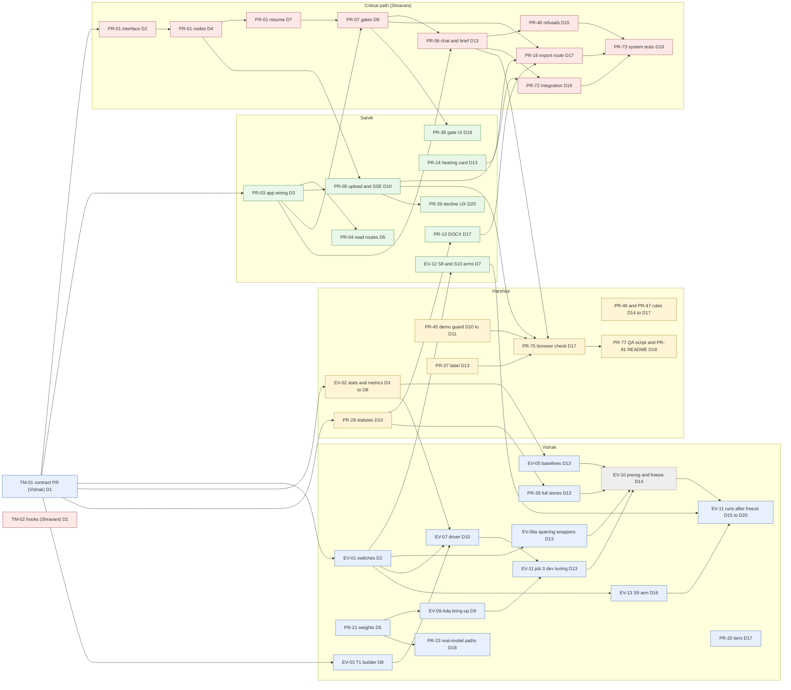

# Team work plan: Vakeel-Sahayak.ai (remaining work)

Index and whole plan for the four-person team. Per-person files (each person edits only their own): [`vishak.md`](vishak.md), [`harshita.md`](harshita.md), [`satvik.md`](satvik.md), [`shravani.md`](shravani.md). Sources: `docs/product-readiness.md` (tasks `PR-01` to `PR-86`, decisions D1 to D11, Preview v0.9), `docs/evaluation-plan.md` (claims, variants S1 to S17, run plan, freeze), `docs/literature-review-and-usage.md` sections 4 to 7, `progress.md`, `DOCKER.md`, `tests/README.md`, and the git history (who built what).

Contents: 0 Summary and assumptions; 1 Team, roles and load; 2 Ownership and shared files; 3 Contract-first day-0 PR; 4 Pull request, review and merge rules; 5 History sync (Wave 0); 6 Waves; 7 Critical path and dependency graph; 8 Sync points, evaluation freeze, definition of done; 9 Evaluation tasks EV-xx and job map; 10 Task index; 11 Risks and what to cut; 12 Decisions needed before Day 1.

## 0. Summary and assumptions

**What the plan does.** It divides the remaining work so that each person owns disjoint directories, works against interfaces frozen on Day 0 or Day 2, and merges small pull requests into `main` in fixed waves. The product target is the **Preview release v0.9** of the readiness plan (flows 1, 2, 3 and 5, live API, gated export, safety UI, verified legal content). The evaluation target is the **core floor** of the evaluation plan: RQ1 main, the sparring 2x2 with the new arms, and the safety set, run after a freeze.

**The honest number.** The committed list below is **72.5 person-days**. Capacity is 61.25 days at 3.5 weeks (17.5, 17.5, 17.5 and 8.75) and 70 days at 4 weeks (20, 20, 20 and 10). The plan is sized to four weeks (104 percent of that capacity, 118 percent of 3.5 weeks). The backlog beyond the committed list is another 136.5 days in ordered "stretch" queues and about 15.5 days of PR work plus the evaluation plan's Tier B and C that are deferred. Everything not committed is either stretch (taken in rank order when someone is early) or explicitly deferred with a reason. Decision T-D3 (section 12) is the one the team must take first.

**Assumptions.**
1. **Day 1 (D1) is the Monday after the history sync** (section 5). Weeks: W1 = D1 to D5, W2 = D6 to D10, W3 = D11 to D15, W4 = D16 to D20. "D0" is the sync day. The exact deadline is 3 to 4 weeks away, so it falls between D17 and D20; tasks marked (T) are the tail that is dropped first if it is D17.
2. Effort numbers are the estimates of `docs/product-readiness.md` (S = 1, M = 2.5, L = 5 person-days) after the scoping cuts of its section 4.4, and the evaluation estimates of section 9 below. They are not measured. The velocity checks at D5 and D10 (section 8) re-baseline them.
3. Harshita's share is deliberately about half; her tasks are well scoped, low in coordination and off the critical path.
4. Nobody runs the test suites against stubs; each person runs the tests of the module they implement, module by module (`tests/README.md`), and `make test-collect` stays clean.
5. Nothing in `progress.md` is edited while this plan runs; each person updates only the status table of their own file. Vishak copies the four status tables into `progress.md` at the end of each week.

**Headline table.**

| Person | Role | Committed (person-days) | Share of the plan |
|---|---|---|---|
| Shravani | Critical path owner: graph, gates, chat, brief, export route, integration and system tests | 20.5 | 28% |
| Vishak | Evaluation lead, models and weights on Ada, data, contract and sync | 21.5 | 30% |
| Satvik | Frontend, DOCX and hearing card, real-API integration | 19.5 | 27% |
| Harshita | Metrics and statistics, legal content, data gaps, small UI items, QA and docs | 11.0 | 15% |
| **Total** | | **72.5** | 100% |

The three full-load people are within 10 percent of each other (19.5 to 21.5). Harshita carries 51 percent of the heaviest load and 54 percent of the mean of the three.

## 1. Team, roles and load

### 1.1 Roles and why (suggestions from the git history; people may swap)

| Person | Built so far | Role in this plan |
|---|---|---|
| Shravani K | core (event log, gates, Makefile, scripts), tool registry pieces, Munshi tool routing, Sarvam, agent animations, test fixtures and fakes | Critical path owner; owns orchestration, record, privacy, tools, the critical-path API routes, integration and system tests, repo hygiene |
| Vishak | Rights engine, Sutradhar, Pairokar and batch desk, stores, frontend foundation, Docker, plan and proposal | Evaluation lead and Ada captain; models, data, stores, Munshi and Peshkar ownership; contract author |
| Satvik Rao | datasets, concordance, gold labelers, truth maintenance, export (first cut), workspace shell and pages, frontend tests | Frontend, DOCX and hearing card, real-API integration; owns API wiring, export, Vakeel, Abhiyojak |
| Harshita Kumari | Peshkar, Vakeel, Abhiyojak, landing page, workspace tabs, fine-tuning and test-set skeletons, many unit tests | Metrics and statistics (tests already written), legal content, data gaps, small UI items, QA, docs |

### 1.2 Load table (person-days, estimates)

| Person | W1 | W2 | W3 | W4 | Committed | Capacity 3.5 weeks | Capacity 4 weeks | Committed / 4-week capacity | Stretch queue (not committed) |
|---|---|---|---|---|---|---|---|---|---|
| Vishak | 5.5 | 5.5 | 5.0 | 5.5 | **21.5** | 17.5 | 20 | 108% | 52.5 |
| Shravani | 5.0 | 5.0 | 5.0 | 5.5 | **20.5** | 17.5 | 20 | 103% | 21.5 |
| Satvik | 5.0 | 5.0 | 5.0 | 4.5 | **19.5** | 17.5 | 20 | 98% | 30.0 |
| Harshita | 2.5 | 2.5 | 2.5 | 3.5 | **11.0** | 8.75 | 10 | 110% | 32.5 |
| **Total** | 18.0 | 18.0 | 17.5 | 19.0 | **72.5** | 61.25 | 70 | 104% | 136.5 |

Committed by kind: 51.5 days of `PR-xx` tasks, 19.5 days of evaluation `EV-xx` tasks, 1.5 days of team tasks (`TM-01`, `TM-02`). Spread of the three full-load people: (21.5 − 19.5) / 20.5 = 9.8 percent. Harshita / mean of the three = 53.7 percent; Harshita / Vishak = 51.2 percent.

### 1.3 If the deadline is 3.5 weeks (D17): what drops first, per person

| Person | Tail items to drop or shrink (about the last 2 to 3 days) | Days saved |
|---|---|---|
| Vishak | PR-23 reduced to OCR, NLI and embeddings only; PR-20; PR-69 part 2 stays as the NOTICE draft | 3.0 |
| Shravani | EV-14 (S15) goes to stretch; PR-73 excludes the slow and real-model variants (already out) | 1.5 |
| Satvik | PR-13 cover note and annexure index as a follow-up; PR-14 layout polish; PR-04 `budget` route | 2.0 |
| Harshita | PR-81 and PR-77 reduced to the three-step install and 10 cases; PR-46 part 2 reduced (a rule that is not verified is switched off, never shown unverified) | 2.25 |

## 2. Ownership table and shared-file rules

### 2.1 Path to owner

Each directory has one owner. Tests follow their package. Paths are under `src/vakeel_sahayak/` unless they start with another top-level name.

| Path | Owner |
|---|---|
| `orchestration/` (except `switches.py`), `record/`, `contracts/`, `privacy/`, `tools/` (except `tools/intake/`), `agents/base.py`, `agents/registry.py` | Shravani |
| `api/routers/chat.py`, `gates.py`, `export.py`, `brief.py` (new) | Shravani |
| `schemas/` (steward of the add-only rule) | Shravani |
| `tests/integration/` (except 3 files), `tests/system/`, `tests/unit/{orchestration, record, contracts, privacy, schemas, config, tools*, agents/base}`, `tests/conftest.py`, `tests/fakes/`, `tests/fixtures/`, `tests/README.md` | Shravani |
| `scripts/git-hooks/`, `scripts/check_commits.sh`, `scripts/run_api.sh`, `.github/`, `Makefile` (steward) | Shravani |
| `configs/budgets.yaml`, `configs/tools.yaml` | Shravani |
| `api/app.py`, `asgi.py`, `deps.py`, `sse.py`, `models.py` (shared add-only), `api/routers/cases.py`, `upload.py`, `events.py`, `desk.py`, `library.py` | Satvik |
| `export/`, `agents/vakeel/`, `agents/abhiyojak/`, `truth_maintenance/` | Satvik |
| `frontend/` (except Harshita's directories below), `frontend/lib/types.ts` and `lib/api.ts` (steward), `frontend/e2e/`, `frontend/tests/` | Satvik |
| `tests/unit/{api (except test_chat_router.py, test_gates_router.py, test_export_router.py), export, truth_maintenance, agents/vakeel, agents/abhiyojak}`, `tests/integration/test_vakeel_abhiyojak_sparring.py` | Satvik |
| `eval/` (except `eval/metrics/`, `eval/stats/`), `testsets/`, `finetune/` | Vishak |
| `models/`, `ingestion/`, `agents/munshi/`, `agents/peshkar/`, `tools/intake/`, `agents/sutradhar/`, `agents/pairokar/`, `batch/`, `pipelines/`, `stores/` | Vishak |
| `configs/eval/`, `configs/models.yaml`, `configs/stores.yaml`, `configs/splits.yaml`, `configs/thresholds.yaml`, `configs/paths.yaml`, `configs/finetune/` | Vishak |
| `scripts/ada/`, `scripts/download_models.sh`, `build_stores.sh`, `build_testsets.sh`, `download_datasets.sh`, `build_interim.sh`, `laptop_overnight.sh`, `setup_dev.sh`; `docker/`, `DOCKER.md`, `data/` (except `data/gaps/`), `NOTICE` | Vishak |
| `docs/evaluation-plan.md`, `docs/preregistration.md` (new), `docs/product-readiness.md`, `docs/literature-review-and-usage.md` | Vishak |
| Tests that follow Vishak's packages (`tests/unit/{eval, testsets, finetune, models, ingestion, pipelines, stores, batch, tools_intake, agents/{munshi, peshkar, sutradhar, pairokar}}`, 3 integration files) | Vishak |
| `eval/metrics/`, `eval/stats/`, `tests/unit/eval/test_metrics.py`, `tests/unit/eval/test_stats.py` | Harshita |
| `rights/`, `tests/unit/rights/`, `configs/rights_rules.yaml`, `configs/bail_sections.yaml`, `data/gaps/` (new) | Harshita |
| `docs/` (everything else: `plan.md`, `proposal/`, `architecture/`, `course/`, `research/`, new `qa/`), root `README.md`, `CHANGELOG.md` | Harshita |
| `frontend/components/landing/`, `components/about/`, `components/workspace/tabs/`, `components/legal/` (new), `components/onboarding/` (new), `app/about/`, `app/help/` (new), `app/welcome/` (new), `lib/i18n/` (new), `messages/` (new) | Harshita |
| `docs/team/vishak.md`, `shravani.md`, `satvik.md`, `harshita.md` | each person their own; `docs/team/README.md` is edited only through a PR that all four review |

The two test files in `tests/unit/eval/` and the three Shravani test files in `tests/unit/api/` are the only file-level carve-outs inside another owner's test directory; they are named here so nobody is surprised.

### 2.2 Shared files and the rules

| File | Steward | Who may edit and how |
|---|---|---|
| `pyproject.toml` | Vishak | Any owner may add a dependency or an extra in a PR that touches only that block (one line each) and tags Vishak; conflicts are resolved by rebase, never by reformatting the file |
| `Makefile` | Shravani | Add-only: new targets at the end under their own comment; no rewrites of existing targets without Shravani |
| `compose.yaml` | Vishak | Changes by others at most 10 lines (for example PR-45 part 2) with Vishak as reviewer |
| `configs/*.yaml` | the per-file owner in 2.1 | A file has exactly one owner; others request changes (below). `configs/models.yaml`, `configs/eval/*` Vishak; `rights_rules.yaml`, `bail_sections.yaml` Harshita; `budgets.yaml`, `tools.yaml` Shravani |
| `progress.md` | Vishak | Frozen during this plan except Vishak's weekly copy of the four status tables |
| `tests/conftest.py`, `tests/fakes/`, `tests/fixtures/` | Shravani | Add-only helpers through a PR that Shravani reviews; no behaviour changes of existing fakes without a ticket |
| `frontend/lib/types.ts`, `frontend/lib/api.ts`, `frontend/lib/mock/`, `frontend/e2e/fixtures/` | Satvik | Anyone may edit in a PR of at most 40 changed lines in these files with Satvik as reviewer; a schema change on the Python side and its TypeScript mirror go in one PR (skeleton convention) |
| `src/vakeel_sahayak/schemas/` | Shravani | Add-only: new files or new optional fields; no renames or removals; the author updates `frontend/lib/types.ts` in the same PR |
| `api/models.py`, `api/routers/__init__.py` | Satvik | Add-only: append your own section or one registry line |
| `orchestration/switches.py` | Vishak | Only through Vishak; fields are frozen by the contract PR |
| `tools/registry.py` (`ALL_TOOL_MODULES`) and `configs/tools.yaml` | Shravani | Add a new tool as in `docs/architecture/skeleton.md` section 2, with Shravani as reviewer |

**How a change is requested.** (1) Open a GitHub issue titled `req:<owner> <one line>` with the exact change and the task ID that needs it. The owner answers within one working day: does it, or says when. (2) For a change of at most 30 changed lines in someone else's file, the requester may open the PR instead; the owner is the reviewer ("hook-in rule"; new features live in the author's own new directory and only the hook-in line goes into the other owner's file). (3) Nobody merges a change in another owner's path without that owner's approval. (4) A failing integration or system test caused by a package is a `co-fix` issue assigned to that package's owner, fixed within one working day.

**Contract changes.** After the day-0 PR (section 3), any change to a frozen shape is a PR labelled `contract` and needs all three of Shravani, Satvik and Vishak to approve.

## 3. Contract-first day-0 PR

One small PR, `feat/contracts-day0` (task TM-01, merged on D1 by noon, reviewers Shravani and Satvik, Harshita acknowledges). It contains **types, stubs, constants and documentation only, no behaviour**, so that backend, frontend and evaluation work in parallel against the same shapes. It is the one PR allowed to touch all the shared files. Where a final field list needs a decision, the PR states it and Satvik and Vishak settle it in review.

| # | Contract | Content frozen | Files touched | Used by |
|---|---|---|---|---|
| C1 | Rights report | The existing `RightsReport` model pinned as the response of the rights read route; per rule: id, status, label, dates used, source, detail, plus nullable `last_verified`, `source_url`, `version`; the e2e fixtures regenerated from it | `schemas/rights_report.py`, `frontend/lib/types.ts`, `frontend/lib/mock/*`, `frontend/e2e/fixtures/*` | PR-04 (Satvik), PR-46 (Harshita), PR-50 |
| C2 | Hearing card | New `HearingCard` model: `concerns[]`, `lead_points[3]`, `conditions_imposed[]`, `open_issues[]`, `banner`, `brief_version`; no rate or probability field of any name | new `schemas/hearing_card.py`, `frontend/lib/types.ts` | PR-14 (Satvik), PR-04, PR-16 |
| C3 | Cause list | `CaseSummary.last_activity` (ISO 8601 UTC, never null, the time of the latest event) | `api/models.py`, `frontend/lib/types.ts` | PR-04, cause-list sort |
| C4 | Library search | Request: `q`, required `before` (YYYY-MM-DD; 422 when missing), optional `court`, `limit`. Hit: adds `sc_root` (string or null) and `good_law` (`status`, `treatment`, `confirmed`). Envelope: `data_cut` date | `api/models.py`, `frontend/lib/types.ts`, library mock | PR-09 (stretch), library page |
| C5 | `Switches` fields | The new fields of evaluation plan section 3.4 with their default (the current behaviour): `retrieval_policy`, `stopping`, `weak_signal`, `graph_expansion`, `store_prior`, `munshi_gap_policy`, `repair_mode`, `critic_mode`, `abhiyojak_isolation`, `draft_mode`, `topology`, `plan_cache`, `urgency_policy`, `output_format`, `defence` flags; `extra="forbid"` kept | `orchestration/switches.py` | EV-01, EV-12, EV-13, EV-14, driver |
| C6 | Evaluation output paths | `data/eval/runs/<run_id>/manifest.json` (system, switches, seeds, budgets, set manifest hash, git SHA), `.../outputs/<system>/<case_id>.json`, `.../scores/<set>.jsonl`, `data/eval/tables/table<N>.csv`, `data/eval/blind.lock`, `data/eval/token_measure.json`, `data/eval/dev_tuning.json`; run ids match `configs/eval/runs.yaml` | `configs/eval/`, `configs/paths.yaml`, `data/README.md` | EV-02, EV-03, EV-07, EV-10, EV-11 |
| C7 | Graph interface (also frozen on D2 by Shravani) | Node names and event kinds of `orchestration/state.py`; entry points `start_run(case_id, kind)`, `resume(case_id, decision)`, `stream_events(case_id, after_id)`; the progress event payload `{step, page, of, eta_s}` | `orchestration/state.py`, `api/sse.py` (types) | PR-01, PR-05, PR-06, PR-07, driver |
| C8 | Gate and dictation routes | Paths and payloads: approve a gate, resolve a checklist item, counsel's answer to a Munshi question, read-back confirm, `GET` the ChangeSet (the gaps named in `tests/README.md`: no route resolves a Gate 2 item for counsel; the ChangeSet is read from SSE today) | stub routers `gates.py`, `chat.py`, `api/models.py` | PR-07, PR-38, PR-05 |
| C9 | New router file | `api/routers/brief.py` (draft start, brief, spar, hearing-prep) registered in `routers/__init__.py`; owned by Shravani | `api/routers/` | PR-06 |
| C10 | Label constant | The text "AI-generated draft. Not legal advice." as one Python constant and one TypeScript constant (the T7 label test, the UI label and the export banner use it) | `schemas/constants.py` (new), `frontend/lib/labels.ts` | PR-37, PR-13, PR-14, PR-16 |
| C11 | Statute data glob | `pipelines/store_builders/statutes.py` also reads `data/gaps/statutes/*.jsonl` with the row format of `data/interim/statutes.jsonl` | `pipelines/store_builders/statutes.py` (input glob only), `data/gaps/README.md` | PR-28, PR-29 |
| C12 | Error shape | `ApiError {code, message, hint?}`; the list of codes used so far; no new codes without a PR | `api/models.py`, `frontend/lib/errors.ts` | PR-36 (stretch), every route |

Not frozen on D1 (frozen when its owner lands the task, announced in the sync): the Settings and health shapes (PR-32, stretch) and the audit-trail JSON (PR-43, stretch).

## 4. Pull request, review and merge rules

**Integration branch.** `main` is the merged baseline and the only integration branch. Every PR targets `main`. There are no long-lived branches: a branch lives at most three working days and is deleted at merge. `ideation-v1` and `ideation-proposal` become read-only after the sync (nobody pushes or opens PRs against them).

**Branch names.** `feat/<area>-<short>`, `fix/<area>-<short>`, `docs/<short>`, `chore/<short>`, for example `feat/api-gates`, `fix/system-t7`, `docs/qa-manual-script`. The suggested names in the per-person files follow this.

**PR size.** One task ID per PR (a task may use several PRs: "part 1", "part 2"). At most about 400 changed lines excluding generated fixtures and lock files; if a PR will be larger, split it by module. A PR that touches another owner's path says so in its first line ("hook-in, at most 30 lines").

**PR title and template.** Title: `PR-03: wire create_app and dependencies` or `EV-07: thin driver and runners (part 1)`. The template (`.github/pull_request_template.md`, created by TM-02) is:

```
Task IDs: PR-xx / EV-xx / TM-xx (one)
Wave and target day:
What changed (3 to 6 lines, plain English):
Paths touched outside my ownership (hook-in, at most 30 lines, owner reviewed): none / list
Contract change: no / yes (label contract)
Tests run (paste the command and the last line of output):
- ruff check src:
- area tests:
- make test-collect:
- frontend (if UI): npm run typecheck, npm run lint, npm test (and e2e if a flow changed):
Screenshots (required for UI changes; before and after):
Checklist:
- [ ] one task ID, at most about 400 changed lines
- [ ] no "# RECONCILED" without a reason on the same line ("# RECONCILED: <why>")
- [ ] no test made to pass by catching NotImplementedError
- [ ] scripts/check_commits.sh origin/main passes (no AI-attribution lines in commits)
- [ ] my status table is updated after merge
Post-freeze label (after eval-freeze-v1 only): post-freeze:fix / arm / product / behaviour
```

**Review rotation.** A PR needs one approval. The first reviewer follows the rotation, so each person learns another person's area.

| Author | First reviewer | Second reviewer (required for) |
|---|---|---|
| Shravani | Vishak | Satvik, for any PR that touches gates, export or the graph (PR-01, PR-06, PR-07, PR-16) |
| Vishak | Satvik | Shravani, for any PR that changes `Switches`, the freeze or the preregistration |
| Satvik | Shravani | Vishak, for the arms in his packages (EV-12) and for anything that touches `export/` output used by F5 and F6 |
| Harshita | the owner of the area she touched: Vishak for `eval/metrics`, `eval/stats`, statutes and rights; Satvik for frontend hook-ins | none; Shravani reviews her QA and README PRs by following them |

Harshita is also a second reviewer, for docs and QA PRs of the others (and reads `docs/team/README.md` changes). The first review comes within one working day; Wave 0 and blockers within four hours. Reviewers check the diff against the task's acceptance line, the tests pasted, and the ownership table.

**Required checks before merge** (the author runs them and pastes the last lines; a reviewer may re-run; the optional CI workflow of TM-02 runs the first three and the commit check):

| Area | Commands |
|---|---|
| Any Python change | `ruff check src`; `make test-collect` (collection stays clean); `scripts/check_commits.sh origin/main` |
| orchestration, record, privacy, tools (Shravani) | `python -m pytest tests/unit/orchestration tests/unit/record tests/unit/privacy -q`; `make test-integration` for graph and gates PRs; `make test-system` once PR-72 is done |
| api and export (Satvik, Shravani) | `python -m pytest tests/unit/api tests/unit/export tests/unit/tools_drafting -q`; `python -m pytest tests/integration/test_api_routes.py -q` |
| agents and truth maintenance | `python -m pytest tests/unit/agents/<name> tests/unit/truth_maintenance -q`; `python -m pytest tests/integration/test_vakeel_abhiyojak_sparring.py -q` |
| ingestion, models, stores, pipelines (Vishak) | `python -m pytest tests/unit/ingestion tests/unit/models tests/unit/stores tests/unit/pipelines -q`; `python -m pytest tests/integration/test_munshi_to_peshkar.py -q` |
| eval, testsets, finetune (Vishak, Harshita) | `python -m pytest tests/unit/eval tests/unit/testsets tests/unit/finetune -q` (only the files of your task; the rest still fail until implemented) |
| rights, configs (Harshita) | `python -m pytest tests/unit/rights tests/unit/config -q` |
| Frontend | `cd frontend && npm run typecheck && npm run lint && npm test`; when a flow changed, `npm run build && npm run e2e` against the production build (not `next dev`) |
| Docker or compose | `docker compose config` and `docker compose build <service>` for the service touched |
| Real models | `make test-models` on the laptop or Ada only; never in CI |

Rules that apply to every PR: no `# RECONCILED` without a reason on the same line (`# RECONCILED: <why>`), and the reviewer must agree with the reason; a test is changed only when it contradicts `docs/plan.md`, never to make it pass; no `# ASSUMPTION:` is silently turned into a fixed value; **no AI-assistant attribution in any commit message, PR description or file** (the shared hook strips it; `scripts/check_commits.sh` fails on it).

**Merge method: squash merge.** One task ID is one commit on `main`: the history reads as a task list, a bad task is reverted with one `git revert`, and the PR title and description become the commit message, so the hook and the check script see only text we control (set GitHub's default for squash to "pull request title and description"). Branch commits inside a PR can be messy. The author merges after approval, updates the branch with `git pull --rebase origin main` (no merge commits into feature branches), and deletes the branch. Nobody force-pushes `main`; protect it (T-D5).

**Co-fix rule.** Integration and system tests are fixed by the owner of the package that fails, labelled `co-fix`, within one working day. Shravani coordinates; she does not fix other people's packages.

## 5. History sync after the history rewrite (Wave 0)

The commit messages were rewritten to remove a trailer, so every commit hash changed. Vishak force-pushes the rewritten `main`, `ideation-v1` and a new `ideation-proposal` that preserves the old `main` history. **After the push, `main` is the merged baseline (the full current project); `ideation-v1` and `ideation-proposal` are read-only.**

**Rule 1: nobody pushes to `main` or `ideation-v1` (or any branch that still contains old commits) until Vishak writes "force-push done" in the team channel.** A push of an old branch would bring the old hashes back.

### 5.1 Vishak (D0), in this order

1. Make sure nobody is mid-push; post "freeze pushes".
2. Create `ideation-proposal` from the rewritten old `main`; push it: `git push origin ideation-proposal`.
3. Push the rewritten `main` and `ideation-v1`: `git push --force-with-lease origin main ideation-v1`.
4. Verify: `git ls-remote origin` shows the new tips; `git log origin/main --format=%B | grep -i 'co-authored-by\|generated with'` prints nothing.
5. Re-target any open GitHub PR to `main` or close it; post "force-push done" with the new tip hash of `main`. Then set branch protection on `main` (T-D5).

### 5.2 Everyone else (run after "force-push done"; about 15 minutes)

Do this in your existing clone. If you would rather re-clone, jump to the last paragraph.

1. **Save what is not on GitHub yet.** For every local branch with commits that were never pushed (including `main` and `ideation-v1`):
   ```
   git status                          # commit or stash local edits first: git stash push -u -m before-sync
   git branch backup/<yourname>-main main
   git branch backup/<yourname>-<branch> <branch>
   git log --format='%H %s' origin/ideation-v1..ideation-v1 > ~/unpushed-<yourname>.txt   # run BEFORE the fetch: it lists your unpushed commits (old hashes)
   ```
2. **Fetch.** `git fetch origin --prune`
3. **Reset local `main` to the new `main`.** `git switch main && git reset --hard origin/main`. **Warning: this discards every local-only commit on `main`.** That is safe only because step 1 saved them under `backup/...`.
4. **Reset the other rewritten branches.** `git switch -C ideation-v1 origin/ideation-v1` and `git switch -C ideation-proposal origin/ideation-proposal` (read-only from now on).
5. **Move your unpushed commits onto the new `main`.** Pick one way:
   - *Rebase onto (keeps the order, easiest for a whole branch).* The old remote tip is still in the reflog of the remote-tracking branch, so:
     ```
     git switch -c feat/<area>-<short> backup/<yourname>-<branch>
     OLD=$(git rev-parse origin/ideation-v1@{1})        # the old pushed tip, before the rewrite
     git rebase --onto origin/main $OLD feat/<area>-<short>
     ```
     If `@{1}` is not what you expect (check with `git reflog show origin/ideation-v1`), take the hash of the last commit you had pushed from `~/unpushed-<yourname>.txt` (the line just above the first unpushed commit in `git log` of the backup branch).
   - *Cherry-pick (best for a few commits).* `git switch -c feat/<area>-<short> origin/main` then `git cherry-pick <hash1> <hash2> ...` using the hashes (oldest first) from `~/unpushed-<yourname>.txt`. A cherry-pick that says "empty" means that change is already in `main`: skip it.
6. **Check.** `git log --oneline origin/main..HEAD` must list only the commits you meant to keep (nothing else, no duplicates of old work); `git diff origin/main --stat` must show only your files; `make test-collect` stays clean.
7. **Install the shared hook** once TM-02 has merged (D1): `make hooks`. Until then the local hook in `.git/hooks/commit-msg` is yours only; it is not shared.
8. Push only your feature branch (`git push -u origin feat/...`), never `main`.

*If your clone is tangled*, clone fresh (`git clone <url> vakeel-fresh`), then bring your commits over from the old clone: `git remote add old ../<old-clone>`, `git fetch old`, and cherry-pick the unpushed hashes. Keep the old clone until your PR is merged.

### 5.3 The versioned hook (task TM-02, Shravani, D1)

The hook in `.git/hooks/commit-msg` is local only. TM-02 adds `scripts/git-hooks/commit-msg` (strips AI-attribution trailers and lines from the message) and a `make hooks` target that runs `git config core.hooksPath scripts/git-hooks`. `scripts/check_commits.sh <range>` is the same check as a script (fails on any attribution line and on `# RECONCILED` without a reason) and goes into the PR template. Everyone runs `make hooks` once after D1.

## 6. Waves: what merges when

Five waves. A wave is a set of merges, not a meeting. The wave table lists every committed PR with its owner, first reviewer (second reviewer in brackets where section 4 requires one) and expected merge day. "p1" and "p2" are the parts of a task that use two PRs.

### 6.1 The schedule

| Wave | ID (part) | Owner | Reviewer | Merge day |
|---|---|---|---|---|
| **0** (D0 to D1) | TM-01 history sync and day-0 contract PR | Vishak | Shravani, Satvik (Harshita acknowledges) | D1 |
| 0 | TM-02 commit hook, `make hooks`, PR template, check script | Shravani | Vishak | D1 |
| **1** (D2 to D8) | EV-01 `Switches` variant table | Vishak | Satvik | D2 |
| 1 | PR-01 graph interface freeze (`orchestration/state.py`) | Shravani | Vishak | D2 |
| 1 | EV-02 p1 statistics | Harshita | Vishak | D3 |
| 1 | PR-03 app wiring | Satvik | Shravani | D3 |
| 1 | PR-01 p1 graph nodes, gates, interrupts | Shravani | Vishak (Satvik) | D4 |
| 1 | PR-04 read routes and pinned shapes | Satvik | Shravani | D5 |
| 1 | EV-02 p2 factor and grounding metrics | Harshita | Vishak | D5 |
| 1 | PR-21 model download and first-run | Vishak | Satvik | D5 |
| 1 | PR-69 p1 NOTICE draft, IPC2BNS email | Vishak | Satvik (Harshita) | D5 |
| 1 | EV-12 p1 S8 self-critique repair arm | Satvik | Shravani (Vishak) | D5 |
| 1 | PR-01 p2 resume and change-set path | Shravani | Vishak | D7 |
| 1 | EV-12 p2 S8 finished, S10 no-isolation arm | Satvik | Shravani (Vishak) | D7 |
| 1 | EV-02 p3 retrieval and agentic metrics, null-agent audit | Harshita | Vishak | D8 |
| 1 | EV-03 T1 builder and manifests | Vishak | Satvik | D8 |
| **2** (D9 to D13) | PR-07 gate routes | Shravani | Vishak (Satvik) | D9 |
| 2 | PR-05 upload, dictation, runner, SSE | Satvik | Shravani | D10 |
| 2 | PR-06 p1 chat and draft routes | Shravani | Vishak (Satvik) | D10 |
| 2 | PR-28 statute gaps (data) | Harshita | Vishak | D10 |
| 2 | EV-07 thin driver, runners, blind lock (includes PR-12) | Vishak | Satvik | D10 |
| 2 | PR-45 p1 strict demo guard | Harshita | Satvik | D10 |
| 2 | PR-45 p2 strict default in compose | Harshita | Satvik (Vishak) | D11 |
| 2 | PR-29 full store build, manifest | Vishak | Satvik | D12 |
| 2 | PR-06 p2 brief, spar, hearing-prep routes | Shravani | Vishak (Satvik) | D13 |
| 2 | PR-14 hearing card | Satvik | Shravani | D13 |
| 2 | EV-05 baselines | Vishak | Satvik | D13 |
| 2 | EV-06a sparring ablation wrappers | Vishak | Satvik | D13 |
| 2 | PR-37 draft label and terms | Harshita | Satvik | D13 |
| **3** (D14 to D17) | EV-10 preregistration and freeze (`prereg-v1`, `eval-freeze-v1`) | Vishak | Shravani, Satvik (Harshita reads) | D14 (hard limit D15) |
| 3 | PR-47 verify case references | Harshita | Vishak | D14 |
| 3 | PR-72 p1 integration tests (graph, API, gates) | Shravani | Vishak | D14 |
| 3 | PR-40 refusals and abstention wiring | Shravani | Vishak | D15 |
| 3 | PR-46 p1 rights rules 1 to 4 verified | Harshita | Vishak | D15 |
| 3 | PR-13 p1 DOCX sections 1 to 7 | Satvik | Shravani | D15 |
| 3 | EV-13 sampling-critic arm (S9) | Vishak | Satvik | D16 |
| 3 | PR-72 p2 remaining integration tests | Shravani | Vishak | D16 |
| 3 | PR-46 p2 rights rules 5 to 7 verified | Harshita | Vishak | D17 |
| 3 | PR-13 p2 List of Dates, annexure index, cover note, banner | Satvik | Shravani (Vishak) | D17 |
| 3 | PR-16 gated export route | Shravani | Vishak (Satvik) | D17 |
| 3 | PR-75 browser-check fix list | Harshita | Shravani | D17 |
| 3 | PR-20 model tiers | Vishak | Satvik | D17 |
| 3 | PR-69 p2 NOTICE and licence list final | Vishak | Satvik (Harshita) | D17 |
| **4** (D18 to D20) | PR-23 real-model paths | Vishak | Satvik | D18 |
| 4 | PR-77 manual QA script | Harshita | Shravani | D18 |
| 4 | PR-81 README quick-start | Harshita | Shravani | D18 |
| 4 | PR-73 system test fixes (flows 1 to 7, T7), several small PRs | Shravani | Vishak | D16 to D19 |
| 4 | Fix PRs from the PR-75 list (labelled `co-fix`) | Satvik, Shravani | rotation | D18 to D19 |
| 4 | PR-38 gate checklist workflow in the UI | Satvik | Shravani | D19 |
| 4 | EV-14 output formats (S15) | Shravani | Vishak | D19 |
| 4 | PR-39 sensitive-matter decline UX | Satvik | Shravani | D20 |
| 4 | Release candidate tag (Preview v0.9) | Vishak | all | D20 |

Evaluation runs (no PRs): EV-09 on Ada D5 to D9; EV-11 part 1 (job 3, dev tuning) D12 to D13; EV-11 part 2 (RQ1 main, B0L, B0S, B6, sparring 2x2) D15 to D20 after the freeze.

### 6.2 Why this order, and what each wave unlocks

| Wave | Dependency reason | What it unlocks |
|---|---|---|
| 0 (D0 to D1) | Every commit hash changed (section 5); the shared shapes must exist before three people code against them | Pushes to `main` are safe; backend, frontend and evaluation can start the same morning against frozen shapes; `make hooks` |
| 1 (D2 to D8) | Only needs the contract PR. PR-03 comes first because three people's routes wait for it; PR-01 is the longest task so it starts on D1; the statistics and metrics are pure functions with tests already written; weights must be on Ada early so GPU time is used from week 1 | A live API (reads) on D5; graph nodes on D4; metrics on D8; the S8 and S10 arms and `Switches` for the evaluation; weights and a real-model smoke on Ada |
| 2 (D9 to D13) | Needs PR-03 and the graph nodes: gate routes, upload with events, chat routes; the evaluation driver needs T1 and the metrics; the full store build needs only the case-law pipeline (the statutes store is rebuilt after PR-28) | Flows 1 to 3 run in a browser on the offline stand-ins; the freeze checklist can go green; the first browser check can start on D14 |
| 3 (D14 to D17) | The freeze needs EV-02, EV-03, EV-05, EV-07 and job 3; the export route needs the gate routes and both export builders | The freeze tag, so the Ada runs start D15; the export before and after Gate 2; the written defect list |
| 4 (D18 to D20) | System tests need integration tests, the export route and the refusals; the gate workflow needs gate routes and the chat route live | Preview v0.9 release candidate; the manual QA script; the README |

Feature freeze for product code is the end of D18; D19 and D20 take fixes only (T-D7).

## 7. Critical path and dependency graph

### 7.1 The critical path has one owner: Shravani

| Step | Task | Days | Planned dates | What must be there first |
|---|---|---|---|---|
| 1 | Graph interface frozen | in PR-01 | D2 | contract PR D1 |
| 2 | PR-01 graph (nodes, gates; resume and change set) | 5.0 | D1 to D7 | none |
| 3 | PR-07 gate routes | 2.5 | D7 to D9 | PR-03 (Satvik, D3) |
| 4 | PR-06 chat, draft, brief, spar, hearing routes | 5.0 | D9 to D13 | PR-03, PR-01 |
| 5 | PR-72 integration tests (fixed per route as each lands) | 1.5 | D13 to D16 | PR-05 (Satvik, D10) |
| 6 | PR-40 refusals wiring | 1.0 | D14 to D15 | PR-06 |
| 7 | PR-16 gated export route | 1.0 | D17 | PR-13 (Satvik, D17), PR-14 (Satvik, D13), PR-07 |
| 8 | PR-73 system tests | 2.5 | D16 to D19 | PR-72, PR-16, PR-40 |

Her work is serial: 18.5 days in a window of 19 working days, with EV-14 (1.5 days) as the first thing she may drop. The inputs she needs from others are all due before she needs them: PR-03 on D3, PR-05 on D10, PR-14 on D13, PR-13 on D17. If PR-13 slips past D17, PR-16 and the flow-3 system tests slip with it: that is the one external risk on the path, and Satvik's scope valves (cover note and annexure index as a follow-up) exist for it.

Near-critical chains: PR-03 then PR-05 then PR-72 (Satvik, 6.5 days of work, then Shravani); PR-13 and PR-14 then PR-16 (Satvik); and the evaluation chain: EV-01, EV-03, EV-07, job 3, EV-10, freeze, runs (Vishak and Harshita).

### 7.2 Dependency graph (task level)



Colours: blue Vishak, red Shravani, green Satvik, yellow Harshita, grey dashed the freeze gate.

## 8. Sync points, evaluation freeze, definition of done

### 8.1 Sync points

| What | When | Who | Length |
|---|---|---|---|
| Stand-up sync | Monday and Thursday: D1, D4, D6, D9, D11, D14, D16, D19 | all four | 15 minutes: blockers and cross-owner dependencies due in the next three days; no status reading |
| End-of-week demo | Friday: D5, D10, D15, D20 | all four | 20 minutes: each person shows what merged, live |
| Velocity check | D5 and D10 (inside the demo) | all four | Each person says days spent against plan. If someone is at least 0.5 day ahead, they pull the next stretch item from their queue; if behind, the item on the tail list (section 1.3) drops at once |
| Evaluation decision on Tier B and C | D12 (evaluation plan E-D5) | Vishak, with the measured tokens per case | decided with the numbers of EV-09 |
| Freeze meeting | D14 | all four | the checklist of 8.2 read out, then the tags |
| Feature freeze | end of D18 | all four | D19 and D20 take only fixes |
| Blockers | any time | whoever is blocked | post in the team channel and tag the owner; the owner answers within four working hours |

### 8.2 The evaluation freeze

**Rule.** The freeze is a commit on `main` that carries the preregistration (`docs/preregistration.md`, git tag `prereg-v1`) and a code tag `eval-freeze-v1`. After it nothing under test is tuned; blind-slice ids are hashed into the preregistration; the scoring entry point refuses blind ids without the tag (EV-07).

**Date.** Evaluation plan section 7.3 puts the freeze at the start of week 2 (D6). That assumed the graph, the exports and the evaluation modules existed; they are stubs today, and the preregistration needs the driver, the metrics, T1 and the dev-tuning run (job 3). The plan therefore proposes **D14 (Thursday of week 3), hard limit D15** (decision T-D1). The Ada window after the freeze is then D15 to D20: about 75 nominal node-hours, about 52 usable after the 30 percent buffer. The preregistration states the floor sizes (RQ1 main at 150 cases and 2 runs for Full and B4, sparring 2x2 at 100 cases) and the claims not run.

**Entry checklist (all must be green on D14):**
1. EV-01 merged; the defaults of `Switches` leave `variant()` equal to `full` (test).
2. EV-02: `tests/unit/eval/test_stats.py` and `test_metrics.py` pass, including the null-agent audit.
3. EV-03: T1 manifests with hashes; the blind ids (80 of the 200) drawn with a seed and hashed; the pool is High Court only.
4. EV-05 baselines and EV-06a wrappers merged.
5. EV-07: the driver completes case-0007 and 10 dev cases with real models on Ada; scripted counsel approves a gate only when the scenario says so; unapproved export still blocked.
6. EV-11 part 1: δ, ε, the pass^3 bar and the answerable-factor rule are written from the 50 dev orders.
7. PR-28 and PR-29 merged (statutes and full stores), so retrieval is the system that will be measured.
8. The measured tokens per case of Full are in `data/eval/token_measure.json`, and the preregistration's run sizes are recomputed from it.

**What may change after the freeze, and how it is tagged.** Every PR after `eval-freeze-v1` that touches a path listed in the preregistration's "systems and sets" carries a label and a title prefix:

| Label | Meaning | Allowed? | Record |
|---|---|---|---|
| `post-freeze:fix` | A bug fix that does not change any system under test | Yes | one line in the "Deviations" section of the preregistration |
| `post-freeze:arm` | Code for a non-default switch value (an arm not yet run: S8, S9, S10, S15, S1, S3, S7, S17); the default Full path is unchanged, proved by the prompt-hash test | Yes, until the arm's first run | a preregistration addendum committed before that arm's first run |
| `post-freeze:product` | API, frontend, export, packaging, documentation (not an input of RQ1 or the ablations) | Yes | none; the numbers do not cover it |
| `post-freeze:behaviour` | Changes how Full behaves | Only for a safety or privacy defect | listed as a deviation in the report; a smoke subset is re-run; tag `eval-patch-<n>` |

Planned post-freeze work and its label: PR-13 and PR-14 are `post-freeze:product` but must merge before the F5 and F6 runs; PR-16, PR-38, PR-39, PR-40 are `product`; PR-23 is `post-freeze:fix` unless it touches the routing ladder (then `behaviour`); EV-12, EV-13, EV-14 are `arm`.

### 8.3 Definition of done

**A PR is done when:** the acceptance line of the task is met; the required checks of section 4 are pasted in the PR; one approval (two where required); squash-merged to `main`; no attribution line; the author's status table says merged with the day.

**A task is done when** all its parts are merged and the tests named for it in the owner's file pass with the default markers.

**The Preview release v0.9 is done when** (from `docs/product-readiness.md` section 4.3, stop-ship lists): `/api/*` is live and the UI never shows demo data unless asked (PR-03, PR-45); flows 1, 2, 3 and 5 run in a browser against the live backend on the offline stand-ins (PR-04 to PR-07); export is refused before Gate 2 at the HTTP layer and the DOCX and hearing card download after it, both carrying the label (PR-13, PR-14, PR-16, PR-37); open NEEDS_REVIEW, UNANSWERED and UNSUPPORTED items block approval in the browser (PR-38); a sensitive-matter upload is declined and purged (PR-39); the seven rules show a verified source and date (PR-46, PR-47); `NOTICE` lists every dataset, model and font (PR-69); `tests/unit`, `tests/integration` and `tests/system` pass with the default markers (PR-72, PR-73) and the failures that remain are in the known-issues list; the first browser check list is written and each item is fixed or listed (PR-75); the README quick-start works on a clean clone (PR-81). Real models run on the lawyer-class machine only to the extent PR-23 reaches; the rest is labelled experimental. The remaining v1.0 items (PR-22, PR-29 distribution, PR-33, PR-62, the clean-machine QA run) are stretch.

**The evaluation core floor is done when:** the freeze tags exist; RQ1 main (Full, B0, B1, B4, plus B0L, B0S, B6) and the sparring 2x2 with the three new arms have saved outputs and manifests; the open 120 are scored; error analysis is written; the blind slice is opened once; the tables carry intervals and the claims that were not run are named as not run.

## 9. Evaluation: EV task definitions and job map

The evaluation plan defines no task IDs of its own (claims C1 to C42, variants S1 to S17, jobs 1 to 33, and the code table of its section 8.3). The stable IDs below map to those sections. "C" is committed, "S" stretch (ranked in the owner's file), "D" deferred. Effort is in person-days of code and operator time, not GPU time.

### 9.1 EV task definitions

| ID | What | Evaluation plan section | Owner | Tier | Days |
|---|---|---|---|---|---|
| EV-01 | `Switches` fields, `variant()` and `for_variant()` table, registry tests updated deliberately | 3.4, 8.3 (switches and variant table) | Vishak | C | 1.0 |
| EV-02 | Statistics (bootstrap, Wilcoxon, Holm, McNemar, cluster bootstrap), core metrics (factor recall, precision and F1, unsupported-fact rate, retrieval, tokens and cost per passed case, stopped-too-early and over-search), the null-agent audit | 4, 5.2, 5.7, 8.2 (metrics, statistics), 8.3 | Harshita | C | 3.0 |
| EV-03 | T1 court-grounded builder, dev (50), open-test (120) and blind (80) manifests, hashed blind ids, High Court pool | 2.6, 8.2 (test-set builders) | Vishak | C | 1.5 |
| EV-04 | T6 chat-question and T7 safety builders (constructed, no manual labels) | 4.5, 4.7, 8.2 | Vishak | S rank 1 | 2.0 |
| EV-05 | Baselines B0, B0L, B0S, B1, B4, B6 and the Full wrapper | 3.1, 8.3 | Vishak | C | 1.5 |
| EV-06 | Ablation wrappers: 06a A2, A8, A9 (sparring 2x2); 06b A1, A3, A4, A6, A7 | 3.4, 8.2 (ablations) | Vishak | 06a C 1.0; 06b S rank 3, 1.0 | 2.0 |
| EV-07 | Thin driver (no LangGraph, scripted counsel), runners, jobs in `configs/eval/runs.yaml`, blind-slice lock; includes PR-12 | 7.3, 5.8, 8.3 (driver, lock, runs.yaml) | Vishak | C | 3.0 |
| EV-08 | Fine-tuning: teacher dossiers, span filter, noise augmentation, dataset, QLoRA, merge; A5 extractors | 7.2 jobs 1, 2, 8; claims C25, C26 | Vishak | S rank 2 | 4.0 |
| EV-09 | Ada bring-up: weights on Ada, real-model smoke, tokens-per-case measurement, teacher pilot data (E-D3) | 7.1 (the number to measure first), 9.2 | Vishak | C | 1.5 |
| EV-10 | Preregistration, tags `prereg-v1` and `eval-freeze-v1`, blind ids hashed | 2.7, 5.8 | Vishak | C | 1.0 |
| EV-11 | Ada operator: part 1 job 3 (dev tuning); part 2 jobs 4, 5, 7 and the arms after the freeze; later stretch jobs | 7.2, 7.3 | Vishak | C (2.0); stretch runs unbudgeted | 2.0 |
| EV-12 | Arms S8 (`repair_mode`, A2b) and S10 (`abhiyojak_isolation`, A8c) in the Vakeel and Abhiyojak packages | 3.3 S8, S10 | Satvik | C | 1.5 |
| EV-13 | Arm S9 (`critic_mode='sampling'`, A8b) as an ablation module, no agent change | 3.3 S9 | Vishak | C | 1.0 |
| EV-14 | S15 output formats (`output_format`, A13) inside `orchestration/structured_output.py` | 3.3 S15 | Shravani | C (tail) | 1.5 |
| EV-15 | S1 self-critique retrieval and S3 stopping variants (A11b) | 3.3 S1, S3 | Vishak | S rank 4 | 3.0 |
| EV-16 | S7 hierarchy-ranked gap re-reading (A11a) | 3.3 S7 | Vishak | S rank 5 | 1.0 |
| EV-17 | S17 injection defences (typed hand-off, spotlighting, cross-check; A15) | 3.3 S17 | Shravani | S rank 3 | 3.0 |
| EV-18 | T2, T3, T8, T9 builders (messy bundles with Augraphy, change sets, speech, citation formats) | 8.2 | Vishak | S rank 12 | 5.0 |
| EV-19 | RQ2 ingestion pipelines P1 to P6 and `munshi_full`; ingestion metrics | 8.2, claims C19 to C24 | Vishak | S rank 13 | 3.0 |
| EV-20 | Features F1 to F8 and the T4 and T5 builders | 8.2, claims C28 to C35 | Vishak | S rank 14 | 5.0 |
| EV-21 | Citation faithfulness by removal and the remaining new metrics | 4.2, 8.3 (new metrics) | Harshita | S rank 7 | 2.0 |
| EV-22 | Tier B and C: S2, S4, S5, S6, S11, S12, S13, S14, S16 and jobs 25 to 33 | 3.3, 7.2 | Vishak | D | n/a |
| EV-23 | `eval/report/` table and figure writers | 6, 8.3 | Vishak | S rank 11 | 2.0 |

Committed evaluation effort: EV-01 1.0, EV-02 3.0, EV-03 1.5, EV-05 1.5, EV-06a 1.0, EV-07 3.0, EV-09 1.5, EV-10 1.0, EV-11 2.0, EV-12 1.5, EV-13 1.0, EV-14 1.5 = **19.5 days**.

Team tasks (not from either plan): TM-01 history sync and day-0 contract PR (Vishak, 1.0), TM-02 hook, PR template, check script (Shravani, 0.5), TM-03 proposal `.tex` and `.pdf` update (Harshita, stretch rank 1, 2.0), TM-04 apply the 25 `docs/plan.md` edits of the literature review (Harshita, stretch rank 2, 2.5), TM-05 request HLDC access (Harshita, D1, under an hour).

### 9.2 Job map (the 24 must jobs of evaluation plan 7.2, Tier A)

Vishak operates every Ada job (EV-11). "Code" is who writes what the job needs. C is committed, S stretch.

| Job | What | EV tasks | Code owner | Tier |
|---|---|---|---|---|
| 1 | Teacher dossiers | EV-08 (pilot in EV-09) | Vishak | S |
| 2 | QLoRA (batch) | EV-08 | Vishak | S |
| 3 | Failure discovery, dev tuning | EV-11 part 1, EV-07, EV-02, EV-03 | Vishak, Harshita | C |
| 4 | RQ1 main | EV-05, EV-07, EV-02, EV-11 part 2 | Vishak, Harshita | C (floor sizes) |
| 5 | B0L, B0S, B6 | EV-05, EV-11 part 2 | Vishak | C |
| 6 | Ablations A1, A3, A4, A6, A7 | EV-06b | Vishak | S |
| 7 | Sparring 2x2 (A2, A8, A9) | EV-06a, EV-11 part 2 | Vishak | C |
| 8 | A5 extractors | EV-08 | Vishak | S |
| 9 | RQ2 vision pages and full system | EV-19, EV-18 | Vishak | S |
| 10 | F2 change sets | EV-20, EV-18 | Vishak | S |
| 11 | F1, F5, F6 baselines and assembly | EV-20 (needs PR-13, PR-14) | Vishak | S |
| 12 | F3 baselines | EV-20 | Vishak | S |
| 13 | F4 no-cache | EV-20 | Vishak | S |
| 14 | T6 tool calling, T7 safety | EV-04, EV-11 | Vishak | S rank 1 (never cut; fallback: the existing `tests/system` T7 scripts) |
| 15 | S8 self-critique repair | EV-12 | Satvik | C |
| 16 | S9 sampling-only critic | EV-13 | Vishak | C |
| 17 | S10 no isolation | EV-12 | Satvik | C |
| 18 | S1 self-critique retrieval | EV-15 | Vishak | S |
| 19 | S3 stopping variants | EV-15 | Vishak | S |
| 20 | S7 gap re-reading | EV-16 | Vishak | S |
| 21 | S15 output formats | EV-14 | Shravani | code C, run S |
| 22 | S17 defences | EV-17 | Shravani | S |
| 23 | Budget sweep (frontier) | EV-11 stretch, needs A7 from EV-06b | Vishak | S |
| 24 | Citation faithfulness by removal | EV-21 | Harshita | S |

Every must job has one owner for its code and Vishak as its operator; the committed ones are 3, 4, 5, 7, 15, 16, 17 (and the code of 21). Tier B and C jobs 25 to 33 are deferred (EV-22).

### 9.3 What the committed capacity buys (claims)

| Claims | Status |
|---|---|
| C1, C2, C3, C4 (Full against B0, B1, B4, B6 on factor recall, unsupported facts, precision guard, tokens) | Run (job 4) |
| C16 (no fabricated citation), C18 (overruled cited), C42 (sources to open) | Run as metrics of job 4 if EV-02 delivers them |
| C7, C8, C13, C28 (sparring against sampling, isolation, self-critique) | Run (jobs 7, 15, 16, 17) |
| C36, C37, C38, C39 (safety) | Run if EV-04 is promoted (job 14); otherwise the existing `tests/system` T7 scripts are the set and the report says so |
| C26, C27 (output format, tool calls) | Code committed (EV-14); the run is stretch |
| C5, C6, C9 to C12, C14, C15, C17, C19 to C25, C29 to C35, C40, C41 | Not run unless promoted (stretch EV-06b, EV-08, EV-15 to EV-20, EV-22); the report names them as not run |

## 10. Task index

Every `PR-01` to `PR-86` appears in exactly one per-person file (checked by a script over the "Task index" line of each file), either committed, in a stretch queue, or deferred with a reason. Efforts in person-days.

| Owner | Committed | Stretch | Deferred (reason in the owner's file) |
|---|---|---|---|
| Shravani (20.5) | TM-02; PR-01, PR-06, PR-07, PR-16, PR-40, PR-72, PR-73; EV-14 | PR-02, PR-10, PR-11, PR-17, PR-43, PR-44, PR-65, PR-66, PR-70; EV-17 | PR-71 |
| Vishak (21.5) | TM-01; PR-12 (inside EV-07), PR-20, PR-21, PR-23, PR-29, PR-69; EV-01, EV-03, EV-05, EV-06a, EV-07, EV-09, EV-10, EV-11, EV-13 | PR-22, PR-24, PR-27, PR-30, PR-33, PR-34, PR-35, PR-62, PR-63, PR-67, PR-83; EV-04, EV-06b, EV-08, EV-15, EV-16, EV-18, EV-19, EV-20, EV-23 | PR-26, PR-31; EV-22 |
| Satvik (19.5) | PR-03, PR-04, PR-05, PR-13, PR-14, PR-38, PR-39; EV-12 | PR-08, PR-09, PR-15, PR-25, PR-32, PR-36, PR-41, PR-42, PR-49, PR-52, PR-53, PR-54, PR-56, PR-57, PR-74 | PR-19, PR-59, PR-60, PR-76 |
| Harshita (11.0) | TM-05; PR-28, PR-37, PR-45, PR-46, PR-47, PR-75, PR-77, PR-81; EV-02 | TM-03, TM-04, PR-18, PR-48, PR-50, PR-51, PR-55, PR-58, PR-61, PR-64, PR-68, PR-78, PR-79, PR-80, PR-82, PR-84, PR-85, PR-86; EV-21 | none |

Counts: 28 committed `PR-xx` tasks (the 24 tasks of the Preview v0.9 list of the readiness plan, plus PR-12, PR-29, PR-73 and PR-77), 51.5 days; deferred `PR-xx`: PR-19, PR-26, PR-31, PR-59, PR-60, PR-71, PR-76 (about 15.5 days, all P2 except PR-76, which the readiness plan puts first on its own cut list).

**Cross-owner dependencies appear in both files.** For each, the "needs from" list of the receiver and the "provides to" list of the giver carry the same item and date; the main ones: contract PR D1 (Vishak to all); graph interface D2 and PR-01 D4 (Shravani to Satvik, Vishak); PR-03 D3, PR-04 D5, PR-05 D10 (Satvik to Shravani, Harshita); EV-01 D2 (Vishak to Satvik, Shravani); EV-12 D7 (Satvik to Vishak); EV-02 D3 and D8 (Harshita to Vishak); PR-28 D10 (Harshita to Vishak and Satvik); PR-37, PR-45 D13 (Harshita to Satvik and Shravani); PR-07 D9, PR-06 D13, PR-16 D17 (Shravani to Satvik and Harshita); PR-14 D13, PR-13 D17 (Satvik to Shravani); PR-75 list D17 (Harshita to Satvik and Shravani); PR-21 install notes D14 (Vishak to Harshita); EV-14 D19 (Shravani to Vishak).

## 11. Risks and what to cut

### 11.1 Risks

| # | Risk | Likelihood, impact (judgement) | Mitigation |
|---|---|---|---|
| T1 | Capacity gap (decision D1 of the readiness plan): committed 72.5 days against 61.25 (3.5 weeks) or 70 (4 weeks) | High, high | Ship the Preview v0.9, not v1.0; tail list (1.3); velocity checks D5 and D10; a fifth person for three weeks would take EV-04, EV-08 and PR-02 first (T-D3) |
| T2 | The critical path has no slack (18.5 of 19 days) and two external inputs (PR-05 D10, PR-13 D17) | Medium, high | Interface frozen on D2; EV-14 is Shravani's first drop; Satvik's scope valves for PR-13; PR-72 is fixed route by route, not at the end |
| T3 | The freeze at D14 leaves one week of Ada time (about 52 usable node-hours) | High, high | Floor sizes stated in the preregistration; job 3 and baselines on dev earlier; claims not run are named as such; if tokens per case are well below 150K (EV-09), the floor grows |
| T4 | The Day-0 force-push goes wrong (lost local commits, old hashes re-pushed) | Low, high | Backups first (section 5), `--force-with-lease`, rule 1, everyone confirms `git log origin/main..` in the channel |
| T5 | Vishak is the single point for Ada, weights, contract, freeze and the data build | Medium, high | Satvik reviews every PR of his within one working day; the Ada recipe is written in EV-09; PR-29 is machine time, not typing time; the stretch queue of Vishak is the most likely to stay unspent and that is accepted |
| T6 | Many tests fail at once when modules land (about 270 `ASSUMPTION` markers and the `SKELETON-GAP` list) | High, medium | Land one module at a time and fix its tests the same day; `# RECONCILED: <why>`; co-fix rule |
| T7 | Export builders (PR-13 on D17) arrive after the freeze and late for PR-16 and the flow-3 tests | Medium, high | PR-14 first (D13); PR-13 part 1 on D15; scope valves; both labelled `post-freeze:product` and must merge before the F5 and F6 runs |
| T8 | Reviewer turnaround blocks the merge schedule | Medium, medium | One working day (four hours in Wave 0); review rotation spreads load; a PR that waits two days is escalated at the next sync |
| T9 | Shared-file conflicts in `types.ts`, `api.ts`, `schemas/`, `pyproject.toml` | Medium, low | Day-0 contract; add-only rules; hook-in rule; stewards |
| T10 | Rights rule verification changes thresholds after the T4 scenarios were built | Low, medium | T4 is stretch; PR-46 lands D15 to D17; any rule change after that rebuilds T4 and is labelled |
| T11 | Harshita's week 4 (3.5 days) is her heaviest and the browser check depends on others' routes | Medium, medium | PR-75 needs only PR-05, PR-06, PR-37, PR-45; the list is due D17; the second pass is stretch |
| T12 | The 4060 cannot hold the models; PR-23 finds unfixable memory problems | Medium, medium | The tier statement (PR-20) and the experimental label; T3 (Ada tunnel) for the demo; known issues |
| T13 | No lawyer reads the rules or the DOCX | High, high | PR-46 and PR-47 from the bare acts, the "last verified" dates, the Gate 2 checklist, and the limits text; the release says no lawyer reviewed unless one did (P-D6, P-D11) |

The risks R1 to R15 of `docs/product-readiness.md` section 7 and the evaluation plan's section 9.2 still apply and are not repeated.

### 11.2 What to cut, in order

1. The tail items of section 1.3 (about 2 to 3 days per person).
2. Stretch is never started before its committed list is done; stretch is taken in rank order.
3. EV-14 (S15) to the stretch queue; then PR-73 without the slow desk test (already out); then PR-72 part 2 reduced to the files whose routes landed.
4. PR-20 and PR-23 reduced: the tier statement is a banner, real-model validation covers OCR, NLI and embeddings only; vision, IndicTrans2 and Whisper go to known issues.
5. PR-13 part 2: the cover note and annexure index become a follow-up.
6. PR-46 part 2: the three rules not verified are switched off in the release.
7. Evaluation: job 4 to 100 cases (the widest intervals still resolve about 7 points); the sparring arms to the cases that fit.

**Never cut** (from the readiness plan): gates enforced in code (PR-01, PR-07, PR-16, PR-38); the privacy boundary (PR-05 purge, PR-39); source links and corpus-rendered citations; the label (PR-37); no outcome predictions (PR-14, PR-40); the demo guard (PR-45); the licences (PR-69); verified rules with dates or the rules switched off (PR-46, PR-47). From the evaluation plan: safety (job 14), the sparring 2x2, the blind slice, the null-agent audit, the preregistration, failure discovery (job 3).

### 11.3 The dial between product and evaluation

Moving days between the two is the real choice behind T-D3. Examples of one-for-one swaps the team can make at the D5 check without changing anyone's ownership:

| Take from the product side | Gives to the evaluation side |
|---|---|
| PR-23 down to 1.0 day (Vishak) | EV-04 T6 and T7 builders (2.0), makes job 14 real |
| PR-20 dropped to a banner (Vishak, 1.0) | half of EV-06b (A1, A3, A4, A6, A7 wrappers) |
| PR-39 and PR-38 stay (never cut); PR-77 and PR-81 shrink (Harshita, 0.5) | EV-21 first half (citation metric) |
| Satvik's PR-14 polish (0.5) | EV-12 is already committed; nothing to give |

Global promotion order when capacity appears (first to be taken): EV-04, EV-08, PR-02, PR-49, TM-04, TM-03, EV-06b, PR-10, EV-15, PR-22, PR-36, PR-86.

## 12. Decisions needed before Day 1

Three groups: the readiness plan's D1 to D11 (prefix P-), the evaluation plan's D1 to D11 (prefix E-), and decisions this plan adds (prefix T-). Each has a recommendation; the team confirms or changes it at the D1 sync.

### 12.1 New decisions of this plan

| # | Decision | Options | Recommendation | By |
|---|---|---|---|---|
| T-D1 | Date of the evaluation freeze | Start of week 2 (D6, evaluation plan 7.3), D14 (this plan), later | D14, hard limit D15, with the entry checklist of 8.2; D6 is not reachable because the graph, driver, metrics and T1 do not exist | Day 1 |
| T-D2 | Merge method | Squash, merge commit, rebase | Squash (section 4) | Day 1 |
| T-D3 | The capacity gap and the product-versus-evaluation split | Commit the 72.5-day list as planned (4-week sizing), add a fifth person for three weeks, move the deadline, cut scope further (11.2) | Commit the list; decide on a fifth person at D5 using the velocity check; if one arrives, they take EV-04, EV-08, PR-02 first | Day 1, again at D5 |
| T-D4 | Who holds which Ada account and who is session captain | Vishak captain; the other two accounts to whoever runs jobs | Vishak captain; write the three account holders in the channel on D1 so job runs have a second operator | Day 1 |
| T-D5 | Branch protection on `main` | none, one approval, one approval plus checks | One approval, squash only, no force-push, branches deleted on merge; Vishak sets it after the sync (needs repository admin) | D0 |
| T-D6 | Variant arms after the freeze | Not allowed, allowed with an addendum | Allowed as `post-freeze:arm` with the prompt-hash test and a preregistration addendum before the arm's first run | Day 1 |
| T-D7 | Feature freeze of product code | End of D18, later | End of D18; D19 and D20 are fixes | Day 1 |
| T-D8 | Review turnaround | Same day, one working day, two | One working day; four hours in Wave 0 and for blockers | Day 1 |
| T-D9 | What happens to `ideation-v1` and `ideation-proposal` | Delete, keep read-only | Keep read-only until D20, then Vishak decides | D0 |

### 12.2 From the readiness plan (`docs/product-readiness.md` section 8)

| # | Decision | Recommendation | Needed by |
|---|---|---|---|
| P-D1 | The capacity gap | Ship the Preview v0.9 (this plan), a fifth person if anyone is free | Day 1 (see T-D3) |
| P-D2 | Default hardware tier | T1 laptop as the product default, T2 an option, T3 (Ada tunnel) for the demo only; measure T1 quality in week 2 | D2 (shapes PR-20, PR-21, PR-23) |
| P-D3 | Where the 2 GB index is hosted | Hugging Face dataset or a release with the CC BY 4.0 attribution inside | Week 2 (only if PR-30 is promoted) |
| P-D4 | IPC2BNS-Verify licence | Email the authors now (Vishak, D2); if no answer by the end of week 3, exclude it from the shipped index and keep it for evaluation | D2 and D15 |
| P-D5 | Product changes after the freeze | Only tagged patches for agent behaviour; the rest unrestricted (section 8.2 labels) | Day 1 |
| P-D6 | Who verifies the Rights Radar rules | The team from the bare acts (PR-46), and a read by any available lawyer; the guide says no lawyer reviewed unless one did | Week 1 |
| P-D7 | Public image registry | GHCR public (only if PR-63 is promoted) | Week 3 |
| P-D8 | Sarvam consent UI | Ship the off-by-default switch and the banner if PR-42 is promoted; otherwise keep `VS_SARVAM=off` fixed in the release | Week 3 |
| P-D9 | Windows and macOS support | One tested Windows machine; macOS documented as CPU-only (only if PR-64 is promoted) | Week 3 |
| P-D10 | Default retention | Keep until deleted, with a delete button (PR-44 stretch) | Week 2 |
| P-D11 | Who the Preview is for | Staff and a trusted lawyer under supervision; not a real client's file until P-D6 and the manual QA pass | Week 3 |

### 12.3 From the evaluation plan (section 9.1)

| # | Decision | Recommendation | Needed by |
|---|---|---|---|
| E-D1 | Blind slice | Post-April-2025 orders if at least 80 exist (count them in EV-03), else a random 80 of the 200 | Before the freeze (D14) |
| E-D2 | Driver without LangGraph | Thin driver (EV-07); the real gates are tested in T7 | Week 1 (decided) |
| E-D3 | Teacher: API or Qwen3-32B | The pilot in EV-09 decides; the API saves 45 to 60 node-hours | D9 |
| E-D4 | Values of δ, ε and the pass^3 bar | Fix on the 50 dev orders (job 3), round to whole points | D13 |
| E-D5 | Which Tier B and C variants to run | Decide from the measured tokens per case; the plan assumes none are run | D12 |
| E-D6 | RQ1 headline | Recall with the precision guard together (C1 with C3) | D14 |
| E-D7 | Sarvam as a labeler | Only for public-text relabeling, optional | Optional |
| E-D8 | IL-PCSR availability | Check the data card in EV-03; run only if available | Week 1 |
| E-D9 | Hindi slice: HLDC or NLLB | NLLB for main runs; Harshita requests HLDC on D1 (TM-05) | D1 |
| E-D10 | A `FORMAT` error class | Add it (small, in `eval/failure_analysis.py`, Vishak) | Week 1 |
| E-D11 | Sessions per account in the peak week | Check cluster rules; this plan assumes the post-freeze window of D15 to D20 | Day 1 (see T-D4) |
