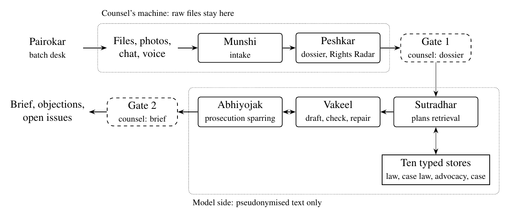

# Vakeel-Sahayak.ai explained: from zero to hero

This guide explains the whole system in plain words, and then goes deeper where the code and the measurements are. Every number comes from a file in this repository, and each section ends with a short source note. Terms are defined where they first appear, and a glossary sits near the end.



*The six agents, the two approval gates (dashed) and the ten typed stores. The left half runs on counsel's machine, where the raw files stay. The right half works only on pseudonymised text.*

Contents

1. The problem in plain words
2. The idea: a harness, not a bigger prompt
3. One case from start to finish
4. Each part and how it is built
5. Why each decision was made
6. What happens when you remove a part
7. The results in context
8. Why it works and why it has potential
9. Glossary
10. Where to look in the code

---

## 1. The problem in plain words

### The lawyer and the pile of papers

Picture a legal-aid lawyer in India. A person has been in jail for months, waiting for trial, and cannot afford a private lawyer. The lawyer must file a regular bail application. The papers arrive as a pile:

- a High Court order, and a scanned Sessions Court order;
- a phone photo of the first information report (the FIR, the police record that starts a case), often in Hindi;
- remand orders (court orders that keep the person in custody) and a custody certificate;
- all of it often merged into one PDF.

From this pile the lawyer must write a brief. A good brief is a list of grounds, each one a reason why bail should be granted, such as "the person has already spent a long time in custody" or "a co-accused with the same role is already on bail". A ground is only as good as the facts and the law behind it.

### What goes into a brief

A bail brief needs five kinds of knowledge, and they have different shapes:

1. **The exact text of the statute.** You look this up by section number. There is no "similarity" involved.
2. **The old-to-new section map.** In 2024 India replaced the IPC and the CrPC with the BNS and the BNSS. An old section number maps to a new one, and the map is a graph, not a document.
3. **What courts have said on each bail factor.** A bail factor is a standard consideration, such as flight risk, risk of tampering with witnesses, or the length of custody. This is reasoning text, hundreds of thousands of paragraphs of it.
4. **The citation history of each authority.** A judgment that was later overruled is no longer good law, and citing it is an error. You need the graph of which judgment cites which.
5. **The case timeline.** Dates decide things. If the charge sheet was not filed in time, the person may have a right to default bail. If the custody has crossed a legal fraction of the maximum sentence, a different right arises.

No single search index serves all five. This is the engineering problem underneath the legal one.

### Why a plain chatbot fails

Give a general chatbot the same pile and ask it for a bail application. It will produce fluent text, and that is exactly the danger:

- It **invents facts.** If the record does not say whether the accused has a previous case, a chatbot will often write a sentence as if it did.
- It **invents case law.** It will cite a judgment with a plausible name, court and paragraph that does not exist, or one that does not say what the sentence claims.
- It **cannot show its work.** The lawyer cannot tell which sentence came from the record and which came from the model's memory.
- It **does not know what it does not know.** A missing document should become a question for the lawyer, not a smooth paragraph.

A wrong fact in a bail brief is not a typo. It can cost a client their liberty, and it can cost the lawyer credibility in front of the judge.

Source: `docs/technical-report/technical_report.tex` (Introduction), `docs/plan.md` section 1.2.

---

## 2. The idea: a harness, not a bigger prompt

The tempting fix is a bigger model or a longer prompt: "be careful, do not invent". The project takes a different route. The language models stay ordinary. What is added is a **harness**: a controlled scaffold of code around the models, so that a model cannot hand the lawyer an unchecked sentence.

The harness has four ideas.

**Evidence contracts.** For each of twelve bail factors, a small file says what a ground on that factor needs: for example "an order for the co-accused (required)", "two authorities (needed)", "a good-law check (required)". It also says which stores may hold each item. If a required item cannot be found, that is not hidden. It becomes an open issue for the lawyer.

**Per-sentence checks.** Every sentence the drafter writes carries a marker that points to its source: `[F:field]` for a case fact, `[A:doc#para]` for a paragraph of a cited judgment. A checker tests the sentence against that source. A sentence that fails is repaired, or withheld and listed for counsel. Nothing is dropped silently.

**A simulated prosecutor.** A separate agent, with its own prompt and its own stores, argues the State's side and raises objections against the draft. The lawyer sees them before the court does.

**Two counsel gates.** The lawyer must approve the facts (Gate 1) before anything is drafted, and approve the brief (Gate 2) before anything can be exported. The code, not a prompt, enforces this. An agent cannot approve its own gate.

The research claim is about this harness. The project asks whether a structured, specialised multi-agent architecture grounds bail drafting better than simpler systems using the same model, and which design decisions account for any gain. The answer was found by testing, including by finding out where the first version failed.

Source: `docs/technical-report/technical_report.tex` (Introduction, Methodology), `AGENTS.md`.

---

## 3. One case from start to finish

### A real worked case from the evaluation: t1dev-019

The technical report follows one development order, **t1dev-019**: an anticipatory bail petition (a request for bail before arrest) in the Andhra Pradesh High Court, with only 871 characters of facts. It is a short record, which makes it a good example of what the system does when the record is thin.

What happened:

- The dossier agent found **ten fields unsupported** by so short a record. Each became a question for counsel instead of a guess.
- The orchestrator planned **five bail factors** and made **115 store calls** to gather evidence.
- The ground on a weak prima facie case cited *Kunal v. State* (Delhi High Court, 2024, para 7). The checker found that the cited paragraph supports the sentence (entailment score 0.99).
- The grounds on gravity and on witness tampering each **failed a first check on one sentence**, and each was repaired against the retrieved authority.
- The ground on antecedents (the accused's past cases) **could only say that the record is silent**. So it left the argument and became an open issue for counsel.
- The simulated prosecutor raised **six objections**: two answered, two partly answered, two unanswered.
- Scripted counsel approved the dossier but not the brief, and the system **refused the export**.

Notice what did not happen. There is no invented antecedent paragraph, no case name made up to fill a gap, and no export without approval.

### A recorded demo case: case 01, cheating with a co-accused already on bail

The repository ships six recorded synthetic demo cases (no real client record) under `demo/cases/`. Case 01 is a good walk, because each stage shows a real number from the recorded run (Sarvam-105B, recorded 15 November 2026, cost INR 5.58).

The story: Accused-1 is charged under IPC 420 and 406 for taking an advance of Rs. 6,50,000 for machinery that was never delivered. He has been in custody since 12.03.2024. The charge sheet was filed in time. His earlier bail application was rejected, but Co-accused-2, with a comparable role, is on bail.

The nine tour steps, with the recorded numbers:

| Step | What happened |
|---|---|
| Intake (Munshi) | Counsel uploaded 11 PDFs at once. Munshi read every page by text layer, named 11 documents, and filed 9 dated events and 2 charged sections. The papers answered every checklist item, so intake asked nothing. |
| Dossier (Peshkar) | 13 dossier fields: 12 from the papers (each with the quoted sentence and page), 0 from counsel, 1 left open (the FIR). The List of Dates has 9 entries, each tied to its page. |
| Gate 1 | Counsel acknowledged the one unsupported field and approved. Nothing is drafted before this. |
| Rights Radar | Seven rules run as date arithmetic and statute tables, with no language model. Default bail: WINDOW_CLOSED (the charge sheet came on day 55 of 60). Undertrial limit (BNSS s.479): NOT_YET, reached on 11.09.2027. |
| Brief (Sutradhar and Vakeel) | 9 factors planned, 56 store calls. Vakeel drafted 8 grounds (8 supported). 15 sentences the checker could not support were withheld, leaving 1 ground for counsel to draft. 18 open issues are listed for counsel. |
| Sparring (Abhiyojak) | 16 objections raised in 2 rounds; 5 ungrounded objections were discarded. Vakeel replied to 5 and Abhiyojak judged each: 0 answered, 3 partly, 2 unanswered. 11 objections got no judged reply because the sparring token budget ran out, and are left for counsel. |
| Hearing card | 5 likely questions from the bench with answers, 3 grounds to lead with, 2 bail conditions counsel can offer. It predicts nothing and gives no grant rate. |
| Gate 2 | The export call before approval was refused (HTTP 403). The checklist has 14 items for counsel (1 unsupported field and 13 unanswered objections). |
| File | After Gate 2, export writes four Word files: the application, the List of Dates, the objections sheet and the hearing card. Each is labelled a draft. |

Two other demo cases show other inputs. Case 03 has a Hindi FIR (Devanagari text layer) with eight English documents; Munshi named the documents in English and Hindi and asked counsel one question. Case 04 has a scanned seizure memo, an image-only page; Munshi read it by OCR (optical character recognition, which turns an image of text into text), and the Rights Radar reported a statutory bar (BAR_APPLIES) because the charge is a commercial quantity under the NDPS Act (the narcotics law).

One honest note from the recorded run: in case 01, 11 of 16 objections were left to counsel because the sparring budget ran out. Section 5 explains how this was found and what was done about it.

Source: `docs/technical-report/technical_report.tex` (A worked case), `demo/cases/01-cheating-parity/tour.json`, `demo/cases/03-ndps-small-hindi/tour.json`, `demo/cases/04-ndps-commercial-scanned/tour.json`.

---

## 4. Each part and how it is built

The code lives in `src/vakeel_sahayak/`. The sections below follow the case flow.

### 4.1 The six agents

Each agent is named after a role in an Indian court office, and each makes one narrow decision. That narrowness is deliberate (see section 5).

| Agent | Court-office role | Decides | Module |
|---|---|---|---|
| **Munshi** (intake) | the clerk who keeps the papers | how to read each page, where to split the bundle into documents, what is missing | `agents/munshi/`, `ingestion/` |
| **Peshkar** (dossier) | the court reader who keeps file and dates | the dossier fields, the List of Dates, the Rights Radar | `agents/peshkar/`, `rights/` |
| **Sutradhar** (orchestrator) | "the one who holds the strings" | which factors to argue, which stores to query per factor, when to stop | `agents/sutradhar/` |
| **Vakeel** (drafter) | the advocate | how to argue each ground; repair or flag each failed sentence | `agents/vakeel/` |
| **Abhiyojak** (prosecution sparring) | the prosecutor | which objections to raise; whether each reply answers them | `agents/abhiyojak/` |
| **Pairokar** (batch desk) | the person who follows up cases | the order of work across many files | `agents/pairokar/`, `batch/` |

All agents share a base class (`agents/base.py`) that charges token budgets, refuses calls that would exceed them, and routes every tool call through one runtime so that it is logged.

**Munshi** reads each page through a routing ladder (`ingestion/ladder.py`): text layer first, then a layout parser, then clean-up plus OCR, then a vision model, and finally "ask counsel". A page climbs only as far as it needs to. A page that fails every route is marked UNREADABLE for counsel, never guessed. Munshi also splits a merged PDF into documents, names their types (FIR, remand order, custody certificate and so on), files dated events, and asks counsel only about what is missing. Hindi and voice input are handled in `ingestion/hindi.py` and `ingestion/voice.py`.

**Peshkar** builds the **dossier**, a structured summary of the case with 13 fields, each carrying a source quote and page (`agents/peshkar/fields.py`). A field the papers do not support is marked UNSUPPORTED, and counsel must acknowledge it at Gate 1. Peshkar also builds the List of Dates (`agents/peshkar/dates.py`) and runs the **Rights Radar** (`rights/`). The Radar is a deterministic rules engine with seven rules, one file each in `rights/rules/`: default bail, undertrial limit (BNSS s.479), notice of appearance, grounds of arrest, production within 24 hours, Antil category (a Supreme Court classification of offences for bail), and statutory bar (such as NDPS s.37). It is code, not a language model, so each result names its rule and the dates it used. The statute tables behind it are built by script from the official PDFs (`configs/first_schedule_*.jsonl`).

**Sutradhar** is the planner. For each factor it picks favourable, adverse or not applicable from the dossier and the Rights Radar (`factor_pick.py`). Then, in lock-step rounds so that a run is reproducible, it plans a `RetrievalPlan` for the unfilled slots of the factor's contract, runs the calls, and rates each slot FILLED, WEAK or MISSING by rule checks (`slot_rules.py`). For slots that fall short it rewords the query, relaxes filters in a fixed order (`relaxation.py`), follows the citation graph, or tries another allowed store. A factor stops when its required slots are filled, its budget is spent, or nothing is left to try. Slots still short become open issues. Sutradhar also routes counsel's chat questions and re-runs only the affected factors after a change.

**Vakeel** drafts one ground per chosen factor. Every sentence ends with a marker (`[F:...]` or `[A:...]`, parsed in `agents/vakeel/claims.py`). Citation text is rendered from corpus metadata, so an unknown document id is an error and a case name is never invented. A fact that counsel stated, but the papers do not show, gets the label "per counsel, not on record". Vakeel also writes replies to objections and assembles the hearing card (`agents/vakeel/hearing.py`).

**Abhiyojak** plays the prosecution. Its input is built from an allow-list (`agents/abhiyojak/isolation.py`): the drafted grounds with their authorities, the dossier facts, and its own three stores (the objection bank, the refusal reasoning in case law, and the statutes). It never sees Vakeel's plan, notes or working state, so it cannot simply agree with them. This is enforced at runtime: a payload carrying a forbidden key raises `ContextIsolationError`. Each objection must be grounded in something it was actually offered; ungrounded ones are discarded and logged. After Vakeel replies, Abhiyojak marks each reply ANSWERED, PARTLY or UNANSWERED with a reason.

**Pairokar** serves a legal-aid office with hundreds of files. It builds a triage card per case and orders the work by a fixed, explainable rule (`batch/urgency.py`): first legal deadlines (a default-bail window open or about to open, an s.479 threshold about to be reached or already crossed), then days past a threshold, then custody length; ties go to the case with no missing documents. Nothing in the order is learned or estimated, so it can always be explained to a person.

### 4.2 The ten typed stores on four shelves

The agents search ten stores (`stores/registry.py`), each built for the shape of its knowledge:

| Shelf | Store | What it holds | How it is searched |
|---|---|---|---|
| Law | `law.statutes` | statute text | exact lookup by section |
| Law | `law.concordance` | the IPC/CrPC to BNS/BNSS map | typed graph |
| Case law | `caselaw.reasoning` | reasoning paragraphs of court orders | hybrid text and vector search |
| Case law | `caselaw.citations` | which judgment cites which, with good-law status | graph |
| Case law | `caselaw.similar` | whole-order fact vectors | vector search |
| Advocacy | `advocacy.arguments` | defence arguments by factor | search, never cited as authority |
| Advocacy | `advocacy.objections` | prosecution objections by factor | search, never cited as authority |
| Case (private) | `case.docs` | the client's documents | search |
| Case (private) | `case.timeline` | dated events | date queries |
| Case (private) | `case.facts` | the dossier | field lookup |

The build holds 161,708 reasoning paragraphs, 70,880 arguments, 55,161 objections and 5,842 citation edges, all from public court text (Open India Law: 115,524 of 115,988 bail-related orders read feed the stores). Retrieval is hybrid: metadata filters first, then BM25 and dense-vector rankings combined by reciprocal rank fusion, with a leakage guard (`stores/leakage_guard.py`) so that a case never sees orders dated after its own. The advocacy shelf is used for coverage and phrasing only. It is never cited as authority.

### 4.3 Evidence contracts

A contract is a YAML file per factor in `contracts/factors/` (twelve in all, from `antecedents.yaml` to `witness_tampering.yaml`). Here is the parity contract, abridged:

```yaml
factor: parity_with_co_accused
applies_if: "a co-accused has been granted bail"
slots:
  co_accused_order: {need: required, stores: [case.docs, case.timeline]}
  role_comparison:  {need: required, stores: [case.docs]}
  authority:        {need: 2, stores: [caselaw.reasoning, caselaw.similar]}
  good_law:         {need: required, stores: [caselaw.citations]}
  likely_objection: {need: 1, stores: [advocacy.objections]}
  argument_patterns:{need: optional, stores: [advocacy.arguments]}
budget: {store_calls: 8, tokens: 12000}
```

The contract fixes what is needed and where it may be. Sutradhar decides the order of calls, the query, whether a result is sufficient, and when to stop. A required slot that stays empty becomes an open issue with the slot's name in the event log. This is how "the record is silent" turns into a visible item rather than an invented sentence.

### 4.4 The claim checker and repair

Vakeel checks every claim sentence by sentence (`agents/vakeel/agent.py`):

- **fact support:** the sentence is tested against the dossier quote;
- **authority support:** the sentence is tested against the cited paragraph, with a natural-language-inference (NLI) model (`models/nli.py`; NLI judges whether a source text entails a sentence);
- rule checks: statute lookup, section mapping, the good-law flag, and "no citation that was not retrieved".

A failed authority is re-retrieved through Sutradhar or swapped. A failed sentence is reworded to what its source supports. This runs at most two rounds. A claim that still fails is NEEDS_REVIEW with its reason in the open issues. Every decision is an event with actor VAKEEL.

### 4.5 The switches

Every design choice that could be tested is an opt-in field in one typed object, `orchestration/switches.py`. The default of every field leaves the output byte-identical to the base system (golden digests in the tests guard this). An ablation is a flag the agents read, never a code fork.

The families are:

- **Baselines B0 to B6**, simpler systems on the same model (listed in section 7).
- **Ablations A1 to A10**, each removing one part (listed in section 6).
- **Variants S1 to S18**, each adapting one idea from a paper (self-critique retrieval, sufficiency-based stopping, a three-role review and others). Each has a row in `docs/literature-to-code-map.md` with its paper, switch, module and test.
- **Intake arms P5 to P8**, which change how Munshi reads pages.
- **Fixes X1 to X8**, which came from the failure analysis (section 5).

The chosen final system, called VS-Final in the report and `c1457` in the code, is Full plus four switches, defined in `C1457_SWITCHES`:

```python
C1457_SWITCHES = {
    "signal_source": "merge",           # X1
    "abstention": "strict",             # X4
    "draft_source": "facts_text",       # X5
    "objection_grounding": "by_id",     # X7
}
```

The product configuration, `production_switches()`, is those four plus the sparring reserve (below). The validator refuses switch combinations that conflict.

### 4.6 The event log

Every action is appended to a SQLite event log (`record/event_log.py`). The table has triggers that abort any UPDATE or DELETE, so the log is append-only. The dossier, the brief and the sparring record are views over this log (`record/views.py`), not separate copies. This gives three properties: a case can be replayed, every decision can be audited, and approvals are facts in the log that no agent can write.

### 4.7 The gates

Approvals are enforced in `record/gates.py` and used by `orchestration/gates.py`:

- `approve_gate` is the one function that writes GATE_APPROVED, always with actor `counsel`. The log itself refuses an approval from anyone else (`ApprovalNotFromCounsel`).
- Agents can only **open** a gate. Inside the LangGraph run, `await_gate` opens it and pauses. On resume it reads counsel's approval from the log, never from the resume value.
- A gate cannot be approved while the checklist is open, unless counsel acknowledges each item (`ChecklistNotCleared`). The checklist holds unsupported dossier fields, NEEDS_REVIEW grounds and UNANSWERED objections.
- Gate 2 stores a `brief_hash`. If the brief changes after approval, the hash no longer matches and the gate is treated as closed again. Export raises `GateNotApproved` before Gate 2.

On the sealed evaluation, each of the four tool-using systems tried one export per order before Gate 2, and the code refused all 320 attempts.

### 4.8 The privacy boundary and pseudonymisation

Raw client files stay on the lawyer's machine. When text must go to a hosted model, it first passes the pseudonymisation boundary (`privacy/`):

- `pseudonymise.py` replaces names with stable per-case aliases (Accused-1, Co-accused-1, Complainant-1, IO-1 and so on). The alias map is local only. It is never written to the event log and never sent out.
- `quasi.py` replaces quasi-identifiers (FIR and case numbers, police stations, villages, addresses, vehicle numbers, ages) with aliases and shifts every date by a per-case offset.
- `boundary.py` is the check on the way out. It refuses binary or media data, the case's real names, and, on the wire to a hosted model, any quasi-identifier or learned name still in the text, even glued to another word.
- `injection_guard.py` wraps untrusted document text so that instructions hidden in a scanned page are treated as data.

On the 250 orders of the main test set, no FIR number, case number or numeric date survived, and the boundary refused the 5 orders where OCR had glued names to other words. During the sealed run it refused 175 outgoing payloads that still carried a personal name. External model services are off by default, gated by `VS_EXTERNAL=off|public|pseudonymised|consented`, plus per-case consent. A provider on a free tier is configured as public-only: client text never goes to it in any mode.

### 4.9 The paid-provider lock

OpenAI and Sarvam cost money. By the owner's decision of 28 October 2026 they are locked in code (`models/paid_lock.py`). Unless `VS_ALLOW_PAID=openai,sarvam` names them, every call is refused before anything touches the network, and the factory answers from the local client instead. The lock is checked in four places: the shared privacy gate, the spend-ledger entry points, and the HTTP transports. Spend is capped in code as well (OpenAI at 5 USD, Sarvam in INR). The point is that budget discipline does not depend on anyone remembering.

### 4.10 The sparring reserve

In the frozen evaluation, drafting and repair used up the token budget before Abhiyojak's reply and judge calls could run. So most objections were raised but never judged. The product therefore has an opt-in switch, `sparring_reserve_tokens` (200,000 in `production_switches()`), which gives Abhiyojak and the reply step their own token pool, separate from the drafting budget.

With the reserve on:

- Judging is **interleaved**: objection 1 is replied to (draft, check, repair) and judged, then objection 2, and so on, instead of all replies and then all judgements.
- The pool has a priority order: first the judge call for a reply already drafted, then drafting a reply, then repair. A holdback of 4,500 tokens is kept so that a repair cannot spend the pool the judge needs.
- Before each objection, the system compares the pool left with the running average cost of the objections done. If another does not fit, drafting stops.
- An objection the pool cannot cover gets no model call and is marked `NOT_REPLIED_BUDGET`. It stays UNANSWERED in the schema (so every consumer already treats it as counsel's), but its reason says plainly that no reply was drafted because the budget was spent. It is never shown as a judged failure.

Source: the module docstrings named above, `docs/plan.md` sections 3 to 11, `docs/handoff/objections-unanswered-2026-11-15.md`, `docs/technical-report/technical_report.tex` (Methodology, Final Method, Tools and approvals).

---

## 5. Why each decision was made

### 5.1 Why separate agents, one per court-office role

The plan's engineering analysis (section 1.2 of `docs/plan.md`) lists five problems that do not look alike: messy inputs, knowledge of different shapes, deciding what to fetch from where, a case that keeps moving, and scale. The agents are cut along those lines, and each makes a narrow decision that can be tested alone.

- **Munshi** exists because the input is a pile of scans, photos and merged PDFs, and every later step needs clean, filed text. Intake is where Hindi and image-only pages are handled.
- **Peshkar** exists because the dates and the rights are arithmetic, not language. A custody count that is off by a day is an error a model should not be trusted with, so the Rights Radar is code.
- **Sutradhar** exists because each factor needs different evidence from different stores. Fetching everything is slow and noisy, and fetching from one store misses things.
- **Vakeel** exists to write and to check. It is the only agent allowed to put words in the brief, and every word it puts there carries a marker.
- **Abhiyojak** exists because a draft that no one has attacked is not ready. It is separate, with its own prompt and its own stores, for a reason from the literature: a critic that reads its partner's reasoning tends to agree with it (the plan cites Wynn et al., 2025, on agents flipping from right to wrong after reading a peer). So its input is an allow-list, enforced in code.
- **Pairokar** exists because a legal-aid office has hundreds of undertrial files and must find the urgent ones first.

The report's own conclusion adds a caution that is worth repeating: adding agents did not help until the interfaces between them carried evidence. Contracts that state what a ground needs, checks that turn a failed sentence into an open issue, and handoffs that preserve an objection's reference are what made the agents useful. More boxes alone did not.

### 5.2 Why typed stores, not one index

A bail brief needs exact statute text, a map from old sections to new, court reasoning, citation history, what each side usually argues, and the client's own record. Each has a different shape and a different right way to search it. An exact section lookup should not be a vector search, and a citation history should not be a paragraph embedding. Also, a language model's memory of Indian High Court bail orders is thin, and that is where models fabricate. BNS and BNSS are recent laws that models know poorly. So the stores are the system's memory, and they are typed so that each question goes to a search method that suits it.

The plan tests this claim directly with baselines: B1 (one store), B2 (whole-order retrieval), B3 (naive chunking), B4 (every store, no plan) and ablation A4 (plain retrieval). The results are in sections 6 and 7.

### 5.3 Why the counsel gates are in code

The work is legal and the person who signs is a lawyer. An approval that exists only as a line in a prompt ("ask the user first") can be skipped by a model, or by a bug. So the gates live in the event log and the export path. An agent can open a gate but cannot approve it. Gate 2 is bound to a hash of the exact brief, so a later edit closes it again. This is the reason the report can state a measured fact: 0 unapproved exports out of 320 attempts. A rule in code can be tested. A rule in a prompt can only be hoped for.

### 5.4 Why the first full system lost to simple baselines

The first full system, called **Full** (planning, checking and adversarial review all switched on), was measured against the baselines on development orders under three hosted model families. On none of them did it beat every baseline:

- On OpenAI `gpt-6-luna` (up to 38 orders), Full's M6 was 0.87 to 0.89 against 0.82 to 0.87 for the baselines, and B4, which queries every store, had higher objection recall (0.90 against 0.75 on 20 orders).
- On the Gemini free tier (public court text only, 25 orders), Full led B0 to B3 on objection recall but not on M6.
- On Sarvam-105B (30 orders), Full's M6 was 1.00 against 0.90 to 0.96.

(M6 is the unsupported-fact rate: the share of argument sentences that an independent entailment checker does not find supported by the case facts. Lower is better. It is defined in section 9.)

No literature variant S1 to S18 improved on Full on Sarvam either, so the search for improvements started from Full on Sarvam-105B. Rather than guess at fixes, the team read Full's outputs and traced the weaknesses to four causes.

### 5.5 What the failure analysis found, and the four fixes

The report names four causes. The first is about how to read a metric, so it has no switch; the other three each got one.

| # | Cause found | Fix | Effect |
|---|---|---|---|
| 1 | M6 checks each argument sentence against the case facts alone, and 55% of Full's flagged sentences state a legal principle from a cited authority. Only about 9% were real mismatches with the facts. (Not a fix target by itself: it set how the metric must be read, and led to the extra metric M6a.) | M6a added beside M6: the same rule, case-fact sentences only. | M6a is 0.43 for VS-Final and 0.75 for Full, but the paired comparison on 16 orders does not separate them. |
| 2 | Intake and dossier filled about 2.8 of 13 dossier fields per case, so the planner never proposed grounds on custody period, parity or trial delay. | **X1**, dossier gaps from the facts: when the dossier lacks a field, the factor picker reads the raw facts text with rules (such as wider patterns for custody periods) and offers the facts text to the drafter for that factor. | Within VS-Final (all four fixes together), answerable coverage rose from 0.38 to 0.61 on the search orders. The report does not credit this to X1 alone. |
| 3 | The system kept an objection only if it named offered material by an exact store label. Full kept 66 objections and discarded 230. 263 of 320 dropped references named a paragraph that had in fact been offered. | **X7**, objections resolved by id: a reference naming offered material under the wrong store label is resolved by the material's id instead of being discarded. Nothing that was not offered is accepted. | Objection recall rose from 0.364 to 1.000 on the 11 search orders with reference objections. The objections had been there and were being thrown away. |
| 4 | Sentences that failed the check stayed in the argument, marked, instead of becoming open issues. | **X4**, strict abstention: a sentence that still fails after repair, or that only says the record is silent, leaves the argument and becomes an open issue for counsel. No empty ground is emitted. | Alone, X4 was the strongest single switch: coverage rose from 0.643 to 1.000 and answerable coverage from 0.379 to 0.530. |

A fourth switch, **X5**, draft from the facts, came from the same analysis. Vakeel drafts from the raw facts text, while the dossier still drives the planner and Gate 1. X5 was the only single switch that lowered M6 with an interval excluding zero (-0.100, 95% interval -0.150 to -0.053 against Full). Its price is that it ties sentences less tightly to each cited paragraph, so citation precision moved from 0.82 to 0.68 on the search orders.

So the four switches of the final system are X1, X4, X5 and X7. The report maps causes (2), (3) and (4) to X1, X7 and X4. X5 was added because it was the only single switch that lowered M6 with an interval excluding zero.

### 5.6 How the winner was chosen, and why some better-looking candidates were rejected

The protocol separates selection from test:

- 30 development orders (t1dev-000 to 029) are the **search** orders, where single switches and then combinations were compared.
- 20 orders (t1dev-030 to 049) are a **holdout**, run once for the chosen system.
- 80 **blind** orders stayed sealed until the code and the hypotheses were frozen under the tags `prereg-v1` and `eval-freeze-v1` on 9 November.

The decision rule: fewest losses against B0 to B6 on the quality metrics, then most wins. A "win" needs the paired bootstrap interval to exclude zero after a Holm correction, so a win is not luck on one order.

The winner, VS-Final (Full plus X1, X4, X5, X7), had 30 wins, 37 ties and 3 losses on the search orders, where Full had 11, 49 and 10. On the holdout it repeated with the same three losses: 22, 26 and 3 against 10, 40 and 5 for Full.

Three candidates had more wins and were rejected, because the team read their outputs instead of trusting the count:

- **VS-Final minus X1** had 38 wins. Head to head it differed from VS-Final on two cells only. It wins the count of unsupported sentences because it writes fewer sentences (5.1 against 6.8 per order, with the same number supported).
- **VS-Final with the free planner** (the model plans with no evidence contracts) had 38 wins and 1 loss. Three read-only checks of its saved outputs found the gains came from measurement. It records no plan, so the unfinished-factor metric has nothing to count (88 contract gaps passed to counsel become 1). Its model rarely searches the precedent stores, so the drafter restates the facts under the factor headings: 18% of its grounds cite an authority against 90%, and 19 of 30 briefs cite none.
- **VS-Final plus X8** (replace a paraphrased fact with the record sentence) added one loss for three wins.

Two single fixes did not help and were dropped: X2 (case facts as near-verbatim spans) left most grounds empty on Sarvam (coverage 0.199), and X3 (one more prosecutor call) added objections without raising recall.

This is a point about method. A win count can be gamed by writing less, copying the facts, or recording nothing. The selection rule was fewest losses first, and every top candidate was read before it was believed.

### 5.7 Why the three remaining losses were not chased

VS-Final still has three losses on the search orders, and the team declared them structural instead of fixing them:

- **Unfinished-factor share, against B4 and B5.** This metric counts planned factors that stop with a required slot unfilled. B4 and B5 have no required slots, so they score near zero by construction. A regular-expression search of the facts text found none of the 62 missing slots (47 of 130 planned factors) stated in the record. So "missing" is the true state: the record is silent. Filling those slots would be fabrication, and not planning those factors would drop the prosecution concerns counsel has to prepare for.
- **Doubly unsupported rate, against B4.** B4 emits only 7.5% of its grounds, a selected few sentences. VS-Final emits 97% of its grounds, and most of its sentences state law from a cited precedent, which the facts cannot entail. Lowering the rate would need declining most grounds or dropping the legal reasoning.

Over all 50 development orders it also loses coverage to B6 (a template that scores 1.00 by construction, since a template cannot decline) and the doubly unsupported rate to B5.

### 5.8 Why the sparring reserve, and why interleaved judging

The sealed blind slice showed the problem. Of 599 objections, 406 (68%) were never judged. The cause was found in a dedicated investigation (`objections-unanswered-2026-11-15.md`): not a bug in the judge, but **token-budget starvation**. The reply and judge calls were refused with `BudgetExhausted`, because the factor's drafting pool (16,000 tokens) or the case cap (150,000) was already spent by Vakeel's drafting and repair. The fail-safe text "The reply could not be judged; counsel to read it" then appeared as UNANSWERED. In the six recorded demo cases, 40 of 41 objections were refused before judging. The budget had been calibrated on a smaller measured spend, and Sarvam-105B spends 16.4K to 20.3K tokens per factor on drafting alone.

The fix went in steps, each corrected by measurement:

1. A reserve of 60,000 tokens was too small. On 7 development orders only 17% of objections were judged. Per order, Abhiyojak spends 18K to 25K tokens raising objections and Vakeel's replies and the repair loop 36K to 42K, so the reserve was gone before the judge calls ran.
2. 120,000 was also too small in the demo runs. Judging ran after all replies and found the pool empty (59 of 67 objections unjudged).
3. The measured per-objection cost is about 8K to 12K tokens (a reply plus repair at 3.4K to 3.9K per Vakeel call, a judge call about 0.8K). So 14 objections need 150K to 180K. The reserve became 200,000.
4. Judging was **interleaved**, so each reply is judged right after it is drafted, with the judge call first in priority. This is the only way to be sure that a spent pool cannot silently turn judged objections into unjudged ones.
5. Whatever the pool cannot cover is labelled `NOT_REPLIED_BUDGET`, so counsel can tell "no reply was drafted" from "a reply was judged weak".

A point of honesty: the reserve is outside the frozen system and the sealed results. Its evidence is exploratory (section 6 and 7 give the numbers).

### 5.9 Why the statute tables are built from official sources, and checked

The Rights Radar and statutory-bar checks are only as good as the tables behind them. The First Schedule handoff (`docs/handoff/first-schedule.md`) records what the team found when it rebuilt the CrPC and BNSS tables from the official PDFs: the first parser had `bailable` the wrong way round for 27 sections and `cognisable` the wrong way round for 19. For example, the live store answered IPC 364 (kidnapping in order to murder) as bailable, while the schedule prints it non-bailable. The parser was fixed, and cells that cannot be read reliably (a "Ditto" falling under a different entry, a relative maximum) are set to null instead of guessed. The NDPS table now holds all 126 sections of the official text, and the statutory-bar logic reads the parsed text of section 37. The lesson is the project's rule in miniature: a wrong flag in a legal table is worse than a missing one, so an unreadable cell stays empty.

Source: `docs/technical-report/technical_report.tex` (Experiment Runs, Final Method), `docs/handoff/arch-search-results.md`, `docs/handoff/objections-unanswered-2026-11-15.md`, `docs/handoff/sparring-reserve-measurement.md`, `docs/handoff/first-schedule.md`, `docs/plan.md` sections 1.2, 3.2, 5, 6.5, 9, `src/vakeel_sahayak/orchestration/switches.py`.

---

## 6. What happens when you remove a part

This section uses only the ablation results. The ablations were run on the 30 development search orders, scored on 25 quality metrics. Each row reads "VS-Final against the ablated system", as wins/ties/losses (W/T/L) of VS-Final. So **4 wins** for VS-Final against "minus X4" means removing X4 costs the system four metric comparisons.

### 6.1 The table

| Removal | VS-Final W/T/L | Reading |
|---|---|---|
| minus X1 (dossier gaps from facts) | 1/18/1 | Mixed. One win and one loss; the loss is the unsupported-sentence count. |
| **minus X4 (strict abstention)** | **4/16/0** | **Costs four wins, gains none.** |
| minus X5 (draft from facts) | 0/20/0 | Tie. |
| **minus X7 (objections by id)** | **2/18/0** | **Costs two wins, gains none.** |
| A3 no tools | 0/20/0 | Tie. |
| A4 plain retrieval | 1/19/0 | One win; at most one cell on 30 orders. |
| A6 fixed router | 0/19/1 | VS-Final loses one cell (unfinished factors). |
| A7 free planner | 0/16/4 | VS-Final loses four cells; measurement artefacts (see below). |
| A1 no dossier (also removes X1, X5) | 0/20/0 | Tie. A combined removal. |
| **A2 no check-and-repair (also removes X4)** | **5/13/1** | **Costs five wins.** A combined removal. |
| A8 no sparring (also removes X7) | 2/17/0 | Costs two wins, the same two as removing X7 alone. A combined removal. |
| **A9 neither (also removes X4 and X7)** | **6/11/1** | **Costs six wins.** A combined removal. |

The report's own summary: no ablation beats VS-Final on more than four of the 25 quality metrics.

### 6.2 Removals that cost the system wins

- **Strict abstention (X4)** costs four wins and gains none. This is the clearest single result. Without X4 a sentence the record cannot support stays in the argument, so the brief contains more claims that nothing backs. The ablation says this matters.
- **Objections by id (X7)** costs two wins. Without it, objections that name offered material under the wrong store label are thrown away. In the single-switch round, X7 alone lifted objection recall from 0.364 to 1.000.
- **No check-and-repair (A2)** costs five wins. But see section 6.4: A2 also removes X4, and removing X4 alone already costs four of those. So the five cannot be divided between check-and-repair and abstention.
- **Neither (A9)** costs six wins. It removes both X4 and X7 together with the parts they depend on.

### 6.3 Removals that tied on the measured metrics

Three removals show **no difference at all** on these 30 orders (0 wins, 0 losses for VS-Final): minus X5, A3 (no tools) and A1 (no dossier). Plain retrieval (A4) moves one cell, minus X1 trades one win for one loss, and the A6 fixed router is ahead of VS-Final on one cell.

Plainly: **on 30 development orders, these removals tied on the measured metrics.** That is all the data says. It does not mean the parts are useless, for reasons that depend on the part:

- **X5 (draft from the facts).** X5 alone lowered M6 in the single-switch round. In the final system, X4 and X1 already cover most of that effect, so removing X5 later changes no cell. X5 remains the choice that makes the drafter read the record directly, and it is part of the frozen, preregistered system.
- **Tools (A3).** The tools are the date calculators, the section mapper, the transfer check and the rights check. They exist so that arithmetic and statute lookups are done by code, not by the model. With 30 orders and 11 of them having reference objections, the metrics cannot show an effect on correctness that appears in rare cases. Auditability is a separate reason: a tool call is logged with its inputs, so the lawyer can see how a number was made.
- **Dossier (A1).** The dossier is the structure Gate 1 is built on. It is what counsel reviews and approves, it carries the source quote of each field, and it feeds the planner. In the evaluated task the input is a short facts text, which is also what A1 reads, so a tie is plausible there. The evaluated task does not test messy client bundles, where the dossier does most of the work.
- **Plain retrieval (A4) and the fixed router (A6).** These test whether filters and planning matter. On 30 orders they change at most one cell, a sample too small to say whether these parts matter.

The report states the limit directly: removing the tools, plain retrieval or the dossier changes at most one cell on 30 orders, a sample too small to say whether these parts matter. Also, only 11 of the 30 orders have reference objections, so the objection metrics rest on small samples. A tie at n = 30 is the absence of evidence, not evidence of absence.

### 6.4 Why A1, A2, A8 and A9 are combined removals

The switch validator refuses to put these four ablations on top of all four fixes, because they conflict. So each one removes a part together with the fix that depends on it:

| Ablation | Removes | Also drops |
|---|---|---|
| A1 no dossier | the dossier | X1 and X5 (with no dossier everything reads the facts) |
| A2 no check-and-repair | Vakeel's check and repair | X4 |
| A8 no sparring | Abhiyojak | X7 |
| A9 neither | check-and-repair and sparring | X4 and X7 |

What this means:

- A2's five wins cannot be split between check-and-repair and strict abstention. Removing X4 alone already costs four.
- A8's two wins are the same two as removing X7 alone. The effect of sparring itself is not separated from the effect of resolving its objections.
- A1 cannot be separated from X1 and X5.
- These four rows show that certain combinations co-vary with the gains under the evaluated configuration. They do not identify a unique mechanism.

### 6.5 The free planner (A7) is not a better design

A7 beats VS-Final on four cells, including M6 (0.50 against 0.90). It is not a better brief. It records no plan, so the unfinished-factor metric has nothing to count, and its drafter restates the facts, with 18% of grounds citing an authority against 90% (section 5.6). On M6a, the two tie. This is why the report says the differences against A7 are measurement artefacts.

### 6.6 Removing the sparring reserve

This is a separate, post-freeze, exploratory measurement on the same 30 development orders (one run per arm, Sarvam-105B). With the reserve against without it:

| Measure | Without reserve (R0) | With reserve (R1) |
|---|---|---|
| Objections raised | 207 | 233 |
| Judged | 53 (26%) | 227 (97%) |
| Judged ANSWERED or PARTLY | 23 (11%) | 130 (56%) |
| Tokens per order | 120,643 | 151,434 |
| Reserve exhausted in | not applicable | 0 orders |

So removing the reserve takes the share of judged objections from 97% back to 26%. The cost is 26% more tokens per order.

Honesty about what this does and does not show:

- Of 20 quality metrics compared in pairs, only over-search differs significantly, and it is worse with the reserve (0.0107 to 0.0258).
- Objection recall rises from 0.73 to 1.00 but does not reach significance (interval [0.00, +0.55], p = 0.061).
- Against baselines B0 to B6, the arm with the reserve has 30/36/4 and the arm without 29/38/3.
- It is a mechanism measurement, not a confirmed gain in brief quality. The no-reserve arm runs the current code, and each arm ran once with a non-deterministic model.

What the reserve clearly buys is **a judged answer for nearly every objection**, so that counsel sees "answered", "partly" or "unanswered" with a reason, instead of an unjudged pile.

Source: `docs/results/search/final_report/summary.md` (Ablations), `docs/results/search/final_report/reserve_dev.md`, `docs/technical-report/technical_report.tex` (Ablations, Appendix "Ablations in Full"), `src/vakeel_sahayak/orchestration/switches.py`.

---

## 7. The results in context

### 7.1 The sealed slice

The 80 blind orders were opened once, after the freeze. The comparison of VS-Final with Full, on the means that the preregistered hypotheses target:

| Metric | Full | VS-Final | Reading |
|---|---|---|---|
| Objection recall (higher is better) | 0.52 | 0.73 | the simulated prosecutor raises more of the real prosecution's objections (25 orders) |
| Answerable coverage (higher is better) | 0.36 | 0.61 | more answerable factors get a supported argument (32 orders) |
| Coverage (higher is better) | 0.70 | 0.92 | more grounds are emitted without a decline |
| M6, unsupported-fact rate (lower is better) | 0.99 | 0.89 | fewer sentences not supported by the facts (79 orders) |
| Citation precision (higher is better) | 0.85 | 0.71 | a trade-off: lower |
| Unfinished-factor share (lower is better) | 0.17 | 0.40 | a trade-off: higher, because unmet factors are listed for counsel instead of filled |
| Time per order | 398 s | 719 s | a trade-off: slower |

Against the baselines on the key task metrics, VS-Final has fabricated-citation rate 0.00, while B4 has 0.95 and B5 has 0.64. (The fabricated-citation rate is the share of citations whose id is absent from the index or whose quoted span is not found verbatim.) On citation precision, VS-Final is 0.71, while B4 is 0.02 and B5 is 0.10.

### 7.2 What "46 wins, 69 ties and 5 losses" means

Against the seven baselines B0 to B6, VS-Final has 46 wins, 69 ties and 5 losses, and Full has 29, 76 and 15. Each of these counts a **metric-by-baseline comparison**: one of the 25 quality metrics set against one of the seven baselines, decided by a paired bootstrap with Holm correction. The totals count comparison outcomes. They are not a count of orders, not independent trials, and not a measure of application quality. Per system, 13 further cells have too few pairs and 42 are undefined (a baseline that cannot produce the metric, for example objection precision when it raises no objection).

Where the five losses fall: none against the one-call baselines B0 to B3. Two each against B4 and B5, and one against the template B6.

Head to head against Full, VS-Final has 8 wins, 13 ties and 3 losses. The three losses are citation precision, citation recall and the unfinished-factor share, which are the trade-offs above.

### 7.3 The five registered hypotheses

| Hypothesis | Result |
|---|---|
| H-A1: no loss to B0 to B6 outside four declared structural cells | **falsified**: one further loss, the count of unsupported sentences against B5 (6.0 against 4.2 per order). Length explains it, since B5 writes 4.4 sentences per order against 7.0, and on the rate VS-Final beats B5. |
| H-A2: beats Full on objection recall and answerable coverage | holds: 0.52 to 0.73; 0.36 to 0.61 |
| H-A3: beats B4 and B5 on citation precision and fabricated citations | holds: 0.71 against 0.02 and 0.10; 0.00 against 0.95 and 0.64 |
| H-A4: M6 not worse than any baseline's | holds: 0.89 against 0.94 to 1.00, a win over all seven |
| H-A5: fewer store calls than B4 | holds: 110 against 188 (41% fewer) |

Four of five hold, and one is reported as falsified. That is a sign the preregistration was real.

### 7.4 The trade-offs, stated plainly

- **Citation precision falls from 0.85 to 0.71.** About three in ten cited paragraphs do not support the sentence that cites them, although none is invented. Drafting from the facts ties sentences less tightly to the cited paragraph.
- **Time per order rises from 398 s (Full) to 719 s.** Against B4 it is 269 s and against B5 160 s. The extra time comes from sequential model calls: contracts, per-sentence checks, repairs and the sparring step. About twelve minutes per order suits overnight batch preparation. Use in a legal-aid office has not been studied.
- **Tokens:** 122,387 for VS-Final against 98,814 for Full, 120,614 for B4 and 79,877 for B5. Store calls: 110 against 103, 188 and 89.
- The fabricated-citation rate of 0.00 tests ids and quoted spans only. It says nothing on whether the cited paragraph supports the sentence, which is what citation precision tests.
- M6 is not a hallucination rate. Case facts cannot entail a sentence that states a legal principle from a cited authority. M6a (case-fact sentences only) is 0.43. The facts alone still fail to entail 0.89 of the argument sentences, so the brief is a first draft for counsel.

### 7.5 Robustness checks

- **Label source (D11).** The same saved outputs were scored against rule-only labels: VS-Final has 45 wins, 70 ties and 5 losses (46, 69, 5 on the agreed labels), Full 29, 74 and 17. Five of 350 cells change outcome, and all five hypothesis verdicts stay the same.
- **Reruns (D12).** Two fresh reruns of all nine systems on the 30 search orders (frozen code, cache off) give VS-Final 30/31/3 and 35/28/3 (original 30/37/3), with the same three losses each time. Full's losses move between runs (10/47/7 and 11/47/8). This shows the three losses are stable and the model is not deterministic.
- **Tools and approvals.** VS-Final makes about 149 tool calls per order over 17 tools, and the system refuses 1.0% for a bad argument, against 3.1% for Full and 4.9% and 6.4% for B4 and B5.

Source: `docs/technical-report/technical_report.tex` (Evaluation Results, Limitations), `docs/results/search/final_report/summary.md` (blind and cost tables).

---

## 8. Why it works and why it has potential

### Why it works

The argument rests on the evidence above, not on the idea sounding right.

1. **Grounding by contract and by check.** A ground is only written if its contract can be filled, and every sentence is tested against its own source. The measured result is the fabricated-citation rate: 0.00 on 80 sealed orders, against 0.95 and 0.64 for the two baselines that use the same tools without contracts.
2. **Abstention instead of invention.** When the record is silent, the system says so. The strict-abstention fix X4 was the strongest single switch, and removing it cost four wins. The remaining three losses of the system are the same behaviour: it lists what is missing instead of filling it. The unfinished-factor share goes up, and that is the system working as designed.
3. **Structured handoffs.** The X7 finding is the clearest example: the objections existed and were being discarded at a handoff. Fixing the reference between two agents lifted objection recall from 0.364 to 1.000 on the search orders.
4. **Approvals enforced in code.** 0 unapproved exports in 320 attempts, and Gate 2 bound to the hash of the brief. This is a property of the code, not of a model's good behaviour.
5. **A failure-driven method.** The team did not tune prompts until numbers rose. It read Full's failures, found four real causes (a metric that flagged legal sentences, a starved dossier, a handoff that discarded 230 of 296 objections, and failed sentences that stayed in the argument), fixed each, and tested the fix on development orders, a holdout and a sealed slice, with the hypotheses registered first. It also rejected two candidates that had more wins because the gains came from writing less or recording no plan.
6. **Honest accounting.** Four of five hypotheses held, one was falsified, the trade-offs are reported beside the gains, and the ablations are stated with their limits. This is what makes the positive results believable.

### Why the problem makes it worthwhile

- **Scale.** Legal aid in India handles very large numbers of undertrial files, and the time of a legal-aid lawyer is the scarce resource. A first draft that is source-checked, with the missing items already listed, changes where that time goes. Pairokar orders a batch by legal urgency, using only the dates and the Rights Radar, so the person who is about to cross a legal threshold is not at the bottom of a stack.
- **Messy inputs are handled at the front.** Intake reads text layers, scans, phone photos and Hindi, splits merged PDFs, and asks only about what is missing. The sealed evaluation does not test this (it starts from the facts text of public orders), but the intake path is covered by tests and the demo cases show it with a Hindi FIR and a scanned seizure memo.
- **Privacy by design.** The raw client files stay on counsel's machine. Only pseudonymised text can leave, and a free-tier model never receives client text. For a profession built on confidentiality, this is a requirement, not a feature.
- **It does not overreach.** The system gives no outcome prediction, no grant rate and no advice to the public. It produces drafts for counsel to settle and sign. This keeps its claims within what it can check.

### What would make it stronger

The technical report's future-work list is specific:

- Rerun the sealed slice with the sparring reserve and the statutory fixes (the sealed result describes the frozen code, without the reserve).
- Run each system several times, since hosted models are non-deterministic and each system ran once on the sealed slice.
- Repeat the comparison on a second model family. The main test used one family, Sarvam-105B.
- Size the sparring reserve per case rather than a flat number.
- Read the NDPS quantity bands from the charge sheet.
- Add a metric that checks law sentences against the cited paragraph and fact sentences against the record.

The report is also explicit about what the test does not show: only 80 of 200 planned test orders were run, the labels come from court orders filtered by labeler agreement, the evaluated task is drafting from clean fact statements, and use in a legal-aid office has not been studied.

Source: `docs/technical-report/technical_report.tex` (Conclusion, Limitations and Future Work), `docs/handoff/arch-search-results.md`.

---

## 9. Glossary

| Term | Meaning |
|---|---|
| **Harness** | The controlled scaffold of code around the language models: contracts, checks, gates and switches. |
| **Bail factor** | A standard consideration in a bail decision. The system uses twelve, for example flight risk, witness tampering, custody period, parity with a co-accused. |
| **Ground** | One argued reason for bail, with its supporting sentences. |
| **Dossier** | A structured summary of the case, 13 fields, each with a source quote and page. |
| **Evidence contract** | A per-factor file stating what slots a ground needs, which are required, and which stores may hold them. |
| **Slot** | One needed item in a contract (for example "co-accused order"). It ends FILLED, WEAK or MISSING. |
| **Open issue** | A thing the system could not support, listed for counsel instead of being written into the brief. |
| **Gate 1, Gate 2** | The two counsel approvals: the dossier, then the brief. |
| **Event log** | The append-only SQLite record of every agent step, tool call and approval. |
| **Pseudonymisation** | Replacing names and identifiers with aliases, and shifting dates, before text leaves the machine. |
| **NLI** | Natural-language inference: a model that judges whether a source text entails a sentence. |
| **M6** | The unsupported-fact rate: the share of argument sentences that an independent entailment checker (MiniCheck) does not find entailed by the case facts. Lower is better. Not a hallucination rate, since facts cannot entail legal principles. |
| **M6a** | The same, for case-fact sentences only. |
| **Doubly unsupported rate** | The share of emitted sentences supported neither by the facts nor by the rest of the same order. |
| **Fabricated-citation rate** | The share of citations whose id is absent from the index or whose quoted span is not found verbatim. |
| **Citation precision** | Whether the cited paragraph supports the sentence that cites it. |
| **Objection recall** | The share of the real prosecution's objections that the simulated prosecutor also raised. |
| **Coverage, answerable coverage** | Coverage: the share of grounds emitted without a decline. Answerable coverage: the share of answerable factors with a supported argument. |
| **Unfinished-factor share** | The share of planned factors that stop with a required slot unfilled. |
| **B0 to B6** | Baselines: B0 single pass; B1 one store; B2 whole-order retrieval; B3 naive chunk retrieval; B4 every store, no plan; B5 learned store router; B6 rule template, no model. |
| **A1 to A10** | Ablations, each removing one part of Full. |
| **X1, X4, X5, X7** | The four fixes in the final system: dossier gaps from facts, strict abstention, draft from the facts, objections by id. |
| **Full, VS-Final (c1457)** | Full is the first system with every part on. VS-Final, called c1457 in the code, is Full plus X1, X4, X5, X7. |
| **W/T/L** | Wins, ties, losses of a system against baselines, counted as metric-by-baseline comparisons. |
| **Holm correction** | A statistical correction that limits false wins when many comparisons are made. |
| **Search, holdout, blind** | The 30 development orders used for selection, 20 more run once, and 80 sealed orders opened once after the freeze. |
| **Sparring reserve** | A separate token pool for Abhiyojak's reply and judge calls, with interleaved judging. |
| **Default bail** | A right to bail when the charge sheet is not filed within the legal window (60, 90 or 180 days depending on the offence). |
| **BNS, BNSS** | The new criminal code and procedure code (2024) replacing the IPC and CrPC. |
| **NDPS** | The Narcotic Drugs and Psychotropic Substances Act; section 37 sets twin conditions for bail in commercial-quantity cases. |

Source: `docs/technical-report/technical_report.tex` (Glossary), the module docstrings.

---

## 10. Where to look in the code

| If you want to see | Look at |
|---|---|
| The six agents | `src/vakeel_sahayak/agents/{munshi,peshkar,sutradhar,vakeel,abhiyojak,pairokar}/agent.py` |
| The agent base class (budgets, calls) | `src/vakeel_sahayak/agents/base.py` |
| How pages are read | `src/vakeel_sahayak/ingestion/ladder.py`, `ingestion/pipeline.py` |
| The Rights Radar (seven rules) | `src/vakeel_sahayak/rights/engine.py`, `rights/rules/` |
| The ten stores | `src/vakeel_sahayak/stores/registry.py` and the store modules beside it |
| Evidence contracts | `src/vakeel_sahayak/contracts/factors/*.yaml`, `contracts/loader.py` |
| Retrieval planning and stopping | `src/vakeel_sahayak/agents/sutradhar/{planning,slot_rules,relaxation,factor_pick}.py` |
| Claim markers, checking, repair | `src/vakeel_sahayak/agents/vakeel/{claims,agent}.py`, `models/nli.py` |
| Objection grounding and isolation | `src/vakeel_sahayak/agents/abhiyojak/{agent,isolation}.py` |
| Batch urgency rule | `src/vakeel_sahayak/batch/urgency.py`, `agents/pairokar/triage.py` |
| All switches and the final system | `src/vakeel_sahayak/orchestration/switches.py` (`C1457_SWITCHES`, `production_switches`) |
| Token budgets | `src/vakeel_sahayak/orchestration/budgets.py`, `configs/budgets.yaml` |
| The event log | `src/vakeel_sahayak/record/event_log.py`, `record/views.py` |
| The gates and the export guard | `src/vakeel_sahayak/record/gates.py`, `orchestration/gates.py` |
| Privacy boundary | `src/vakeel_sahayak/privacy/{pseudonymise,quasi,boundary,injection_guard}.py` |
| Paid-provider lock | `src/vakeel_sahayak/models/paid_lock.py` |
| Export of the four Word files | `src/vakeel_sahayak/export/` |
| Recorded demo cases and tours | `demo/cases/*/tour.json`, `demo/cases/*/events.jsonl` |
| Final result tables | `docs/results/search/final_report/summary.md`, `reserve_dev.md` |
| The full reports | `docs/technical-report/technical_report.tex`, `docs/report/sections/*.tex` |
| The design and the plan | `docs/plan.md`, `docs/literature-to-code-map.md`, `docs/evaluation-plan.md` |
| Handoff notes (decisions) | `docs/handoff/*.md` |

To run it offline, see `AGENTS.md` (`make setup`, then `make smoke`). To walk it through a browser with the recorded cases, start the API and the frontend as the README describes and open the evaluator demo tour.
